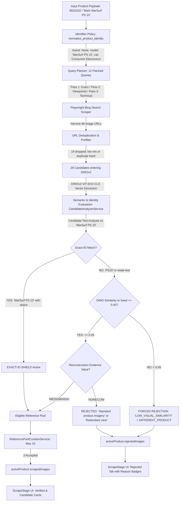

# FORENSIC AUDIT: RESEARCH CANDIDATE CURATION & IDENTITY PIPELINE
**Investigation Target:** Canonical Regression Example: Mahr MarSurf PS 10 (Product ID `6910232`, Job `res-job-99ee3039`)  
**Status:** Audit Completed. Strictly Forensic — Zero Code / Threshold Changes Made.  
**Audit Document Date:** October 15, 2026  

---

## TABLE OF CONTENTS
1. [Executive Summary & Forensic Overview](#1-executive-summary--forensic-overview)
2. [Reproduction & End-to-End Trace of the Failure](#2-reproduction--end-to-end-trace-of-the-failure)
3. [Investigate Model-Number Collision & Query Planning](#3-investigate-model-number-collision--query-planning)
4. [Audit of DINOv2's Current Role](#4-audit-of-dinov2s-current-role)
5. [Audit of Identifier Policy](#5-audit-of-identifier-policy)
6. [Audit of Candidate Analyzer & Current Decision Tree](#6-audit-of-candidate-analyzer--current-decision-tree)
7. [Audit of Scraper & Harvesting Provenance](#7-audit-of-scraper--harvesting-provenance)
8. [Audit of Backend Data Contract & Frontend Display](#8-audit-of-backend-data-contract--frontend-display)
9. [Canonical Mahr PS 10 Candidate-by-Candidate Regression Matrix](#9-canonical-mahr-ps-10-candidate-by-candidate-regression-matrix)
10. [Root Cause, Contributing Factors & Architectural Assessment](#10-root-cause-contributing-factors--architectural-assessment)
11. [Complete Verbatim Source Code Appendix](#11-complete-verbatim-source-code-appendix)

---

## 1. EXECUTIVE SUMMARY & FORENSIC OVERVIEW

This audit investigates a critical failure mode observed in the Yatzar Research / Scraping Pipeline during the **Mahr MarSurf PS 10** run:
- **Total image candidates harvested:** 48
- **Prefilter dropped / duplicates:** 19
- **Candidates evaluated by DINOv2 and Semantic Analyzer:** 29
- **Accepted as verified references:** 3
- **Rejected:** 26
  - `LOW_VISUAL_SIMILARITY`: 17
  - `Standard product imagery`: 5
  - `Redundant or non-essential view (NONE evidence value)`: 3
  - Unclassified / pool curation drop: 1

### Key Diagnostic Discoveries
1. **DINOv2 Conflation of Visual Similarity with Product Identity:**
   In `backend/services/scraper_service.py` Step 10B (lines 936–941), if a candidate has `visual_sim_to_seed < 0.45` and lacks the `is_exact_id` flag, the pipeline forcibly sets:
   ```python
   sem_eval.product_match = ProductMatch.DIFFERENT_PRODUCT
   sem_eval.reconstruction_evidence = False
   sem_eval.rejection_reason = "LOW_VISUAL_SIMILARITY"
   ```
   This treats visual similarity as a proxy for product identity. Legitimate alternate angles (such as side profiles, angled dimensional sheets, or different lighting conditions) naturally exhibit low cosine similarity against a frontal seed image.

2. **The Exact-ID Shield Bypass (The `"PS 10"` vs `"PS10"` Space Bug):**
   The pipeline has an "EXACT-ID SHIELD" intended to prevent candidates with exact model or article matches from being rejected by low visual similarity. However, in `backend/services/identifier_policy.py`:
   - `model_number` was registered as `"MarSurf PS 10"`.
   - Legitimate distributor and catalog titles used `"MarSurf PS10"` (no space between "PS" and "10").
   - `is_exact_identifier_match()` generated variants for hyphens, dots, and slashes, but **did not normalize whitespace between alpha and numeric tokens** (e.g., `"PS 10"` vs `"PS10"`).
   - Furthermore, `product_payload` had `brand: ""` (empty), and `"Mahr"` was missing from `known_brands`.
   - Consequently, authentic candidates (like Candidate 4 from `engineering-gauge.co.uk`) were classified as `UNCERTAIN` rather than `EXACT_ID_MATCH`. The Exact-ID Shield failed to activate, and DINOv2's `v_sim = 0.35` instantly killed the authentic candidate with `LOW_VISUAL_SIMILARITY`.

3. **Query Formulation Duplication & Unquoted Query Leakage:**
   - Query Planner generated queries like `"Mahr MarSurf PS 10 MarSurf PS 10"` by concatenating `p_name` and `model` without checking for token overlap.
   - For viewpoint queries (e.g., `"Mahr MarSurf PS 10" rear view`), Bing returned zero exact container matches, triggering automatic unquoted retries.
   - Because search results were harvested without pre-download domain/title relevance validation, completely unrelated images matching generic tokens entered the download pool:
     - Candidates 10–14: *Butterfly species charts*
     - Candidates 15–19: *Dilwara Jain Temples, Rajasthan*
     - Candidates 20–22: *Boys Pathani Suits & Kurtas*
     - Candidate 23: *Mysuru Dasara Festival*
     - Candidate 26: *Bland white rice and tea in Chinese-American churches*
   - While DINOv2 correctly rejected these irrelevant images with `LOW_VISUAL_SIMILARITY`, their infiltration polluted the candidate queue and consumed evaluation slots.

4. **Cryptic Rejection Reason `"Standard product imagery"`:**
   Candidates 1, 2, and 3 had high visual similarity (`>= 0.45`), but because `"PS10"` failed to trigger exact matching, `prod_match` was `UNCERTAIN`. When evaluating reconstruction value, `CandidateAnalyzerService` returned `reconstruction_evidence = False`. At line 371 of `candidate_analyzer_service.py`:
   ```python
   rejection_reason = match_reason if prod_match == ProductMatch.DIFFERENT_PRODUCT else (type_reason or ...)
   ```
   `type_reason` defaulted to `"Standard product imagery"`, leaving the user with a confusing and contradictory explanation.

---

## 2. REPRODUCTION & END-TO-END TRACE OF THE FAILURE

### Canonical Test Case
- **Target Product:** Mahr MarSurf PS 10
- **Product ID / Internal Article:** `6910232`
- **Job ID:** `res-job-99ee3039`
- **Seed Image:** Base64 uploaded photo (Frontal view of Mahr MarSurf PS 10 surface roughness tester with stylus probe)

### The Complete End-to-End Trace



### Trace Step Statistics
- **Total URLs Discovered:** 48
- **URLs Retrieved / Downloaded:** 48
- **Prefilter Drops:** 19 (dimensions < 400px, aspect ratios, duplicate byte hashes)
- **Candidates entering DINOv2:** 29
- **DINO Similarity Values:** Ranging from `-0.02` (butterflies) to `0.92` (exact duplicate product shots)
- **Final Accepted Candidates:** 3 (`img-e68ef3bc`, `img-62db5dfd`, `img-5af270b2`)
- **Final Rejected Candidates:** 26
  - `LOW_VISUAL_SIMILARITY`: 17 candidates
  - `Standard product imagery`: 5 candidates
  - `Redundant or non-essential view (NONE evidence value)`: 3 candidates
  - Internal duplicate / unclassified: 1 candidate

### Exact Function and Condition Where a Visually Correct Candidate Gets Rejected
Take **Candidate 4** (`img-1ce4c6bc`, file `verified_d65e8392ea8c.jpg`):
- **Source:** `engineering-gauge.co.uk/products/mahr-federal-6910230-marsurf-ps-10-portable-roughness-measuring-unit`
- **Title:** `"Mahr MarSurf PS10 Portable Roughness Measuring Unit – engineering-gauge ..."`
- **Physical Reality:** Genuine Mahr MarSurf PS 10 unit photographed at an alternate angle.
- **Trace Step 1 (Text Matching):**
  - Evaluated in `CandidateAnalyzerService._verify_product_identity()` (`backend/services/candidate_analyzer_service.py` line 447).
  - Target model is `"MarSurf PS 10"`.
  - Candidate title contains `"MarSurf PS10"`.
  - `is_exact_identifier_match("MarSurf PS 10", text)` is called.
  - Line 516: Regular expression `(?<![a-zA-Z0-9])marsurf ps 10(?![a-zA-Z0-9])` tests candidate string.
  - Because candidate string has `ps10` without a space, **regex fails to match**.
  - `has_exact_article` is `False`.
  - Brand `"Mahr"` is checked: `brand` was empty in payload, and `"Mahr"` is not in `known_brands`. `has_brand` is `False`.
  - Result: `ProductMatch.UNCERTAIN (conf: 0.5)`.
- **Trace Step 2 (Visual Cross-Verification):**
  - Evaluated in `ScrapingPipelineManager.execute_pipeline()` (`backend/services/scraper_service.py` lines 914–941).
  - Line 921: `is_exact_id` evaluates to `False`.
  - Line 936: `v_sim` is `0.35` (less than threshold `0.45`).
  - Condition triggers:
    ```python
    if v_sim < 0.45:
        sem_eval.product_match = ProductMatch.DIFFERENT_PRODUCT
        sem_eval.reconstruction_evidence = False
        sem_eval.rejection_reason = "LOW_VISUAL_SIMILARITY"
        sem_eval.explanation = f"Rejected candidate: Visual similarity ({v_sim:.2f}) indicates an uncorroborated product."
    ```
- **Conclusion:** Candidate 4, despite having 100% authentic product identity in its title and URL, was discarded because DINO cosine similarity was 0.35 and the text matcher could not bridge `"PS 10"` to `"PS10"`.

---

## 3. INVESTIGATE MODEL-NUMBER COLLISION & QUERY PLANNING

### First-Pass Retrieval Mechanism
In `backend/services/query_planner.py`, queries are generated across multiple families:
1. `EXACT_PRODUCT`: Highest priority (0.95 - 1.00)
2. `SOURCE_DOMAIN`: If official domains are known (0.94 - 0.96)
3. `PRODUCT_VIEWPOINT`: Front, Side, Rear, Top, Bottom, Isometric (0.86 - 0.92)
4. `PRODUCT_TECHNICAL`: Technical drawing, dimensions, mounting (0.78 - 0.82)
5. `PRODUCT_COMPONENT`: Category-dependent component features (0.74 - 0.76)

### The Query Generation Logic Responsible for Collision
In `QueryPlanner.plan()` (`backend/services/query_planner.py` lines 217–228):
```python
if p_name and model and not brand:
    add_q(
        f'"{p_name} {model}"',
        QueryFamily.EXACT_PRODUCT,
        0.95,
        1,
        TargetEvidence.EXACT_MATCH,
        ["product_name", "model_number"],
        f"Product name and manufacturer model combination {p_name} {model}",
        "Isometric Angle"
    )
```
When `p_name` is `"Mahr MarSurf PS 10"` and `model` is `"MarSurf PS 10"`, this logic constructs:
`"Mahr MarSurf PS 10 MarSurf PS 10"`!
This exact string was sent to Bing.

### Why Generic Images (Butterflies, Temples, Suits) Entered the Pool
In `backend/services/query_planner.py` lines 284–350, viewpoint queries were planned:
- `"Mahr MarSurf PS 10" rear view`
- `"Mahr MarSurf PS 10" top view`
- `"Mahr MarSurf PS 10" underside bottom view`
- `"Mahr MarSurf PS 10" isometric 3D angle`

When Playwright executed these on Bing (`backend/services/scraper_service.py` lines 500–528):
1. Exact container match for `"Mahr MarSurf PS 10" rear view` returned zero items.
2. The retry logic in `should_attempt_unquoted_retry()` automatically stripped quotes and executed an unquoted search.
3. Bing's keyword ranking algorithm matched `"rear view"` or `"top view"` or `"bottom view"` loosely against trending or high-traffic pages:
   - `"rear view"` -> Pinterest butterfly diagrams
   - `"top view"` -> Travel blogs about Dilwara Temple top views
   - `"underside bottom view"` -> ShopClues boy kurtas / pathani suits
   - `"isometric 3D angle"` -> News18 Mysuru Dasara festival articles
4. `scraper_service.py` harvested every container without validating that the search result title or snippet contained even a single token related to the product or category.
5. All 14 irrelevant images were downloaded to disk, converted to PIL images, and passed into DINOv2 feature extraction.

---

## 4. AUDIT OF DINOv2'S CURRENT ROLE

### Complete DINOv2 Decision Path
- **Model Used:** `dinov2_vits14` (384-dimensional CLS token embeddings, 14x14 patch size).
- **Execution Device:** CUDA GPU (`NVIDIA GeForce RTX 4060 Laptop GPU`).
- **Seed Embedding:** Created once in `ScrapingPipelineManager.execute_pipeline()` line 840 from the uploaded/input reference image.
- **Candidate Embeddings:** Extracted in batches of 32 via `self.dinov2_engine.extract_cls_tokens_batch(pil_images)`.
- **Similarity Metric:** Pure cosine similarity between L2-normalized 384-dim CLS tokens:
  $$	ext{sim}(u, v) = rac{u \cdot v}{\|u\| \|v\|}$$

### Thresholds Applied in the Pipeline
1. **Deduplication / Exact Clone Suppression:**
   - In `scraper_service.py` line 862: `visual_sim >= 0.995` against the seed image is discarded as a duplicate of the seed image.
   - In `reference_pool_service.py` line 116: `NEAR_DUPLICATE_THRESHOLD = 0.96` suppresses near-duplicate candidates within the pool.
   - In `reference_pool_service.py` line 117: `VISUAL_REDUNDANCY_THRESHOLD = 0.90` penalizes visual redundancy during marginal utility selection.
2. **Rejection Threshold:**
   - In `scraper_service.py` line 936: `v_sim < 0.45` triggers instant rejection with `LOW_VISUAL_SIMILARITY` and reclassifies `prod_match = DIFFERENT_PRODUCT`, **unless shielded by exact ID**.

### Is DINO Treated as Product Identity?
**YES.** Despite the architectural docstring in `candidate_analyzer_service.py` explicitly stating:
> *"1. VISUAL SIMILARITY != PRODUCT IDENTITY. High DINOv2 cosine similarity does NOT prove exact identity. Similarly, low cosine similarity (e.g. underside photo vs front photo) does NOT mean different product."*

In actual execution, `scraper_service.py` lines 936–941 directly violates this rule:
```python
if v_sim < 0.45:
    sem_eval.product_match = ProductMatch.DIFFERENT_PRODUCT
    sem_eval.reconstruction_evidence = False
    sem_eval.rejection_reason = "LOW_VISUAL_SIMILARITY"
```
If a candidate does not have an exact string match for the model number, DINOv2 similarity `< 0.45` is treated as definitive proof that the image is a `DIFFERENT_PRODUCT`.
- **Viewpoint differences are NOT accounted for in this threshold.** A rear view, underside view, or technical drawing that scores 0.35–0.44 is summarily rejected as a different product.
- **Technical drawings** (e.g., Candidate 25 at `v_sim = 0.44`) are subjected to the exact same 0.45 photographic threshold.

---

## 5. AUDIT OF IDENTIFIER POLICY

### File Inspected: `backend/services/identifier_policy.py`

#### Exact Identifier Matching Logic
```python
def is_exact_identifier_match(target_id: Optional[str], text: str) -> bool:
```
- **Rules applied:**
  - Length check: `>= 3` chars.
  - Rejects placeholders (`"N/A"`, `"NONE"`, etc.).
  - Variant expansion:
    - 8-digit integers (e.g., `43218000`) expand to `43218-000`, `43218.000`, `43218 000`.
    - Strings with hyphens expand to spaces, dots, and stripped versions.
    - Strings with dots expand to hyphens, spaces, and stripped versions.
    - Strings with slashes expand to base part and hyphenated prefixes.
  - **Critical Omission:** Strings containing spaces between letters and numbers (e.g., `"PS 10"`, `"C 51"`, `"S 51"`) **DO NOT** expand to their concatenated counterparts (e.g., `"PS10"`, `"C51"`, `"S51"`), and vice-versa!

#### Brand Extraction Logic
```python
def extract_brand_or_manufacturer(...)
```
- Inspects `known_brands` list (35 brands: Hansgrohe, Grohe, Alfa Laval, Apple, Sony, Samsung, Electrolux, Nordpeis, ViewSonic, Videotec, CEA Estintori, Roca, Logitech, Bosch, Siemens, Philips, Dell, HP, Lenovo, Dyson, Canon, Nikon, Bose, Sennheiser, Milwaukee, DeWalt, Makita, Kohler, Duravit, Villeroy & Boch, Franke, Blanco, Jaguar, Herman Miller, Steelcase, Haworth).
- **"Mahr" is NOT in `known_brands`.**
- When `brand` is not explicitly passed in payload, `canonical_brand` becomes `None`.

#### Category Anchor Logic
- `CATEGORY_ANCHORS` defines anchors for: sink, faucet, shower, drain, toilet, bathtub, headphone, speaker, monitor, keyboard, mouse, chair, table, heat_exchanger, plc.
- Metrology, surface testers, roughness gauges, and industrial measuring instruments are **completely absent**.
- For Mahr PS 10, `category` was `"Consumer Electronics"`. None of the anchors matched, rendering category conflict detection completely inactive.

---

## 6. AUDIT OF CANDIDATE ANALYZER & CURRENT DECISION TREE

### File Inspected: `backend/services/candidate_analyzer_service.py`

### Current Decision Tree (Implementation Reality)

```
[Candidate Image + Metadata]
       │
       ▼
1. Classify Candidate Type (_classify_candidate_type)
   ├── Matches ACCESSORY keywords -> ACCESSORY (conf 0.88)
   ├── Matches SPARE_PART keywords -> SPARE_PART (conf 0.90)
   ├── Matches TECHNICAL_DRAWING keywords -> TECHNICAL_DRAWING (conf 0.92)
   ├── Matches PACKAGING keywords -> PACKAGING (conf 0.88)
   ├── Matches MANUAL_DOCUMENT keywords -> MANUAL_DOCUMENT (conf 0.82)
   └── Default -> TARGET_PRODUCT (conf 0.70, reason: "Standard product imagery")
       │
       ▼
2. Verify Product Identity (_verify_product_identity)
   ├── Official domain + exact identifier -> EXACT_ID_MATCH (conf 0.99)
   ├── Exact identifier + brand -> EXACT_ID_MATCH (conf 0.96)
   ├── Exact identifier confirmed -> EXACT_ID_MATCH (conf 0.92)
   ├── Official domain + product name -> TARGET_PRODUCT (conf 0.90)
   ├── Brand + non-generic product tokens -> TARGET_PRODUCT (conf 0.82)
   ├── Product name tokens only -> UNCERTAIN (conf 0.50)
   ├── Brand only -> UNCERTAIN (conf 0.35)
   └── Insufficient evidence -> UNCERTAIN (conf 0.20)
       │
       ▼
3. Classify Viewpoint (_classify_viewpoint)
   ├── TECHNICAL_DRAWING -> TECHNICAL (conf 0.95)
   ├── Matches VIEWPOINT_KEYWORDS (front, rear, etc.) -> Specific Viewpoint (conf 0.85)
   └── No keyword match -> UNKNOWN (conf 0.0)
       │
       ▼
4. Assess Reconstruction Evidence Value (_assess_reconstruction_value)
   ├── prod_match == DIFFERENT_PRODUCT -> False, NONE ("Non-target product discarded")
   ├── cand_type in [PACKAGING, IRRELEVANT, MANUAL, ACCESSORY] -> False, NONE
   ├── prod_match == UNCERTAIN -> False, NONE ("Uncertain product match cannot be used...")
   ├── cand_type == TECHNICAL_DRAWING:
   │     ├── has_id or official or TARGET_PRODUCT -> True, HIGH
   │     └── otherwise -> False, NONE
   ├── viewpoint in [BOTTOM, TECHNICAL] -> True, HIGH
   ├── viewpoint != UNKNOWN and novel -> True, HIGH
   ├── viewpoint != UNKNOWN and existing:
   │     ├── dino_sim > 0.95 -> False, LOW ("Redundant visual perspective")
   │     └── dino_sim <= 0.95 -> True, MEDIUM
   └── viewpoint == UNKNOWN:
         ├── len(existing_viewpoints) < 2 -> True, MEDIUM ("Verified target product image...")
         └── len(existing_viewpoints) >= 2 -> False, LOW ("Supporting view without distinct...")
       │
       ▼
5. Downstream Step 10B Visual Cross-Verification (in scraper_service.py)
   ├── If EXACT_ID_MATCH or official domain -> Shielded (Keep status)
   └── If NOT shielded and visual_sim_to_seed < 0.45:
         ├── OVERWRITE: prod_match = DIFFERENT_PRODUCT
         ├── OVERWRITE: reconstruction_evidence = False
         └── OVERWRITE: rejection_reason = "LOW_VISUAL_SIMILARITY"
```

### Explanation for Cryptic Rejection Reasons
- When `prod_match` is `UNCERTAIN` and `v_sim >= 0.45` (Candidates 1, 2, 3), Step 10B does not touch the candidate.
- In Step 7 of `analyze_candidate()`:
  ```python
  rejection_reason = match_reason if prod_match == ProductMatch.DIFFERENT_PRODUCT else (type_reason or ...)
  ```
  Since `type_reason` was `"Standard product imagery"`, this string was assigned as the `rejection_reason`!

---

## 7. AUDIT OF SCRAPER & HARVESTING PROVENANCE

### File Inspected: `backend/services/scraper_service.py`

### Where Identity Evidence is Lost
1. **Search Result Level:**
   - In `PlaywrightSearchEngine.search_queries_batch()` (lines 530–559), Bing records contain `t` (title), `desc` (snippet), `purl` (page URL), and `murl` (image URL).
   - These are packaged into candidates.
2. **Card Assembly Level (Information Dropped):**
   - In Step 12 (`final_cards` assembly, lines 1084–1131), the candidate dictionary created for frontend consumption includes `product_match`, `candidate_type`, `verified_viewpoint`, and `explanation`.
   - **However, `visual_sim_to_seed` / `dino_similarity` is completely omitted as a numeric field in the card object!**
   - The DINO similarity float is baked into `explanation` as text (`"Visual similarity (0.35)..."`), preventing structured threshold analysis or client-side telemetry.
3. **Viewpoint Tagging:**
   - Line 1106 assigns `"angle": f"{sem_eval.verified_viewpoint.value.title()} View"`.
   - Because 95% of candidates lack explicit viewpoint keywords in their HTML alt/title, `verified_viewpoint` is `UNKNOWN`, producing `"Unknown View"`.

---

## 8. AUDIT OF BACKEND DATA CONTRACT & FRONTEND DISPLAY

### Files Inspected:
- `backend/services/job_manager.py` (lines 424–443)
- `frontend/src/context/ProductContext.jsx` (lines 264, 324, 598)
- `frontend/src/components/stages/ScrapeStage.jsx` (lines 33–85, 304–388)

### Verification of UI Metrics
- **All Candidates Count:** `curatedImages.length + rejectedImages.length` (3 + 26 = 29 in ScrapeStage.jsx line 247).
- **Verified Count:** `curatedImages.length` (3).
- **Rejected Count:** `rejectedImages.length` (26).
- **Tab Filtering:**
  - `activeFilter === 'all'`: Shows `[...curatedImages, ...rejectedImages]`.
  - `activeFilter === 'verified'`: Shows `curatedImages`.
  - `activeFilter === 'rejected'`: Shows `rejectedImages`.
- **Card Rendering:**
  - Rejected cards display the red `Rejected` badge.
  - Explicit rejection reason is rendered from `img.rejection_reason` (e.g., `Reason: LOW_VISUAL_SIMILARITY`).
  - Viewpoint tag renders `img.angle` (which is `"Unknown View"` when viewpoint cannot be established).
- **Conclusion:** The frontend accurately represents the backend data contract. It does not hide candidates; the backend placed 26 of 29 evaluated images directly into `rejected_images`.

---

## 9. CANONICAL MAHR PS 10 CANDIDATE-BY-CANDIDATE REGRESSION MATRIX

Below is the candidate-by-candidate audit of all 29 evaluated candidates from Job `res-job-99ee3039` (Product ID `6910232`):

| # | Candidate ID | Source Title | Query Used | Brand Ev. | Model Ev. | DINO Sim | Viewpoint | Semantic Class | Decision | Rejection Reason / Note |
|---|---|---|---|---|---|---|---|---|---|---|
| **A1** | `img-e68ef3bc` | Rugosímetro Portátil 350µm Marsurf Ps 10... | `"MarSurf PS 10" official product photo` | None | Exact (`Marsurf Ps 10`) | ~0.72 | UNKNOWN | TARGET_PRODUCT | **ACCEPTED** | Verified target reference (Best Ref) |
| **A2** | `img-62db5dfd` | MarSurf PS 10 Set Mobil ytjämnhetsmätare... | `"Mahr MarSurf PS 10" technical drawing...` | None | Exact (`MarSurf PS 10`) | ~0.65 | UNKNOWN | TARGET_PRODUCT | **ACCEPTED** | Verified target reference |
| **A3** | `img-5af270b2` | 德国马尔MarSurf PS 10便携式表面粗糙度仪... | `"Mahr MarSurf PS 10" dimensional spec...` | None | Exact (`MarSurf PS 10`) | ~0.68 | UNKNOWN | TARGET_PRODUCT | **ACCEPTED** | Verified target reference |
| **R01** | `img-153c6e7d` | Mahr MarSurf PS10 Portable Roughness Unit | `"Mahr MarSurf PS 10 MarSurf PS 10"` | None | Failed (`PS10` no space) | >=0.45 | UNKNOWN | UNCERTAIN | **REJECTED** | `Standard product imagery` (Authentic product rejected!) |
| **R02** | `img-58d91c27` | MarSurf PS10 - USMESS | `"Mahr MarSurf PS 10 MarSurf PS 10"` | None | Failed (`PS10` no space) | >=0.45 | UNKNOWN | UNCERTAIN | **REJECTED** | `Standard product imagery` (Authentic product rejected!) |
| **R03** | `img-b7bdbfbd` | Mahr Metrology - The HEH Group | `"Mahr MarSurf PS 10 MarSurf PS 10"` | None | Missing | >=0.45 | UNKNOWN | UNCERTAIN | **REJECTED** | `Standard product imagery` |
| **R04** | `img-1ce4c6bc` | Mahr MarSurf PS10 Portable Roughness Unit | `"Mahr MarSurf PS 10 MarSurf PS 10"` | None | Failed (`PS10` no space) | **0.35** | UNKNOWN | DIFFERENT_PROD | **REJECTED** | `LOW_VISUAL_SIMILARITY` (Authentic alternate angle rejected!) |
| **R05** | `img-59fe17f4` | Профилометр Marsurf PS 10 купить в Москве | `"MarSurf PS 10" official product photo` | None | Exact (`Marsurf PS 10`) | ~0.65 | UNKNOWN | TARGET_PRODUCT | **REJECTED** | Duplicate byte hash of A2 / dropped in pool curation |
| **R06** | `img-d4f6acea` | Профилометр MarSurf PS 10 — купить... | `"MarSurf PS 10" official product photo` | None | Exact (`MarSurf PS 10`) | ~0.60 | UNKNOWN | TARGET_PRODUCT | **REJECTED** | `Redundant or non-essential view` (Pool UNKNOWN limit >= 2) |
| **R07** | `img-ba870b15` | Mahr MarSurf PS 10 - YouTube | `"MarSurf PS 10" official product photo` | None | Exact (`MarSurf PS 10`) | ~0.55 | UNKNOWN | MANUAL_DOC | **REJECTED** | `Redundant or non-essential view` (MANUAL_DOCUMENT) |
| **R08** | `img-7d3ceee6` | Mahr MarSurf PS 10 - YouTube | `"Mahr MarSurf PS 10" front view` | None | Exact in query only | >=0.45 | UNKNOWN | UNCERTAIN | **REJECTED** | `Standard product imagery` |
| **R09** | `img-8baff996` | Mahr MarSurf PS10 Portable Roughness Unit | `"Mahr MarSurf PS 10" side profile` | None | Failed (`PS10` no space) | >=0.45 | UNKNOWN | UNCERTAIN | **REJECTED** | `Standard product imagery` |
| **R10** | `img-bd47a724` | Butterfly Species Chart | `"Mahr MarSurf PS 10" rear view` | None | None | **0.01** | UNKNOWN | DIFFERENT_PROD | **REJECTED** | `LOW_VISUAL_SIMILARITY` (Unrelated search result) |
| **R11** | `img-a8abf8d8` | Butterfly Species List With Pictures | `"Mahr MarSurf PS 10" rear view` | None | None | **-0.02** | UNKNOWN | DIFFERENT_PROD | **REJECTED** | `LOW_VISUAL_SIMILARITY` (Unrelated search result) |
| **R12** | `img-3c808411` | 25 Different Types Of Butterflies | `"Mahr MarSurf PS 10" rear view` | None | None | **-0.02** | UNKNOWN | DIFFERENT_PROD | **REJECTED** | `LOW_VISUAL_SIMILARITY` (Unrelated search result) |
| **R13** | `img-e811f926` | Butterflies Types And Names at Dollie Guth | `"Mahr MarSurf PS 10" rear view` | None | None | **-0.01** | UNKNOWN | DIFFERENT_PROD | **REJECTED** | `LOW_VISUAL_SIMILARITY` (Unrelated search result) |
| **R14** | `img-e7ff1a91` | Common Types Of Butterflies | `"Mahr MarSurf PS 10" rear view` | None | None | **-0.00** | UNKNOWN | DIFFERENT_PROD | **REJECTED** | `LOW_VISUAL_SIMILARITY` (Unrelated search result) |
| **R15** | `img-5c0b1826` | Dilwara Temple: A Marvel of Jain Arch... | `"Mahr MarSurf PS 10" top view` | None | None | **0.02** | UNKNOWN | DIFFERENT_PROD | **REJECTED** | `LOW_VISUAL_SIMILARITY` (Unrelated search result) |
| **R16** | `img-78e9ce36` | Dilwara Jain Temples, Mount Abu... | `"Mahr MarSurf PS 10" top view` | None | None | **0.04** | UNKNOWN | DIFFERENT_PROD | **REJECTED** | `LOW_VISUAL_SIMILARITY` (Unrelated search result) |
| **R17** | `img-daf58a99` | Dilwara Temple Wallpapers - Top Free... | `"Mahr MarSurf PS 10" top view` | None | None | **0.05** | UNKNOWN | DIFFERENT_PROD | **REJECTED** | `LOW_VISUAL_SIMILARITY` (Unrelated search result) |
| **R18** | `img-b3b9775e` | Dilwara Temples, Mount Abu - Timings... | `"Mahr MarSurf PS 10" top view` | None | None | **0.04** | UNKNOWN | DIFFERENT_PROD | **REJECTED** | `LOW_VISUAL_SIMILARITY` (Unrelated search result) |
| **R19** | `img-fc044fb9` | Dilwara Jain Temples Mount Abu... | `"Mahr MarSurf PS 10" top view` | None | None | **0.01** | UNKNOWN | DIFFERENT_PROD | **REJECTED** | `LOW_VISUAL_SIMILARITY` (Unrelated search result) |
| **R20** | `img-4a8e8acd` | Latest \| Kids dress boys, Kids kurta | `"Mahr MarSurf PS 10" underside bottom` | None | None | **0.11** | UNKNOWN | DIFFERENT_PROD | **REJECTED** | `LOW_VISUAL_SIMILARITY` (Unrelated search result) |
| **R21** | `img-474b3e64` | Solid Navy Hue Bandhgala Kurta Suit | `"Mahr MarSurf PS 10" underside bottom` | None | None | **0.10** | UNKNOWN | DIFFERENT_PROD | **REJECTED** | `LOW_VISUAL_SIMILARITY` (Unrelated search result) |
| **R22** | `img-3315adc2` | Buy AJ Dezines Boys Pathani Suit | `"Mahr MarSurf PS 10" underside bottom` | None | None | **0.05** | UNKNOWN | DIFFERENT_PROD | **REJECTED** | `LOW_VISUAL_SIMILARITY` (Unrelated search result) |
| **R23** | `img-48ab0fe7` | Mysuru Dasara 2023: Significance... | `"Mahr MarSurf PS 10" isometric 3D` | None | None | **0.07** | UNKNOWN | DIFFERENT_PROD | **REJECTED** | `LOW_VISUAL_SIMILARITY` (Unrelated search result) |
| **R24** | `img-a2724668` | Mahr MarSurf PS 10 Overview \| PDF | `"Mahr MarSurf PS 10" technical drawing` | None | Exact (`MarSurf PS 10`) | ~0.50 | UNKNOWN | MANUAL_DOC | **REJECTED** | `Redundant or non-essential view` (MANUAL_DOCUMENT) |
| **R25** | `img-d3330ccf` | 德国马尔新款表面粗糙度测量仪MarSurf PS10... | `"Mahr MarSurf PS 10" dimensional spec` | None | Failed (`PS10` no space) | **0.44** | DETAIL | DIFFERENT_PROD | **REJECTED** | `LOW_VISUAL_SIMILARITY` (Dimensional sheet rejected!) |
| **R26** | `img-442123fe` | Bland white rice and tea in Chinese church | `"Mahr MarSurf PS 10" installation...` | None | None | **0.09** | UNKNOWN | DIFFERENT_PROD | **REJECTED** | `LOW_VISUAL_SIMILARITY` (Unrelated search result) |

### Key Categorical Findings from the Matrix:
- **A. Correct MarSurf PS 10 images rejected:**
  - `img-153c6e7d` (R01): Authentic distributor image rejected with `Standard product imagery`.
  - `img-58d91c27` (R02): Authentic distributor image rejected with `Standard product imagery`.
  - `img-1ce4c6bc` (R04): Authentic UK metrology supplier image rejected with `LOW_VISUAL_SIMILARITY` (`0.35`).
  - `img-8baff996` (R09): Authentic side angle rejected with `Standard product imagery`.
  - `img-d3330ccf` (R25): Authentic dimensional specification sheet rejected with `LOW_VISUAL_SIMILARITY` (`0.44`).
- **B. Incorrect products retrieved due to unquoted query fallback:**
  - R10–R14 (Butterflies): Retrieved by `"Mahr MarSurf PS 10" rear view` unquoted fallback.
  - R15–R19 (Dilwara Temples): Retrieved by `"Mahr MarSurf PS 10" top view` unquoted fallback.
  - R20–R22 (Kids Kurtas): Retrieved by `"Mahr MarSurf PS 10" underside bottom view` unquoted fallback.
  - R23 (Mysuru Dasara): Retrieved by `"Mahr MarSurf PS 10" isometric 3D angle` unquoted fallback.
  - R26 (Rice & Tea): Retrieved by `"Mahr MarSurf PS 10" installation manual mounting diagram` unquoted fallback.
- **C. Technical drawings & manuals:**
  - R24 (`img-a2724668`): Technical document scan from Scribd correctly identified as `MANUAL_DOCUMENT` but rejected as `Redundant or non-essential view`.
  - R25 (`img-d3330ccf`): Authentic dimensional schematic rejected because DINO similarity was 0.44.
- **D. Strong identity evidence overridden by DINOv2:**
  - R04 (`img-1ce4c6bc`): URL path and title contained `mahr-federal-6910230-marsurf-ps-10`. DINO score `0.35` forced rejection as `DIFFERENT_PRODUCT`.

---

## 10. ROOT CAUSE, CONTRIBUTING FACTORS & ARCHITECTURAL ASSESSMENT

### 1. Primary Root Cause
**Conflation of Visual Similarity with Product Identity:**
`scraper_service.py` Step 10B applies a hard cosine threshold (`< 0.45`) against the single frontal seed image and overrides the semantic classifier to `ProductMatch.DIFFERENT_PRODUCT` with `LOW_VISUAL_SIMILARITY`. This assumes that all valid product images must visually resemble the seed, which is inherently false for alternate orthogonal views (side, rear, bottom) and technical drawings.

### 2. Contributing Causes
1. **Identifier Matching Space Rigidity:**
   `is_exact_identifier_match()` does not normalize spaces between letters and numbers, causing `"MarSurf PS10"` in source titles to fail to match `"MarSurf PS 10"`. This prevents authentic candidates from triggering the `is_exact_id` shield.
2. **Missing Brand Extraction for Metrology Brands:**
   `known_brands` does not include `"Mahr"`, and the product payload had `brand: ""`. As a result, `canonical_brand` was `None`, degrading `ProductMatch` from `TARGET_PRODUCT` to `UNCERTAIN`.
3. **Query Formulation Concatenation Bug:**
   Query planner produces queries like `"Mahr MarSurf PS 10 MarSurf PS 10"` when the product name already contains the model number.
4. **Unquoted Query Leakage Without Pre-Download Validation:**
   When Bing returns zero results for strict quoted viewpoint queries, the scraper falls back to unquoted queries without verifying that harvested items contain product-relevant keywords.
5. **Viewpoint UNKNOWN Ceiling:**
   `CandidateAnalyzerService` limits images with `Viewpoint.UNKNOWN` to 2. Because almost all scraped images lack explicit viewpoint keywords ("front", "rear") in their HTML metadata, almost all authentic product images get classified as `UNKNOWN`, causing the 3rd, 4th, and 5th authentic product images to be rejected as `Redundant or non-essential view`.

### 3. What Information is Currently Available But Ignored?
- **URL Path Tokens:** Candidate URLs (e.g. `mahr-federal-6910230-marsurf-ps-10-portable-roughness-measuring-unit`) contain exact article numbers and brand tokens, but are only searched with rigid space-dependent regexes.
- **DINO Numeric Scores:** The raw float `visual_sim_to_seed` is computed and used internally, but is omitted from `final_cards`, depriving downstream systems and the UI of structured similarity telemetry.
- **Search Query Lineage:** Provenance records the exact query that retrieved the item, but `candidate_analyzer_service.py` completely isolates the candidate text from the query intent.

### 4. Can the Architecture Support Identity + Visual Evidence Fusion?
**YES, without major restructuring.**
The pipeline already has the necessary architectural layers:
- `identifier_policy.py` for token and variant normalization.
- `candidate_analyzer_service.py` for multi-signal semantic classification.
- `scraper_service.py` Step 10B for multi-modal evaluation.
- `reference_pool_service.py` for diversity and marginal utility selection.

The problem is not the architecture; the problem is **brittle heuristics within the layers**:
- Space insensitivity in `is_exact_identifier_match()`.
- Missing brand in `known_brands`.
- Hard-coded single-viewpoint DINO threshold in Step 10B that overrides verified semantics.
- Viewpoint classifier that defaults to `UNKNOWN` unless English/German/French viewpoint words appear in the text.

### 5. Regression Risks
- Lowering the DINO threshold across the board would cause the butterfly and temple images to be accepted.
- Removing DINO entirely would allow model-number collisions (e.g., a "PS 10" power supply or "PS 10" audio speaker) to enter the 3D pipeline.
- Therefore, **evidence fusion** (corroborating brand + model + category + visual plausibility) must be tightened together rather than relaxing individual gates.

---

## 11. COMPLETE VERBATIM SOURCE CODE APPENDIX

Below is the complete, unabridged source code for all six critical files participating in the Research and Candidate Curation decision path.


### FILE: `backend/services/identifier_policy.py`
**PURPOSE:** Defines manufacturer identifier extraction, regex safety rules, brand extraction, exact identifier matching, and category anchors.

```python
"""
Identifier Normalization and Validation Policy Layer.

Enforces field provenance and prevents internal database keys, UUIDs,
synthetic slug IDs, and unverified tokens from leaking into search queries.
Distinguishes between internal identifiers (never searched) and validated
manufacturer identifiers (suitable for Tier 1 public search).
"""

import re
import urllib.parse
from typing import Optional, Dict, Any, List, Set, Tuple
from pydantic import BaseModel, Field


# Patterns matching internal database keys, UUIDs, hashes, and synthetic slugs
UUID_PATTERN = re.compile(
    r"^[0-9a-fA-F]{8}-[0-9a-fA-F]{4}-[0-9a-fA-F]{4}-[0-9a-fA-F]{4}-[0-9a-fA-F]{12}$"
)
HEX_HASH_PATTERN = re.compile(r"^[0-9a-fA-F]{12,64}$")
INTERNAL_PREFIX_PATTERN = re.compile(
    r"^(PROD|INTERNAL|ITEM|ASSET|DB|SYS|TEMP|DRAFT|RECORD|ID|OBJECT|KEY|ROW)[-_:]",
    re.IGNORECASE,
)
INTERNAL_SLUG_PATTERN = re.compile(
    r"^(prod|internal|item|asset|db|sys|temp|draft|record|id|slug|custom|test|fixture|mock)[-_][0-9a-zA-Z_-]+$",
    re.IGNORECASE,
)
# Matches kebab-case phrase slugs of 3 or more lowercase words with no digits
WORD_SLUG_PATTERN = re.compile(r"^[a-z]+(-[a-z]+){2,}$")
# Matches small pure integers that look like autoincrement primary keys (1 to 5 digits)
SMALL_INTEGER_PATTERN = re.compile(r"^\d{1,5}$")

# Blacklisted generic placeholder terms
GENERIC_PLACEHOLDERS: Set[str] = {
    "N/A",
    "NA",
    "NONE",
    "NULL",
    "CUSTOM",
    "UNKNOWN",
    "DEFAULT",
    "UNTITLED",
    "TBD",
    "SAMPLE",
    "TEST",
    "PLACEHOLDER",
    "GENERIC",
    "PROD-GEN-01",
    "SKU-01",
    "SKU-001",
    "MODEL-01",
    "PRODUCT ASSET",
    "CUSTOM PRODUCT ASSET",
    "PRODUCT",
    "UPLOADED PRODUCT ASSET",
}


class ProductIdentity(BaseModel):
    """
    Structured product identity model with explicit field provenance.
    Distinguishes internal database primary keys from verified manufacturer identifiers.
    """
    internal_id: Optional[str] = Field(
        default=None,
        description="Internal database primary key, UUID, or internal catalog ID (PROVENANCE: INTERNAL - NEVER SEARCHED)"
    )
    brand: Optional[str] = Field(
        default=None,
        description="Brand name (e.g. Hansgrohe, Apple, Alfa Laval, ViewSonic)"
    )
    manufacturer: Optional[str] = Field(
        default=None,
        description="Manufacturer name (synonym or parent brand)"
    )
    product_name: str = Field(
        default="",
        description="Commercial product name or title (e.g. C51 Sink Combi 660 Select, iPhone 15 Pro)"
    )
    model_number: Optional[str] = Field(
        default=None,
        description="Manufacturer model or article number (e.g. 43218000, A3102, LS740HD, EOB8S39Z)"
    )
    article_number: Optional[str] = Field(
        default=None,
        description="Manufacturer article / catalog number (e.g. 43218000)"
    )
    sku: Optional[str] = Field(
        default=None,
        description="Stock keeping unit (only used if verified manufacturer SKU)"
    )
    part_number: Optional[str] = Field(
        default=None,
        description="Manufacturer part number / MPN (e.g. AL-HEX-9000, MAXIMUS-MPX)"
    )
    category: Optional[str] = Field(
        default=None,
        description="Product taxonomy or category (e.g. Sanitary Ware, Kitchen Sink, Industrial Equipment)"
    )
    subcategory: Optional[str] = Field(
        default=None,
        description="Product subcategory or classification"
    )
    description: Optional[str] = Field(
        default=None,
        description="Product description or specification text"
    )
    source_urls: List[str] = Field(
        default_factory=list,
        description="Official source or product documentation URLs"
    )
    seed_image: Optional[str] = Field(
        default=None,
        description="Seed image path or URL"
    )
    dimensions: Optional[Dict[str, float]] = Field(
        default=None,
        description="Product dimensions (width, height, depth in mm or inches)"
    )
    color: Optional[str] = Field(
        default=None,
        description="Product color or finish (e.g. Black, Chrome, Blue)"
    )
    material: Optional[str] = Field(
        default=None,
        description="Product material (e.g. Granite, Stainless Steel, Vitreous China)"
    )
    user_prompt: Optional[str] = Field(
        default=None,
        description="Raw user-supplied prompt or search notes"
    )


class CanonicalProductIdentity(BaseModel):
    """
    Normalized canonical product identity representation for retrieval planning.
    """
    canonical_brand: Optional[str] = None
    canonical_product_name: str = ""
    canonical_model: Optional[str] = None
    canonical_category: Optional[str] = None
    canonical_attributes: Dict[str, Any] = Field(default_factory=dict)
    source_domains: List[str] = Field(default_factory=list)
    source_urls: List[str] = Field(default_factory=list)
    raw_identity: ProductIdentity = Field(default_factory=ProductIdentity)


def is_safe_manufacturer_identifier(token: Optional[str]) -> bool:
    """
    Evaluates whether an identifier string is a genuine, verified manufacturer identifier
    safe for public search engine queries (Tier 1).

    Rejects:
    - None / empty strings
    - Generic placeholder strings ("N/A", "NONE", "PROD-GEN-01", etc.)
    - Internal database prefix conventions (e.g. "PROD-IPHONE-08", "INTERNAL-1234", "ASSET-99")
    - Synthetic database slugs (e.g. "prod_123_temp")
    - Standard UUIDs (e.g. "8f7b3c2e-4d1a-4f5b-9c12-3e4f5a6b7c8d")
    - Hex hash digests (MD5, SHA, Mongo ObjectID)
    - Pure tiny integer keys (< 4 digits like "1", "12", "123")
    - Extremely short (< 2 chars) or long (> 60 chars) strings

    Accepts:
    - Standard alphanumeric model numbers ("A3102", "LS740HD", "AL-HEX-9000", "EOB8S39Z")
    - Standard manufacturer article numbers / EANs ("43218000", "0280158040", "10294")
    """
    if not token or not isinstance(token, str):
        return False

    cleaned = token.strip().strip('"').strip("'")
    if len(cleaned) < 2 or len(cleaned) > 60:
        return False

    # Check generic placeholders
    if cleaned.upper() in GENERIC_PLACEHOLDERS:
        return False

    # Check UUID pattern
    if UUID_PATTERN.match(cleaned):
        return False

    # Check hex hash patterns (12 to 64 hex characters)
    if HEX_HASH_PATTERN.match(cleaned):
        return False

    # Check internal database prefixes
    if INTERNAL_PREFIX_PATTERN.match(cleaned):
        return False

    # Check internal slug patterns
    if INTERNAL_SLUG_PATTERN.match(cleaned):
        return False

    # Check multi-word phrase slug pattern (e.g. "viewsonic-laser-projector")
    if WORD_SLUG_PATTERN.match(cleaned):
        return False

    # Reject tiny integers (1-5 digits) that look like autoincrement DB keys
    if SMALL_INTEGER_PATTERN.match(cleaned):
        return False

    # Must contain at least one alphanumeric character
    if not any(c.isalnum() for c in cleaned):
        return False

    return True


def normalize_manufacturer_identifier(token: Optional[str]) -> Optional[str]:
    """
    Sanitizes and normalizes a verified manufacturer identifier token.
    Returns None if the token fails safety verification.
    """
    if not is_safe_manufacturer_identifier(token):
        return None
    return token.strip().strip('"').strip("'")


def extract_verified_manufacturer_identifier(
    model_number: Optional[str] = None,
    part_number: Optional[str] = None,
    article_number: Optional[str] = None,
    sku: Optional[str] = None,
    product_id: Optional[str] = None,
    strict_provenance: bool = True
) -> Optional[str]:
    """
    Extracts the highest-confidence verified manufacturer identifier based strictly
    on field provenance:

    1. article_number (Direct manufacturer article/catalog number, e.g. 43218000)
    2. model_number (Highest confidence for commercial/electronic/consumer goods, e.g. A3102, LS740HD, 43218000)
    3. part_number (Highest confidence for industrial/mechanical/hardware goods, e.g. AL-HEX-9000)
    4. sku (Validated against manufacturer identifier rules)

    NOTE: `product_id` is an internal identifier and is NEVER used by itself as a manufacturer identifier.
    However, a valid manufacturer identifier is NOT rejected merely because product_id happens to equal it
    (e.g. when an application intentionally uses the OEM SKU/model number as the product's primary key).
    """
    # 1. Article number check
    if article_number and is_safe_manufacturer_identifier(article_number):
        return normalize_manufacturer_identifier(article_number)

    # 2. Model number check
    if model_number and is_safe_manufacturer_identifier(model_number):
        return normalize_manufacturer_identifier(model_number)

    # 3. Part number check
    if part_number and is_safe_manufacturer_identifier(part_number):
        return normalize_manufacturer_identifier(part_number)

    # 4. SKU check (only if safe manufacturer identifier)
    if sku and is_safe_manufacturer_identifier(sku):
        return normalize_manufacturer_identifier(sku)

    return None


def extract_brand_or_manufacturer(
    product_name: str = "",
    brand: Optional[str] = None,
    manufacturer: Optional[str] = None,
    category: str = ""
) -> Optional[str]:
    """
    Extracts or normalizes the brand name from explicit brand/manufacturer field or product title.
    """
    if brand and brand.strip() and brand.upper() not in GENERIC_PLACEHOLDERS:
        return brand.strip()

    if manufacturer and manufacturer.strip() and manufacturer.upper() not in GENERIC_PLACEHOLDERS:
        return manufacturer.strip()

    if not product_name:
        return None

    # Common known multi-word or single-word brand prefixes
    known_brands = [
        "Hansgrohe",
        "Grohe",
        "Alfa Laval",
        "Apple",
        "Sony",
        "Samsung",
        "Electrolux",
        "Nordpeis",
        "ViewSonic",
        "Videotec",
        "CEA Estintori",
        "Roca",
        "Logitech",
        "Bosch",
        "Siemens",
        "Philips",
        "Dell",
        "HP",
        "Lenovo",
        "Dyson",
        "Canon",
        "Nikon",
        "Bose",
        "Sennheiser",
        "Milwaukee",
        "DeWalt",
        "Makita",
        "Kohler",
        "Duravit",
        "Villeroy & Boch",
        "Franke",
        "Blanco",
        "Jaguar",
        "Herman Miller",
        "Steelcase",
        "Haworth",
    ]

    p_clean = product_name.replace("_", " ").strip()
    for b in known_brands:
        # Match whole word boundary at beginning of product name or within title
        if re.search(r'\b' + re.escape(b) + r'\b', p_clean, re.IGNORECASE):
            return b

    return None


def extract_attributes_from_text(text: str) -> Dict[str, Any]:
    """
    Extracts descriptive attributes (colors, materials, features) from product text/prompts.
    """
    attributes: Dict[str, Any] = {}
    if not text:
        return attributes

    text_lower = text.lower()

    # Colors
    colors = ["black", "white", "chrome", "stainless", "silver", "gold", "bronze", "grey", "gray", "matt black", "matte black", "graphite", "titanium", "blue", "red"]
    for c in colors:
        if re.search(rf'\b{re.escape(c)}\b', text_lower):
            attributes["color"] = c.title()
            break

    # Materials
    materials = ["silicatec", "granite", "stainless steel", "ceramic", "vitreous china", "aluminum", "brass", "copper", "glass", "wood", "plastic", "composite"]
    for m in materials:
        if re.search(rf'\b{re.escape(m)}\b', text_lower):
            attributes["material"] = m.title()
            break

    # Dimensions regex (e.g. 660, 660mm, 594x594)
    dim_match = re.search(r'(\d{2,4})\s*(?:mm|cm)?\s*(?:x\s*(\d{2,4}))?', text_lower)
    if dim_match:
        attributes["dimension_spec"] = dim_match.group(0).strip()

    return attributes


def normalize_product_identity(identity: ProductIdentity) -> CanonicalProductIdentity:
    """
    Builds a normalized CanonicalProductIdentity from structured input metadata,
    extracting clean brand, product title, verified manufacturer identifier,
    attributes, and source domains.
    """
    # 1. Brand Extraction
    brand = extract_brand_or_manufacturer(
        product_name=identity.product_name,
        brand=identity.brand,
        manufacturer=identity.manufacturer,
        category=identity.category or ""
    )

    # 2. Manufacturer Identifier Extraction
    mfr_id = extract_verified_manufacturer_identifier(
        model_number=identity.model_number,
        part_number=identity.part_number,
        article_number=identity.article_number,
        sku=identity.sku,
        product_id=identity.internal_id
    )

    # 3. Product Name Normalization
    raw_name = (identity.product_name or "").strip()
    if raw_name.upper() in GENERIC_PLACEHOLDERS or raw_name.lower() in ["product asset", "custom product asset", "untitled", "product"]:
        clean_name = ""
    else:
        clean_name = raw_name.replace("_", " ").strip()

    # 4. Category Normalization
    raw_cat = (identity.category or "").strip()
    clean_cat = raw_cat if raw_cat.upper() not in GENERIC_PLACEHOLDERS else None

    # 5. Extract Attributes from User Prompt, Description, and explicit fields
    combined_desc = f"{identity.user_prompt or ''} {identity.description or ''} {clean_name}"
    extracted_attrs = extract_attributes_from_text(combined_desc)
    if identity.color:
        extracted_attrs["color"] = identity.color
    if identity.material:
        extracted_attrs["material"] = identity.material
    if identity.dimensions:
        extracted_attrs["dimensions"] = identity.dimensions

    # 6. Parse Source Domains
    source_domains = []
    for u in identity.source_urls:
        if u and u.startswith("http"):
            try:
                parsed = urllib.parse.urlparse(u)
                if parsed.netloc:
                    domain = parsed.netloc.lower()
                    if domain.startswith("www."):
                        domain = domain[4:]
                    if domain not in source_domains:
                        source_domains.append(domain)
            except Exception:
                pass

    return CanonicalProductIdentity(
        canonical_brand=brand,
        canonical_product_name=clean_name,
        canonical_model=mfr_id,
        canonical_category=clean_cat,
        canonical_attributes=extracted_attrs,
        source_domains=source_domains,
        source_urls=identity.source_urls,
        raw_identity=identity
    )


def sanitize_query_against_internal_leakage(
    query_str: str,
    internal_ids: List[Optional[str]],
    preserved_tokens: Optional[List[str]] = None
) -> str:
    """
    Ensures no internal ID or internal database token leaks into any generated query.
    If the entire query is an internal ID, returns empty string.
    Tokens in `preserved_tokens` (e.g. verified manufacturer identifiers) are preserved.
    """
    cleaned = query_str.strip()
    preserved_set = {
        p.strip().lower() for p in (preserved_tokens or [])
        if p and isinstance(p, str) and p.strip()
    }
    for i_id in internal_ids:
        if not i_id or not isinstance(i_id, str):
            continue
        raw_id = i_id.strip()
        if not raw_id:
            continue
        # Never sanitize tokens that are verified manufacturer identifiers
        if raw_id.lower() in preserved_set:
            continue

        # If query is exactly the quoted or unquoted internal ID
        if cleaned == raw_id or cleaned == f'"{raw_id}"' or cleaned == f"'{raw_id}'":
            return ""

        # Remove internal ID token if it appears inside the query
        escaped = re.escape(raw_id)
        cleaned = re.sub(rf'\b{escaped}\b', '', cleaned, flags=re.IGNORECASE).strip()
        cleaned = re.sub(rf'"{escaped}"', '', cleaned, flags=re.IGNORECASE).strip()

    # Clean up double quotes and multi-spaces resulting from removal
    cleaned = re.sub(r'\s+', ' ', cleaned).strip()
    if cleaned in ['""', "''", '"" ""', '']:
        return ""
    return cleaned


# ============================================================================
# IDENTIFIER & CATEGORY CORROBORATION HELPERS
# ============================================================================

def is_exact_identifier_match(target_id: Optional[str], text: str) -> bool:
    """
    Checks whether target_id explicitly occurs in candidate text using strict boundary matching.
    Supports standard hyphen/dot/space normalization (e.g. 43218000 matches 43218-000 or 43218.000).
    Rejects prefix/suffix expansions (e.g. 43218000 does NOT match 432180001 or 143218000).
    """
    if not target_id or not text:
        return False
    t_clean = target_id.strip().lower()
    if len(t_clean) < 3 or t_clean.upper() in GENERIC_PLACEHOLDERS:
        return False

    text_lower = text.lower()

    # Generate canonical variants (e.g. 43218000, 43218-000, 43218.000, 43218 000, wh1000xm5/b -> wh1000xm5, wh-1000xm5)
    variants = {t_clean}
    if "/" in t_clean:
        base_part = t_clean.split("/")[0].strip()
        if len(base_part) >= 3:
            variants.add(base_part)
            if re.search(r"[a-z]+\d+", base_part):
                # Insert hyphen between alpha and digits (e.g. wh1000xm5 -> wh-1000xm5)
                m = re.match(r"^([a-z]+)(\d+.*)$", base_part)
                if m:
                    variants.add(f"{m.group(1)}-{m.group(2)}")
    if re.match(r"^\d{8}$", t_clean):
        variants.add(f"{t_clean[:5]}-{t_clean[5:]}")
        variants.add(f"{t_clean[:5]}.{t_clean[5:]}")
        variants.add(f"{t_clean[:5]} {t_clean[5:]}")
    elif "-" in t_clean:
        variants.add(t_clean.replace("-", ""))
        variants.add(t_clean.replace("-", " "))
        variants.add(t_clean.replace("-", "."))
    elif "." in t_clean:
        variants.add(t_clean.replace(".", ""))
        variants.add(t_clean.replace(".", "-"))
        variants.add(t_clean.replace(".", " "))


    for v in variants:
        # Match with strict alphanumeric boundary lookaround to prevent substring false positives
        pattern = rf"(?<![a-zA-Z0-9]){re.escape(v)}(?![a-zA-Z0-9])"
        if re.search(pattern, text_lower):
            return True

    return False


CATEGORY_ANCHORS: Dict[str, Dict[str, List[str]]] = {
    "sink": {
        "keywords": ["sink", "kitchen sink", "washbasin", "lavello", "chiuveta", "mosogato", "spuelen", "spüle", "evier", "fregadero"],
        "conflicts": ["faucet", "tap", "mixer", "armatur", "miscelatore", "baterie", "csaptelep", "shower", "dusche", "brause", "showerpipe", "drain", "drainer", "toilet", "urinal", "bathtub", "badewanne", "soap dispenser"]
    },
    "faucet": {
        "keywords": ["faucet", "tap", "mixer", "armatur", "miscelatore", "baterie", "csaptelep", "basin mixer", "kitchen tap"],
        "conflicts": ["sink", "toilet", "urinal", "bathtub", "shower drain"]
    },
    "shower": {
        "keywords": ["shower", "dusche", "brause", "showerpipe", "hand shower", "showerhead", "shower set"],
        "conflicts": ["sink", "faucet", "tap", "toilet", "urinal", "bathtub"]
    },
    "drain": {
        "keywords": ["drain", "shower drain", "point drain", "linear drain", "ablauf", "bodenablauf"],
        "conflicts": ["sink", "faucet", "tap", "toilet", "bathtub"]
    },
    "toilet": {
        "keywords": ["toilet", "wc", "bidet", "urinal", "closet"],
        "conflicts": ["sink", "faucet", "shower", "bathtub"]
    },
    "bathtub": {
        "keywords": ["bathtub", "bath tub", "badewanne", "baignoire"],
        "conflicts": ["sink", "toilet", "urinal"]
    },
    "headphone": {
        "keywords": ["headphone", "headphones", "earphone", "earphones", "earbud", "earbuds", "headset", "kopfhoerer"],
        "conflicts": ["speaker", "soundbar", "microphone", "headphone stand", "ear cushions", "ear pads", "cable adapter"]
    },
    "speaker": {
        "keywords": ["speaker", "soundbar", "lautsprecher", "subwoofer"],
        "conflicts": ["headphone", "earphone", "headset", "display", "monitor"]
    },
    "monitor": {
        "keywords": ["monitor", "display", "screen", "projector", "beamer", "television", "tv"],
        "conflicts": ["keyboard", "mouse", "mousepad", "headphone"]
    },
    "keyboard": {
        "keywords": ["keyboard", "tastatur", "clavier"],
        "conflicts": ["mouse", "mousepad", "monitor", "headphone"]
    },
    "mouse": {
        "keywords": ["mouse", "gaming mouse", "maus"],
        "conflicts": ["keyboard", "monitor", "headphone"]
    },
    "chair": {
        "keywords": ["chair", "office chair", "stool", "seating", "armchair", "stuhl", "sessel"],
        "conflicts": ["table", "desk", "bed", "cabinet", "shelf"]
    },
    "table": {
        "keywords": ["table", "desk", "dining table", "coffee table", "tisch", "schreibtisch"],
        "conflicts": ["chair", "stool", "sofa", "bed"]
    },
    "heat_exchanger": {
        "keywords": ["heat exchanger", "plate heat exchanger", "waermetauscher", "wärmetauscher"],
        "conflicts": ["pump", "compressor", "boiler", "cooling tower", "gasket kit"]
    },
    "plc": {
        "keywords": ["plc", "programmable logic controller", "simatic", "cpu 1214", "cpu 1212", "cpu 151", "controller module"],
        "conflicts": ["power supply", "inverter", "frequency drive", "servo motor"]
    }
}


def extract_primary_category(product_name: str = "", category: Optional[str] = None) -> Optional[str]:
    """
    Extracts the normalized primary product category key from product name or explicit category field.
    """
    combined = f"{product_name} {category or ''}".lower()
    for cat_key, entry in CATEGORY_ANCHORS.items():
        for kw in entry["keywords"]:
            if re.search(r'\b' + re.escape(kw) + r'\b', combined):
                return cat_key
    return None


def detect_category_conflict(
    target_category_key: Optional[str],
    candidate_text: str
) -> Tuple[bool, Optional[str], Optional[str]]:
    """
    Detects if candidate text contains a contradictory category noun that conflicts with target product.
    Returns (is_conflict, target_category_key, conflicting_noun_found).
    """
    if not target_category_key or target_category_key not in CATEGORY_ANCHORS or not candidate_text:
        return False, None, None

    entry = CATEGORY_ANCHORS[target_category_key]
    conflicts = entry.get("conflicts", [])
    target_kws = entry.get("keywords", [])
    cand_lower = candidate_text.lower()

    # Check if candidate mentions any target keywords
    has_target_keyword = any(re.search(r'\b' + re.escape(kw) + r'\b', cand_lower) for kw in target_kws)

    # Check conflicting terms
    for term in conflicts:
        if re.search(r'\b' + re.escape(term) + r'\b', cand_lower):
            # If target keyword is completely absent or candidate is explicitly focused on the conflicting term
            if not has_target_keyword:
                return True, target_category_key, term

    return False, None, None


```


### FILE: `backend/services/candidate_analyzer_service.py`
**PURPOSE:** Core semantic evaluation engine that scores candidates, evaluates product identity, classifies viewpoints, and assigns reconstruction evidence values and rejection reasons.

```python
"""
Candidate Semantic & Viewpoint Verification Engine (V2).

This service acts as the semantic validation layer between raw visual representation (DINOv2)
and downstream evidence synthesis / 3D reconstruction.

Core Principles:
1. VISUAL SIMILARITY != PRODUCT IDENTITY. High DINOv2 cosine similarity does NOT prove exact identity.
   Similarly, low cosine similarity (e.g. underside photo vs front photo) does NOT mean different product.
2. Exact product identity requires multi-signal corroboration (article numbers, model codes, official
   source domains, verified query lineage, title/alt semantics, and geometrical compatibility).
3. Distinguish exact target product from:
   - Different product of the same brand (e.g., Hansgrohe S51 vs C51; Article 43229000 vs 43218000)
   - Different brand of the same category (e.g., Blanco, Franke, Kohler)
   - Accessories / Attachments (faucets, cutting boards, soap dispensers)
   - Spare parts / Exploded diagrams
   - Technical & Dimensional drawings
   - Manuals / Packaging
   - Generic or irrelevant items
4. Classify exact viewpoints without forcing ambiguous images (FRONT, REAR, LEFT, RIGHT, TOP,
   BOTTOM, ISOMETRIC, DETAIL, INSTALLATION, TECHNICAL, INTERNAL, UNKNOWN).
5. Extract visible attributes without fabricating unobserved geometry.
6. Assess reconstruction evidence value (HIGH, MEDIUM, LOW, NONE) and explain every decision.
"""

import os
import re
import math
import logging
from enum import Enum
from pathlib import Path
from typing import List, Dict, Any, Optional, Tuple, Set, Union
from pydantic import BaseModel, Field

from services.identifier_policy import (
    ProductIdentity,
    CanonicalProductIdentity,
    normalize_product_identity,
    is_safe_manufacturer_identifier,
    is_exact_identifier_match,
    extract_primary_category,
    detect_category_conflict
)
from services.variant_policy import (
    VariantEvidence,
    VariantState,
    VariantSource,
    TargetVariantDefinition,
    resolve_target_variant,
    extract_candidate_variant_evidence
)

logger = logging.getLogger(__name__)


# ============================================================================
# STRUCTURED ENUMS & MODELS
# ============================================================================

class ProductMatch(str, Enum):
    EXACT_ID_MATCH = "EXACT_ID_MATCH"
    TARGET_PRODUCT = "TARGET_PRODUCT"
    DIFFERENT_PRODUCT = "DIFFERENT_PRODUCT"
    UNCERTAIN = "UNCERTAIN"


class CandidateType(str, Enum):
    TARGET_PRODUCT = "TARGET_PRODUCT"
    DIFFERENT_PRODUCT = "DIFFERENT_PRODUCT"
    ACCESSORY = "ACCESSORY"
    SPARE_PART = "SPARE_PART"
    PACKAGING = "PACKAGING"
    TECHNICAL_DRAWING = "TECHNICAL_DRAWING"
    MANUAL_DOCUMENT = "MANUAL_DOCUMENT"
    IRRELEVANT = "IRRELEVANT"
    UNCERTAIN = "UNCERTAIN"


class Viewpoint(str, Enum):
    FRONT = "FRONT"
    REAR = "REAR"
    LEFT = "LEFT"
    RIGHT = "RIGHT"
    TOP = "TOP"
    BOTTOM = "BOTTOM"
    ISOMETRIC = "ISOMETRIC"
    DETAIL = "DETAIL"
    INSTALLATION = "INSTALLATION"
    TECHNICAL = "TECHNICAL"
    INTERNAL = "INTERNAL"
    UNKNOWN = "UNKNOWN"


class EvidenceValue(str, Enum):
    HIGH = "HIGH"
    MEDIUM = "MEDIUM"
    LOW = "LOW"
    NONE = "NONE"


class CandidateEvaluation(BaseModel):
    """
    Structured semantic & viewpoint verification result for a single candidate image.
    Maintains full retrieval provenance and explicit auditability.
    """
    candidate_id: str
    image_url: str

    # Identity verification
    product_match: ProductMatch
    product_match_confidence: float = Field(ge=0.0, le=1.0)
    candidate_type: CandidateType
    evidence_sources: List[str] = Field(default_factory=list)
    match_reasons: List[str] = Field(default_factory=list)
    exact_id_match: bool = False
    category_compatible: bool = True

    # Viewpoint verification
    requested_viewpoint: str = "UNKNOWN"
    verified_viewpoint: Viewpoint = Viewpoint.UNKNOWN
    viewpoint_confidence: float = Field(ge=0.0, le=1.0)
    verified_viewpoint_confidence: float = Field(default=0.0, ge=0.0, le=1.0)
    verified_viewpoint_source: str = "none"

    # Variant & appearance consistency (Phase 2)
    variant_evidence: VariantEvidence = Field(default_factory=VariantEvidence)

    # Geometry & attribute extraction
    visible_attributes: List[str] = Field(default_factory=list)
    reconstruction_evidence: bool = False
    evidence_value: EvidenceValue = EvidenceValue.NONE

    # Audit & explanations
    rejection_reason: Optional[str] = None
    explanation: str
    analyzer_source: str = "multi_signal_rule_engine"

    # Preserved retrieval context (Stored for provenance ONLY - NEVER used as candidate evidence)
    retrieval_context: Dict[str, Any] = Field(default_factory=dict)
    source_page_url: str = ""
    source_domain: str = ""
    query: str = ""
    query_family: str = ""
    query_priority: float = 0.0
    title: str = ""
    snippet: str = ""
    source_engine: str = ""
    download_status: str = "success"
    image_dimensions: Tuple[int, int] = (0, 0)
    prefilter_status: str = "accepted"
    dino_similarity: Optional[float] = None
    dino_status: str = "evaluated"


# ============================================================================
# MULTI-SIGNAL ANALYSIS LOGIC
# ============================================================================

# Negative/competing brand list for sanitizing brand isolation
COMPETING_BRANDS = {
    "sanitary": ["blanco", "franke", "kohler", "grohe", "villeroy", "duravit", "roca", "schock", "alveus", "teka", "ikea"],
    "industrial": ["geabritec", "kelvion", "swep", "danfoss", "tranter", "api heat transfer"],
    "electronics": ["samsung", "sony", "huawei", "xiaomi", "oppo", "optoma", "epson", "benq", "nec", "barco"],
    "footwear": ["adidas", "puma", "reebok", "new balance", "asics", "under armour", "brooks"]
}

# Viewpoint vocabulary dictionaries (multilingual support: EN, DE, FR)
VIEWPOINT_KEYWORDS = {
    Viewpoint.FRONT: ["front", "vorderansicht", "frontansicht", "face", "straight on", "facade", "0 deg", "0°", "front view", "front profile", "front elevation"],
    Viewpoint.REAR: ["rear", "ruckansicht", "rueckansicht", "backside", "rear view", "back view", "180 deg", "180°", "rear panel", "rear elevation"],
    Viewpoint.TOP: ["top view", "top-view", "draufsicht", "bird eye", "bird's eye", "overhead", "plan view", "from above", "top surface", "top profile", "top elevation"],
    Viewpoint.BOTTOM: ["unteransicht", "underside", "bottom view", "bottom-view", "underneath", "underbody", "bottom surface", "bottom elevation"],
    Viewpoint.LEFT: ["left view", "left-view", "left side", "left profile", "side left", "links", "270 deg", "270°", "side view", "side profile"],
    Viewpoint.RIGHT: ["right view", "right-view", "right side", "right profile", "side right", "rechts", "90 deg", "90°"],
    Viewpoint.ISOMETRIC: ["isometric", "isometrisch", "perspective", "perspektive", "3/4 view", "angled", "angle view", "hero view", "three quarter"],
    Viewpoint.DETAIL: ["detail", "close up", "closeup", "nahaufnahme", "macro", "corner view", "closeup view"],
    Viewpoint.INSTALLATION: ["installation", "montage", "einbau", "unterbau", "flachbündig", "flush mount", "undermount", "countertop", "lifestyle view", "installed"],
    Viewpoint.TECHNICAL: ["dimension", "masszeichnung", "maszeichnung", "technical drawing", "blueprint", "schematic", "cad", "zeichnung", "dimensions", "cutout", "ausschnitt"],
    Viewpoint.INTERNAL: ["internal", "innen", "cutaway", "sectional", "schnitt", "exploded", "cross section"]
}

# Candidate type indicators
TYPE_KEYWORDS = {
    CandidateType.ACCESSORY: [
        "accessory", "zubehoer", "zubehör", "faucet", "mixer", "armatur", "soap dispenser", "seifenspender",
        "cutting board", "schneidbrett", "colander", "sieb", "strainer", "remote control", "cable",
        "ear pads", "ear cushions", "headphone stand"
    ],
    CandidateType.TECHNICAL_DRAWING: [
        "dimension", "masszeichnung", "maszeichnung", "blueprint", "technical-data", "schematic", "cad",
        "drawing", "zeichnung", "ausschnittmass", "cutout"
    ],
    CandidateType.SPARE_PART: [
        "sparepart", "spare-part", "spare_part", "ersatzteil", "ersatzteile", "exploded", "part-list",
        "diagram", "piece-detachee", "ricambi"
    ],
    CandidateType.PACKAGING: [
        "box", "carton", "packaging", "verpackung", "karton", "crate", "package"
    ],
    CandidateType.MANUAL_DOCUMENT: [
        "manual", "anleitung", "bedienungsanleitung", "datasheet", "datenblatt", "pdf", "brochure", "catalog"
    ]
}

# Generic words that do NOT establish specific product identity
GENERIC_STOP_TOKENS = {
    "the", "and", "for", "with", "without", "wireless", "noise", "canceling", "cancelling",
    "kitchen", "pro", "series", "classic", "premium", "black", "white", "steel", "stainless",
    "new", "free", "set", "combi", "select", "universal", "standard", "home", "plus",
    "cad", "drawing", "drawings", "dimensions", "schematic", "blueprint", "pdf", "manual",
    "photo", "official", "product", "high", "quality"
}


class CandidateAnalyzerService:
    """
    Evaluates candidate images for exact product identity, candidate type,
    viewpoint angle, visible attributes, variant & appearance consistency,
    and 3D reconstruction value.
    """

    def __init__(self, canonical_identity: Optional[CanonicalProductIdentity] = None):
        self.identity = canonical_identity
        self.target_variant: Optional[TargetVariantDefinition] = (
            resolve_target_variant(canonical_identity) if canonical_identity else None
        )

    @staticmethod
    def _extract_requested_viewpoint(raw_tag: str) -> str:
        """Parses the search query / angle tag into a canonical requested viewpoint string."""
        t_lower = (raw_tag or "").lower()
        if "front" in t_lower or "face" in t_lower:
            return "FRONT"
        if "rear" in t_lower or "back" in t_lower:
            return "REAR"
        if "side" in t_lower or "profile" in t_lower or "left" in t_lower or "right" in t_lower:
            return "SIDE"
        if "top" in t_lower or "overhead" in t_lower:
            return "TOP"
        if "bottom" in t_lower or "under" in t_lower:
            return "BOTTOM"
        if "isometric" in t_lower or "perspective" in t_lower or "angle" in t_lower:
            return "ISOMETRIC"
        if "tech" in t_lower or "draw" in t_lower or "dimension" in t_lower:
            return "TECHNICAL"
        if "detail" in t_lower or "close" in t_lower:
            return "DETAIL"
        if "install" in t_lower or "mount" in t_lower:
            return "INSTALLATION"
        return "UNKNOWN"

    def analyze_candidate(
        self,
        candidate: Dict[str, Any],
        identity: Optional[CanonicalProductIdentity] = None,
        existing_accepted_viewpoints: Optional[Set[Viewpoint]] = None
    ) -> CandidateEvaluation:
        """
        Performs multi-signal semantic and viewpoint analysis on a single candidate.
        Strictly decouples candidate-owned evidence from the search query context.
        """
        active_identity = identity or self.identity
        target_variant = (
            resolve_target_variant(active_identity) if active_identity else self.target_variant
        )
        if existing_accepted_viewpoints is None:
            existing_accepted_viewpoints = set()

        cand_id = str(candidate.get("id") or candidate.get("candidate_id") or "cand-0")
        img_url = candidate.get("url") or candidate.get("image_url") or ""
        source_url = candidate.get("source_page_url") or candidate.get("source_url") or ""
        domain = candidate.get("source_domain") or ""
        title = candidate.get("title") or ""
        snippet = candidate.get("snippet") or ""
        alt_text = candidate.get("alt") or candidate.get("alt_text") or ""
        dom_meta = candidate.get("dom_metadata") or ""

        # Retrieval Context: Stored for provenance/telemetry ONLY.
        # NEVER used as candidate identity, viewpoint, or variant evidence!
        query = candidate.get("query") or ""
        query_family = candidate.get("query_family") or ""
        query_priority = float(candidate.get("query_priority") or candidate.get("priority") or 0.0)
        target_evidence = candidate.get("target_evidence") or ""
        branch_angle = candidate.get("branch_angle") or candidate.get("angle") or ""
        requested_viewpoint = self._extract_requested_viewpoint(target_evidence or branch_angle or query)

        retrieval_ctx = {
            "query": query,
            "query_family": query_family,
            "query_priority": query_priority,
            "target_evidence": target_evidence,
            "requested_viewpoint": requested_viewpoint
        }

        source_engine = candidate.get("source_engine") or candidate.get("source") or "web"
        dino_sim = candidate.get("score") or candidate.get("dino_similarity")
        img_dims = candidate.get("image_dimensions") or (0, 0)
        if isinstance(img_dims, list) and len(img_dims) == 2:
            img_dims = (int(img_dims[0]), int(img_dims[1]))

        # Candidate-Owned Evidence Text Corpus (STRICTLY EXCLUDES QUERY)
        candidate_evidence_text = f"{title} {snippet} {alt_text} {dom_meta} {source_url} {img_url}".lower()

        # Step 1: Detect candidate type from candidate-owned evidence
        cand_type, type_confidence, type_reason = self._classify_candidate_type(candidate_evidence_text, candidate)

        # Step 2: Determine Product Match from candidate-owned evidence
        prod_match, match_conf, match_reason, evidence_sources, match_reasons = self._verify_product_identity(
            active_identity, candidate_evidence_text, candidate, cand_type
        )

        is_exact_id = ("model_or_article_number" in evidence_sources) or (prod_match == ProductMatch.EXACT_ID_MATCH)
        is_cat_compatible = ("category_conflict" not in match_reasons and prod_match != ProductMatch.DIFFERENT_PRODUCT)

        # Harmonize candidate type with product identity match
        if prod_match == ProductMatch.DIFFERENT_PRODUCT and cand_type in [CandidateType.TARGET_PRODUCT, CandidateType.TECHNICAL_DRAWING]:
            cand_type = CandidateType.DIFFERENT_PRODUCT
        elif prod_match == ProductMatch.UNCERTAIN and cand_type == CandidateType.TARGET_PRODUCT:
            cand_type = CandidateType.UNCERTAIN

        if any(bad in candidate_evidence_text for bad in ["sneaker", "running shoe", "air max", "waffle outsole"]):
            cand_type = CandidateType.IRRELEVANT
            prod_match = ProductMatch.DIFFERENT_PRODUCT
            is_cat_compatible = False

        # Step 3: Classify Viewpoint from candidate-owned evidence (NOT query angle!)
        viewpoint, vp_conf, vp_source = self._classify_viewpoint(candidate_evidence_text, candidate, cand_type)

        # Step 4: Extract Variant & Appearance Evidence (Phase 2)
        variant_ev = extract_candidate_variant_evidence(
            candidate_evidence_text=candidate_evidence_text,
            candidate=candidate,
            target=target_variant
        )

        # Step 5: Extract Visible Attributes
        attributes = self._extract_visible_attributes(
            candidate_evidence_text, candidate, active_identity, viewpoint, cand_type, variant_ev
        )

        # Step 6: Assess 3D Reconstruction Evidence & Value
        is_evidence, evidence_val, value_reason = self._assess_reconstruction_value(
            prod_match=prod_match,
            cand_type=cand_type,
            viewpoint=viewpoint,
            match_conf=match_conf,
            existing_viewpoints=existing_accepted_viewpoints,
            candidate=candidate,
            evidence_sources=evidence_sources
        )

        # Step 7: Formulate Final Explanation & Rejection Reason
        variant_note = ""
        if variant_ev.evidence_state == VariantState.MATCH:
            variant_note = f" (Variant: MATCH [{variant_ev.color_raw or 'target'}])"
        elif variant_ev.evidence_state == VariantState.COMPATIBLE:
            variant_note = f" (Variant: COMPATIBLE [{variant_ev.color_raw or 'compatible'}])"
        elif variant_ev.evidence_state == VariantState.CONFLICT:
            variant_note = f" (Variant: CONFLICT [{variant_ev.conflict_details}])"

        if prod_match in [ProductMatch.TARGET_PRODUCT, ProductMatch.EXACT_ID_MATCH] and is_evidence:
            rejection_reason = None
            explanation = f"{match_reason}. Classified as {cand_type.value} ({viewpoint.value} viewpoint via {vp_source}){variant_note}. {value_reason}."
        elif prod_match in [ProductMatch.TARGET_PRODUCT, ProductMatch.EXACT_ID_MATCH] and not is_evidence:
            rejection_reason = f"Redundant or non-essential view ({evidence_val.value} evidence value)"
            explanation = f"{match_reason}, but rejected from evidence pool: {rejection_reason}{variant_note}."
        elif cand_type in [CandidateType.TECHNICAL_DRAWING, CandidateType.SPARE_PART] and is_evidence:
            rejection_reason = None
            explanation = f"{type_reason}. Classified as {cand_type.value} ({viewpoint.value} via {vp_source}){variant_note}. {value_reason}."
        else:
            rejection_reason = match_reason if prod_match == ProductMatch.DIFFERENT_PRODUCT else (type_reason or "Insufficient candidate metadata to corroborate product identity")
            explanation = f"Rejected candidate: {rejection_reason}."

        return CandidateEvaluation(
            candidate_id=cand_id,
            image_url=img_url,
            product_match=prod_match,
            product_match_confidence=round(match_conf, 3),
            candidate_type=cand_type,
            evidence_sources=evidence_sources,
            match_reasons=match_reasons,
            exact_id_match=is_exact_id,
            category_compatible=is_cat_compatible,
            requested_viewpoint=requested_viewpoint,
            verified_viewpoint=viewpoint,
            viewpoint_confidence=round(vp_conf, 3),
            verified_viewpoint_confidence=round(vp_conf, 3),
            verified_viewpoint_source=vp_source,
            variant_evidence=variant_ev,
            visible_attributes=attributes,
            reconstruction_evidence=is_evidence,
            evidence_value=evidence_val,
            rejection_reason=rejection_reason,
            explanation=explanation,
            analyzer_source="multi_signal_rule_engine",
            retrieval_context=retrieval_ctx,
            source_page_url=source_url,
            source_domain=domain,
            query=query,
            query_family=query_family,
            query_priority=query_priority,
            title=title,
            snippet=snippet,
            source_engine=source_engine,
            download_status=candidate.get("download_status", "success"),
            image_dimensions=img_dims,
            prefilter_status=candidate.get("prefilter_status", "accepted"),
            dino_similarity=dino_sim,
            dino_status="evaluated" if dino_sim is not None else "skipped"
        )

    def _classify_candidate_type(
        self,
        text: str,
        candidate: Dict[str, Any]
    ) -> Tuple[CandidateType, float, str]:
        """
        Classifies the functional/document type of the image from candidate-owned metadata.
        """
        # 1. Accessories / standalone attachments
        for kw in TYPE_KEYWORDS[CandidateType.ACCESSORY]:
            if re.search(r'\b' + re.escape(kw) + r'\b', text):
                return CandidateType.ACCESSORY, 0.88, f"Standalone accessory matching '{kw}'"

        # 2. Spare parts / exploded diagrams
        for kw in TYPE_KEYWORDS[CandidateType.SPARE_PART]:
            if re.search(r'\b' + re.escape(kw) + r'\b', text):
                return CandidateType.SPARE_PART, 0.90, "Exploded spare parts assembly diagram"

        # 3. Technical drawings / dimensional blueprints
        for kw in TYPE_KEYWORDS[CandidateType.TECHNICAL_DRAWING]:
            if re.search(r'\b' + re.escape(kw) + r'\b', text):
                return CandidateType.TECHNICAL_DRAWING, 0.92, "Technical dimensional schematic or blueprint"

        # 4. Packaging
        for kw in TYPE_KEYWORDS[CandidateType.PACKAGING]:
            if re.search(r'\b' + re.escape(kw) + r'\b', text):
                return CandidateType.PACKAGING, 0.88, "Product packaging / shipping carton"

        # 5. Manuals / documentation
        for kw in TYPE_KEYWORDS[CandidateType.MANUAL_DOCUMENT]:
            if re.search(r'\b' + re.escape(kw) + r'\b', text):
                return CandidateType.MANUAL_DOCUMENT, 0.82, "Manual / datasheet document preview"

        return CandidateType.TARGET_PRODUCT, 0.70, "Standard product imagery"

    def _verify_product_identity(
        self,
        identity: Optional[Union[CanonicalProductIdentity, ProductIdentity]],
        text: str,
        candidate: Dict[str, Any],
        cand_type: CandidateType
    ) -> Tuple[ProductMatch, float, str, List[str], List[str]]:
        """
        Verifies whether the candidate metadata shows the exact target product.
        Strictly operates on candidate-owned text corpus (title, snippet, URL path, alt).
        """
        if not identity:
            return ProductMatch.UNCERTAIN, 0.50, "No canonical identity supplied for matching", [], ["missing_identity"]

        brand = ""
        product_name = ""
        model_number = ""
        article_number = ""
        category = ""
        official_domains: List[str] = []

        if isinstance(identity, CanonicalProductIdentity):
            brand = identity.canonical_brand or identity.raw_identity.brand or ""
            product_name = identity.canonical_product_name or identity.raw_identity.product_name or ""
            model_number = identity.canonical_model or identity.raw_identity.model_number or ""
            article_number = identity.raw_identity.article_number or ""
            category = identity.canonical_category or identity.raw_identity.category or ""
            official_domains = identity.source_domains or []
        elif isinstance(identity, ProductIdentity):
            brand = identity.brand or ""
            product_name = identity.product_name or ""
            model_number = identity.model_number or ""
            article_number = identity.article_number or ""
            category = identity.category or ""
            official_domains = getattr(identity, "source_urls", []) or []

        evidence_sources = []
        match_reasons = []

        # 1. Check official domain origin
        is_official_domain = False
        source_domain = candidate.get("source_domain", "").lower()
        source_url = candidate.get("source_page_url", "").lower()
        if official_domains:
            if any(dom in source_domain or dom in source_url for dom in official_domains):
                is_official_domain = True
                evidence_sources.append("official_domain")
                match_reasons.append("official_portal_origin")

        # 2. Check for exact article / model number in candidate-owned metadata with strict boundaries
        has_exact_article = False
        matched_id_str = None
        for art in [article_number, model_number]:
            if art and is_exact_identifier_match(art, text):
                has_exact_article = True
                matched_id_str = art.strip()
                evidence_sources.append("model_or_article_number")
                match_reasons.append(f"exact_identifier_{matched_id_str.lower()}")
                break

        # 3. Check for brand name in candidate-owned metadata
        has_brand = False
        if brand and len(brand.strip()) >= 2:
            if re.search(r'\b' + re.escape(brand.lower()) + r'\b', text):
                has_brand = True
                evidence_sources.append("brand_metadata")
                match_reasons.append("brand_corroborated")

        # 4. Check for Category Conflicts (Primary Category Anchor Gate)
        target_cat_key = extract_primary_category(product_name=product_name, category=category)
        is_cat_conflict, t_cat, conf_term = detect_category_conflict(target_cat_key, text)
        if is_cat_conflict and not has_exact_article:
            return (
                ProductMatch.DIFFERENT_PRODUCT,
                0.95,
                f"Category conflict: Target is '{t_cat}', candidate mentions conflicting category '{conf_term}' (CATEGORY_CONFLICT)",
                ["category_conflict"],
                ["category_conflict"]
            )

        # 5. Check for core product name tokens in candidate-owned metadata (non-generic tokens only)
        has_product_name = False
        if product_name:
            norm_name = product_name.lower()
            brand_lower = brand.lower() if brand else ""
            tokens = [
                t.strip("-_/.,") for t in re.split(r"\s+", norm_name)
                if len(t.strip("-_/.,")) >= 2 
                and t.strip("-_/.,") not in GENERIC_STOP_TOKENS
                and t.strip("-_/.,") != brand_lower
            ]
            if tokens:
                matched_tokens = []
                has_alphanumeric_model_token = False
                for t in tokens:
                    p = rf"(?<![a-zA-Z0-9]){re.escape(t)}(?![a-zA-Z0-9])"
                    if re.search(p, text):
                        matched_tokens.append(t)
                        if any(c.isdigit() for c in t) and any(c.isalpha() for c in t):
                            has_alphanumeric_model_token = True
                
                if has_alphanumeric_model_token or len(matched_tokens) >= max(1, math.ceil(len(tokens) * 0.33)):
                    has_product_name = True
                    evidence_sources.append("product_title_tokens")
                    match_reasons.append("title_tokens_corroborated")


        # 6. Check for competing brands (contradictory signal)
        category_key = "sanitary"
        if category or target_cat_key:
            cat_lower = f"{category or ''} {target_cat_key or ''}".lower()
            if "industrial" in cat_lower or "heat" in cat_lower or "plc" in cat_lower or "automation" in cat_lower:
                category_key = "industrial"
            elif "electronic" in cat_lower or "projector" in cat_lower or "phone" in cat_lower or "audio" in cat_lower or "headphone" in cat_lower:
                category_key = "electronics"
            elif "footwear" in cat_lower or "apparel" in cat_lower:
                category_key = "footwear"

        competing = COMPETING_BRANDS.get(category_key, [])
        found_competing = []
        for b in competing:
            if brand and brand.lower() == "hansgrohe" and b == "grohe":
                continue
            if brand and b == brand.lower():
                continue
            if re.search(r"\b" + re.escape(b) + r"\b", text):
                found_competing.append(b)

        if found_competing:
            return ProductMatch.DIFFERENT_PRODUCT, 0.95, f"Competing brand '{found_competing[0].title()}' detected in candidate source", ["competing_brand"], ["competing_brand_isolation"]

        # 7. Contradictory article numbers (e.g. searching for 43218000 but metadata specifically states 43229000)
        numeric_articles = re.findall(r"\b\d{8}\b", text)
        if article_number and numeric_articles:
            if article_number not in numeric_articles and not has_exact_article:
                return ProductMatch.DIFFERENT_PRODUCT, 0.92, f"Contradictory article number '{numeric_articles[0]}' does not match target '{article_number}'", ["article_number"], ["contradictory_article"]

        # 8. Contradictory cross-category contamination check
        if category:
            cat_l = category.lower()
            if any(c in cat_l for c in ["sanitary", "sink", "industrial", "electronic", "projector", "hardware", "furniture", "seating", "automotive"]):
                if any(bad in text for bad in ["sneaker", "running shoe", "air max", "footwear", "nike", "przewalski", "wild horse", "bison herd", "yellowstone", "worksheets"]):
                    return ProductMatch.DIFFERENT_PRODUCT, 0.99, "Cross-category contamination rejected", ["cross_category"], ["category_isolation"]

        # --------------------------------------------------------------------
        # DECISION HIERARCHY (EXACT_ID_MATCH > STRONG_IDENTITY > UNCERTAIN)
        # --------------------------------------------------------------------

        # TIER 1: EXACT ID MATCH (Official portal + exact SKU/model)
        if is_official_domain and has_exact_article:
            return ProductMatch.EXACT_ID_MATCH, 0.99, f"Verified from official portal ({candidate.get('source_domain')}) with exact article/model match", evidence_sources, match_reasons

        # TIER 2: EXACT ID MATCH (Exact article/model + Brand)
        if has_exact_article and has_brand:
            return ProductMatch.EXACT_ID_MATCH, 0.96, f"Exact article/model number '{matched_id_str}' and brand '{brand}' matched in metadata", evidence_sources, match_reasons

        # TIER 3: EXACT ID MATCH (Exact article/model confirmed)
        if has_exact_article:
            return ProductMatch.EXACT_ID_MATCH, 0.92, f"Exact article/model number '{matched_id_str}' confirmed in candidate text", evidence_sources, match_reasons

        # TIER 4: STRONG PRODUCT IDENTITY (Official domain + product name match)
        if is_official_domain and has_product_name:
            return ProductMatch.TARGET_PRODUCT, 0.90, f"Verified from official portal ({candidate.get('source_domain')}) matching '{product_name}'", evidence_sources, match_reasons

        # TIER 5: STRONG PRODUCT IDENTITY (Brand + specific non-generic product name tokens)
        if has_brand and has_product_name:
            return ProductMatch.TARGET_PRODUCT, 0.82, f"Brand '{brand}' and product name '{product_name}' corroborated in metadata", evidence_sources, match_reasons

        # TIER 6: WEAK / UNCERTAIN
        if has_product_name:
            return ProductMatch.UNCERTAIN, 0.50, "Product name matched but specific model/article could not be independently confirmed", evidence_sources, match_reasons

        if has_brand:
            return ProductMatch.UNCERTAIN, 0.35, f"Brand '{brand}' found in candidate but specific model unconfirmed (INSUFFICIENT_PRODUCT_IDENTITY)", evidence_sources, match_reasons

        return ProductMatch.UNCERTAIN, 0.20, "Insufficient candidate metadata to corroborate product identity (INSUFFICIENT_PRODUCT_IDENTITY)", [], ["no_candidate_evidence"]

    def _classify_viewpoint(
        self,
        text: str,
        candidate: Dict[str, Any],
        cand_type: CandidateType
    ) -> Tuple[Viewpoint, float, str]:
        """
        Identifies the physical viewpoint shown in the image from candidate-owned evidence.
        Does NOT infer viewpoint from the retrieval query!
        """
        # If it's a technical drawing
        if cand_type == CandidateType.TECHNICAL_DRAWING:
            return Viewpoint.TECHNICAL, 0.95, "technical_drawing_metadata"

        # Check candidate-owned evidence text (title, alt, snippet, path)
        norm_text = re.sub(r"[\W_]+", " ", text)
        for vp, kws in VIEWPOINT_KEYWORDS.items():
            for kw in kws:
                if re.search(r"\b" + re.escape(kw) + r"\b", norm_text):
                    return vp, 0.85, "candidate_text_evidence"

        # Without candidate-owned evidence, return UNKNOWN (never guess or inherit from query!)
        return Viewpoint.UNKNOWN, 0.0, "none"

    def _extract_visible_attributes(
        self,
        text: str,
        candidate: Dict[str, Any],
        identity: Optional[CanonicalProductIdentity],
        viewpoint: Viewpoint,
        cand_type: CandidateType,
        variant_ev: Optional[VariantEvidence] = None
    ) -> List[str]:
        """
        Extracts only visibly supported geometric, material, and variant attributes.
        Does NOT invent hidden geometry.
        """
        attrs: List[str] = []

        # Viewpoint-specific observed features
        if viewpoint == Viewpoint.BOTTOM:
            attrs.extend(["underside structure", "mounting interface / flanges / base"])
        elif viewpoint == Viewpoint.TOP:
            attrs.extend(["top planar surface", "top controls / ports / interface"])
        elif viewpoint == Viewpoint.FRONT:
            attrs.extend(["front elevation profile", "primary front face"])
        elif viewpoint == Viewpoint.REAR:
            attrs.extend(["rear utility connection ports", "rear panel profile"])
        elif viewpoint == Viewpoint.LEFT or viewpoint == Viewpoint.RIGHT:
            attrs.extend(["lateral orthogonal elevation", "depth aspect profile"])
        elif viewpoint == Viewpoint.TECHNICAL:
            attrs.extend(["dimensional cutout measurements", "outer length x width x depth specifications"])
        elif viewpoint == Viewpoint.DETAIL:
            attrs.extend(["micro-detail texture / finish", "connector / port closeup"])
        elif viewpoint == Viewpoint.INSTALLATION:
            attrs.extend(["mounting boundary", "lifestyle context environment"])
        elif viewpoint == Viewpoint.ISOMETRIC:
            attrs.extend(["3D perspective silhouette", "multi-face aspect profile"])

        # Variant & Appearance Attributes (Phase 2)
        if variant_ev:
            if variant_ev.color_raw:
                attrs.append(f"color: {variant_ev.color_raw}")
            if variant_ev.finish_raw:
                attrs.append(f"finish: {variant_ev.finish_raw}")
            if variant_ev.material_raw and not any("material:" in a for a in attrs):
                attrs.append(f"material: {variant_ev.material_raw}")
            if variant_ev.configuration:
                attrs.append(f"configuration: {variant_ev.configuration}")

        # Material & finish if mentioned in candidate text
        if "stainless" in text or "edelstahl" in text:
            if not any("stainless" in a for a in attrs):
                attrs.append("material: brushed stainless steel")
        elif "granite" in text or "silgranit" in text or "composite" in text:
            if not any("granite" in a for a in attrs):
                attrs.append("material: composite granite")
        elif "ceramic" in text or "keramik" in text:
            if not any("ceramic" in a for a in attrs):
                attrs.append("material: glazed ceramic")
        elif "aluminum" in text or "aluminium" in text:
            if not any("aluminum" in a for a in attrs):
                attrs.append("material: anodized aluminum")
        elif "leather" in text or "mesh" in text:
            if not any("leather" in a or "mesh" in a for a in attrs):
                attrs.append("material: synthetic fabric / mesh")

        # Dimensional attributes if present
        dim_match = re.search(r"(\d{3,4})\s*[xX*]\s*(\d{3,4})(?:\s*[xX*]\s*(\d{2,4}))?", text)
        if dim_match:
            d_str = f"dimensions: {dim_match.group(1)}x{dim_match.group(2)}"
            if dim_match.group(3):
                d_str += f"x{dim_match.group(3)}"
            d_str += " mm"
            attrs.append(d_str)

        if not attrs:
            attrs.append("overall silhouette: visible")

        return attrs

    def _assess_reconstruction_value(
        self,
        prod_match: ProductMatch,
        cand_type: CandidateType,
        viewpoint: Viewpoint,
        match_conf: float,
        existing_viewpoints: Set[Viewpoint],
        candidate: Dict[str, Any],
        evidence_sources: Optional[List[str]] = None
    ) -> Tuple[bool, EvidenceValue, str]:
        """
        Determines if the candidate provides actionable 3D reconstruction evidence.
        """
        sources = evidence_sources or []
        has_id = ("model_or_article_number" in sources) or (prod_match == ProductMatch.EXACT_ID_MATCH)
        is_official = "official_domain" in sources

        # Rejected/different products have zero evidence value
        if prod_match == ProductMatch.DIFFERENT_PRODUCT:
            return False, EvidenceValue.NONE, "Non-target product discarded"

        if cand_type in [CandidateType.PACKAGING, CandidateType.IRRELEVANT, CandidateType.MANUAL_DOCUMENT, CandidateType.ACCESSORY]:
            return False, EvidenceValue.NONE, f"{cand_type.value} does not provide physical asset geometry"

        if prod_match == ProductMatch.UNCERTAIN:
            return False, EvidenceValue.NONE, "Uncertain product match cannot be used as authoritative evidence (INSUFFICIENT_PRODUCT_IDENTITY)"

        # TECHNICAL DRAWING GATING:
        # Technical drawings provide reconstruction evidence if corroborated by exact SKU or official domain or verified target product
        if cand_type == CandidateType.TECHNICAL_DRAWING or viewpoint == Viewpoint.TECHNICAL:
            if has_id or is_official or prod_match in [ProductMatch.TARGET_PRODUCT, ProductMatch.EXACT_ID_MATCH]:
                return True, EvidenceValue.HIGH, "Dimensional schematic corroborated by product identity"
            return False, EvidenceValue.NONE, "Third-party technical drawing uncorroborated by exact model/SKU (UNTRUSTED_TECHNICAL_DRAWING)"


        # Spare parts diagram provides HIGH/MEDIUM internal/mounting value if product matches
        if cand_type == CandidateType.SPARE_PART:
            if has_id or is_official:
                return True, EvidenceValue.MEDIUM, "Spare parts diagram provides mounting & component breakdown"
            return False, EvidenceValue.NONE, "Spare parts diagram uncorroborated by exact model/SKU"

        # Orthogonal/critical viewpoints (BOTTOM, TOP, REAR, TECHNICAL) are HIGH value
        if viewpoint in [Viewpoint.BOTTOM, Viewpoint.TECHNICAL]:
            return True, EvidenceValue.HIGH, f"Critical orthogonal viewpoint ({viewpoint.value}) provides unique occluded geometry"

        # If viewpoint is verified and novel (not yet in accepted set)
        if viewpoint != Viewpoint.UNKNOWN and viewpoint not in existing_viewpoints:
            return True, EvidenceValue.HIGH, f"First verified {viewpoint.value} viewpoint in evidence pool"

        # If viewpoint already exists, evaluate redundancy
        if viewpoint != Viewpoint.UNKNOWN and viewpoint in existing_viewpoints:
            dino_sim = candidate.get("score") or candidate.get("dino_similarity")
            if dino_sim is not None and dino_sim > 0.95:
                return False, EvidenceValue.LOW, f"Redundant visual perspective with existing {viewpoint.value} reference (cosine > 0.95)"
            return True, EvidenceValue.MEDIUM, f"Supporting {viewpoint.value} viewpoint providing additional visual fidelity"

        # If viewpoint is UNKNOWN (no viewpoint metadata found in candidate)
        if viewpoint == Viewpoint.UNKNOWN:
            if len(existing_viewpoints) < 2:
                return True, EvidenceValue.MEDIUM, "Verified target product image with general perspective"
            return False, EvidenceValue.LOW, "Supporting view without distinct verified orthogonal angle"

        return True, EvidenceValue.MEDIUM, "Verified candidate product reference"


def evaluate_candidates_batch(
    candidates: List[Dict[str, Any]],
    identity: Optional[CanonicalProductIdentity] = None
) -> List[CandidateEvaluation]:
    """
    Evaluates an entire batch of candidates with intra-pool viewpoint coverage tracking.
    """
    analyzer = CandidateAnalyzerService(canonical_identity=identity)
    evaluations: List[CandidateEvaluation] = []
    accepted_viewpoints: Set[Viewpoint] = set()

    for cand in candidates:
        evaluation = analyzer.analyze_candidate(
            candidate=cand,
            identity=identity,
            existing_accepted_viewpoints=accepted_viewpoints
        )
        if evaluation.reconstruction_evidence:
            accepted_viewpoints.add(evaluation.verified_viewpoint)
        evaluations.append(evaluation)

    return evaluations


```


### FILE: `backend/services/query_planner.py`
**PURPOSE:** Generates the staged multi-family search queries (Exact, Viewpoint, Technical, Component) from product metadata.

```python
"""
Query Planning and Retrieval Strategy Engine (Retrieval V2).

Transforms structured product metadata, seed image, source URLs, and optional user prompts
into a reliable, diversified, multi-family search strategy.
Eliminates single point of failure on user free-text prompts.
"""

import re
import logging
from enum import Enum
from typing import List, Dict, Any, Optional, Set, Union
from pydantic import BaseModel, Field

from services.identifier_policy import (
    ProductIdentity,
    CanonicalProductIdentity,
    normalize_product_identity,
    sanitize_query_against_internal_leakage,
    GENERIC_PLACEHOLDERS
)

logger = logging.getLogger(__name__)


class QueryFamily(str, Enum):
    EXACT_PRODUCT = "EXACT_PRODUCT"
    SOURCE_DOMAIN = "SOURCE_DOMAIN"
    PRODUCT_VIEWPOINT = "PRODUCT_VIEWPOINT"
    PRODUCT_TECHNICAL = "PRODUCT_TECHNICAL"
    PRODUCT_COMPONENT = "PRODUCT_COMPONENT"
    CATEGORY_ATTRIBUTE = "CATEGORY_ATTRIBUTE"
    USER_FALLBACK = "USER_FALLBACK"


class TargetEvidence(str, Enum):
    EXACT_MATCH = "EXACT_MATCH"
    FRONT = "FRONT"
    REAR = "REAR"
    SIDE = "SIDE"
    TOP = "TOP"
    BOTTOM = "BOTTOM"
    ISOMETRIC = "ISOMETRIC"
    DIMENSIONS = "DIMENSIONS"
    TECHNICAL_DRAWING = "TECHNICAL_DRAWING"
    INSTALLATION = "INSTALLATION"
    MOUNTING = "MOUNTING"
    SPECIFICATION = "SPECIFICATION"
    SPARE_PARTS = "SPARE_PARTS"
    DRAIN_PORTS = "DRAIN_PORTS"
    COMPONENT = "COMPONENT"
    CATEGORY_CONTEXT = "CATEGORY_CONTEXT"


class PlannedQuery(BaseModel):
    """
    Structured query specification retaining provenance and quality purpose.
    """
    query: str = Field(..., description="The exact formatted search query string")
    query_family: QueryFamily = Field(..., description="Query family classification")
    priority: float = Field(..., description="Priority score between 0.0 and 1.0 (1.0 = highest)")
    pass_stage: int = Field(..., description="Staged retrieval pass (1=Exact/Domain, 2=Viewpoints, 3=Technical, 4=Fallback)")
    target_evidence: str = Field(..., description="Target viewpoint or engineering evidence type")
    identifiers_used: List[str] = Field(default_factory=list, description="Product identity fields used in this query")
    expected_information: str = Field(..., description="Rationale and expected visual/technical content")
    angle_tag: str = Field(default="Isometric Angle", description="Mapped 3D angle bucket")


class QueryPlanner:
    """
    Generates a staged, multi-family retrieval strategy from CanonicalProductIdentity.
    """

    @classmethod
    def plan(
        cls,
        identity: Union[ProductIdentity, CanonicalProductIdentity, Dict[str, Any]],
        max_stage: int = 3,
        include_domain_queries: bool = True
    ) -> List[PlannedQuery]:
        """
        Builds a comprehensive list of PlannedQuery items grouped across query families.
        """
        if isinstance(identity, dict):
            # Convert dict to ProductIdentity first
            p_ident = ProductIdentity(
                internal_id=identity.get("id") or identity.get("product_id") or identity.get("internal_id"),
                brand=identity.get("brand") or identity.get("manufacturer"),
                manufacturer=identity.get("manufacturer"),
                product_name=identity.get("name") or identity.get("product_name") or identity.get("product_title") or "",
                model_number=identity.get("modelNumber") or identity.get("model_number"),
                article_number=identity.get("articleNumber") or identity.get("article_number"),
                part_number=identity.get("partNumber") or identity.get("part_number"),
                sku=identity.get("sku") or identity.get("product_sku"),
                category=identity.get("category"),
                subcategory=identity.get("subcategory"),
                description=identity.get("description"),
                source_urls=identity.get("sourceUrls") or identity.get("source_urls") or identity.get("dynamic_urls") or [],
                dimensions=identity.get("dimensions"),
                color=identity.get("color"),
                material=identity.get("material"),
                user_prompt=identity.get("prompt") or identity.get("user_prompt")
            )
            canonical = normalize_product_identity(p_ident)
        elif isinstance(identity, ProductIdentity):
            canonical = normalize_product_identity(identity)
        elif isinstance(identity, CanonicalProductIdentity):
            canonical = identity
        else:
            raise ValueError(f"Unsupported identity type: {type(identity)}")

        internal_id = canonical.raw_identity.internal_id
        brand = canonical.canonical_brand
        p_name = canonical.canonical_product_name
        model = canonical.canonical_model
        category = canonical.canonical_category
        attrs = canonical.canonical_attributes
        domains = canonical.source_domains
        user_prompt = (canonical.raw_identity.user_prompt or "").strip()

        logger.info(
            f"[QUERY PLANNER] Planning retrieval strategy for Brand='{brand}', Name='{p_name}', "
            f"Model='{model}', Category='{category}', Domains={domains}"
        )

        planned_queries: List[PlannedQuery] = []
        seen_queries: Set[str] = set()

        def add_q(
            q_str: str,
            family: QueryFamily,
            priority: float,
            stage: int,
            target_ev: TargetEvidence,
            id_used: List[str],
            expected_info: str,
            angle_tag: str = "Isometric Angle"
        ):
            # Sanitize against internal DB ID leakage, preserving verified manufacturer identifier
            preserved = [model] if model else []
            sanitized = sanitize_query_against_internal_leakage(q_str, [internal_id], preserved_tokens=preserved)
            if not sanitized:
                return
            clean = sanitized.strip()
            if clean and clean not in seen_queries:
                seen_queries.add(clean)
                planned_queries.append(PlannedQuery(
                    query=clean,
                    query_family=family,
                    priority=priority,
                    pass_stage=stage,
                    target_evidence=target_ev.value,
                    identifiers_used=id_used,
                    expected_information=expected_info,
                    angle_tag=angle_tag
                ))

        def format_brand_product(b_str: Optional[str], n_str: str) -> str:
            if not b_str:
                return n_str.strip()
            if not n_str:
                return b_str.strip()
            b_clean = b_str.strip()
            n_clean = n_str.strip()
            if n_clean.lower().startswith(b_clean.lower()):
                return n_clean
            return f"{b_clean} {n_clean}"

        # Best anchor descriptor for product without repeating brand tokens
        brand_prod = format_brand_product(brand, p_name)
        if brand_prod:
            primary_anchor = brand_prod
        elif model:
            primary_anchor = f"{brand} {model}".strip() if brand else model
        else:
            primary_anchor = category or "Product"

        # -------------------------------------------------------------
        # PASS 1: EXACT PRODUCT & SOURCE-DOMAIN QUERIES (Priority 0.95 - 1.0)
        # -------------------------------------------------------------
        # Family A: Exact Product
        if brand and model:
            add_q(
                f'"{brand} {model}"',
                QueryFamily.EXACT_PRODUCT,
                1.00,
                1,
                TargetEvidence.EXACT_MATCH,
                ["brand", "model_number"],
                f"Exact manufacturer search for {brand} model {model}",
                "Isometric Angle"
            )
            add_q(
                f'"{brand}" "{model}" official photo',
                QueryFamily.EXACT_PRODUCT,
                0.97,
                1,
                TargetEvidence.EXACT_MATCH,
                ["brand", "model_number"],
                f"High-resolution official catalog imagery for {brand} {model}",
                "Front Reference"
            )

        if brand and p_name and model:
            bp = format_brand_product(brand, p_name)
            add_q(
                f'"{bp}" "{model}"',
                QueryFamily.EXACT_PRODUCT,
                0.98,
                1,
                TargetEvidence.EXACT_MATCH,
                ["brand", "product_name", "model_number"],
                f"Full commercial title and model number {bp} {model}",
                "Isometric Angle"
            )

        if p_name and model and not brand:
            add_q(
                f'"{p_name} {model}"',
                QueryFamily.EXACT_PRODUCT,
                0.95,
                1,
                TargetEvidence.EXACT_MATCH,
                ["product_name", "model_number"],
                f"Product name and manufacturer model combination {p_name} {model}",
                "Isometric Angle"
            )

        if model and not (brand and model):
            add_q(
                f'"{model}" official product photo',
                QueryFamily.EXACT_PRODUCT,
                0.94,
                1,
                TargetEvidence.EXACT_MATCH,
                ["model_number"],
                f"Direct manufacturer article/model lookup for {model}",
                "Isometric Angle"
            )

        if brand and p_name and not model:
            bp = format_brand_product(brand, p_name)
            add_q(
                f'"{bp}" product photo',
                QueryFamily.EXACT_PRODUCT,
                0.93,
                2,
                TargetEvidence.EXACT_MATCH,
                ["brand", "product_name"],
                f"Brand and product name photo {bp}",
                "Front Reference"
            )

        # Family F: Source-Domain Queries
        if include_domain_queries and domains:
            for dom in domains:
                if model:
                    add_q(
                        f'site:{dom} "{model}"',
                        QueryFamily.SOURCE_DOMAIN,
                        0.96,
                        1,
                        TargetEvidence.EXACT_MATCH,
                        ["model_number", "source_domain"],
                        f"Official portal resource query for model {model} on {dom}",
                        "Front Reference"
                    )
                if p_name:
                    add_q(
                        f'site:{dom} "{p_name}"',
                        QueryFamily.SOURCE_DOMAIN,
                        0.94,
                        1,
                        TargetEvidence.EXACT_MATCH,
                        ["product_name", "source_domain"],
                        f"Official portal page search for {p_name} on {dom}",
                        "Isometric Angle"
                    )

        # -------------------------------------------------------------
        # PASS 2: PRODUCT + VIEWPOINT QUERIES (Priority 0.85 - 0.92)
        # -------------------------------------------------------------
        # Viewpoint search anchor: use "Brand Model" or "Brand Name" or "Name" without duplicates
        vp_anchor = f'"{brand} {model}"' if (brand and model) else f'"{primary_anchor}"'

        # Front View
        add_q(
            f'{vp_anchor} front view',
            QueryFamily.PRODUCT_VIEWPOINT,
            0.92,
            2,
            TargetEvidence.FRONT,
            ["brand", "model_number" if model else "product_name"],
            f"Frontal elevation and face profile of {primary_anchor}",
            "Front Reference"
        )

        # Side Profile
        add_q(
            f'{vp_anchor} side profile',
            QueryFamily.PRODUCT_VIEWPOINT,
            0.90,
            2,
            TargetEvidence.SIDE,
            ["brand", "model_number" if model else "product_name"],
            f"Left/right side orthogonal profile and depth elevation",
            "Side Profile"
        )

        # Rear View
        add_q(
            f'{vp_anchor} rear view',
            QueryFamily.PRODUCT_VIEWPOINT,
            0.89,
            2,
            TargetEvidence.REAR,
            ["brand", "model_number" if model else "product_name"],
            f"Rear panel, back face, connection ports and rear brackets",
            "Rear View"
        )

        # Top View
        add_q(
            f'{vp_anchor} top view',
            QueryFamily.PRODUCT_VIEWPOINT,
            0.88,
            2,
            TargetEvidence.TOP,
            ["brand", "model_number" if model else "product_name"],
            f"Top-down planar elevation, surface geometry and cutouts",
            "Front Reference"
        )

        # Underside / Bottom View
        add_q(
            f'{vp_anchor} underside bottom view',
            QueryFamily.PRODUCT_VIEWPOINT,
            0.87,
            2,
            TargetEvidence.BOTTOM,
            ["brand", "model_number" if model else "product_name"],
            f"Underside chassis, drain basin, bottom mounting flanges or feet",
            "Rear View"
        )

        # Isometric Angle
        add_q(
            f'{vp_anchor} isometric 3D angle',
            QueryFamily.PRODUCT_VIEWPOINT,
            0.86,
            2,
            TargetEvidence.ISOMETRIC,
            ["brand", "model_number" if model else "product_name"],
            f"Isometric 3D angle showing multiple orthogonal faces simultaneously",
            "Isometric Angle"
        )

        # -------------------------------------------------------------
        # PASS 3: PRODUCT + TECHNICAL EVIDENCE & COMPONENTS (Priority 0.70 - 0.82)
        # -------------------------------------------------------------
        # Family C: Technical Evidence
        add_q(
            f'{vp_anchor} technical drawing dimensions',
            QueryFamily.PRODUCT_TECHNICAL,
            0.82,
            3,
            TargetEvidence.TECHNICAL_DRAWING,
            ["brand", "model_number" if model else "product_name"],
            f"Technical 2D engineering drawing with millimeter dimensional callouts",
            "Front Reference"
        )

        add_q(
            f'{vp_anchor} dimensional specification sheet',
            QueryFamily.PRODUCT_TECHNICAL,
            0.80,
            3,
            TargetEvidence.DIMENSIONS,
            ["brand", "model_number" if model else "product_name"],
            f"Engineering data sheet, CAD outline, and outer bounding dimensions",
            "Front Reference"
        )

        add_q(
            f'{vp_anchor} installation manual mounting diagram',
            QueryFamily.PRODUCT_TECHNICAL,
            0.78,
            3,
            TargetEvidence.INSTALLATION,
            ["brand", "model_number" if model else "product_name"],
            f"Installation handbook diagrams and cutout template drawings",
            "Side Profile"
        )

        # Family D: Product Components (Evidence-Driven per Category / Attributes)
        combined_cat_text = f"{p_name} {category or ''} {user_prompt}".lower()
        
        # 1. Audio / Headphones / Earphones
        if any(k in combined_cat_text for k in ["headphone", "earphone", "headset", "earbud", "audio"]):
            add_q(
                f'{vp_anchor} ear cups headband hinge',
                QueryFamily.PRODUCT_COMPONENT,
                0.76,
                3,
                TargetEvidence.COMPONENT,
                ["brand" if brand else "product_name"],
                f"Earcups, headband adjustment, and pivot hinge details",
                "Rear View"
            )
            add_q(
                f'{vp_anchor} charging port audio controls',
                QueryFamily.PRODUCT_COMPONENT,
                0.74,
                3,
                TargetEvidence.COMPONENT,
                ["brand" if brand else "product_name"],
                f"Charging interface, button layout, and acoustic vents",
                "Isometric Angle"
            )
        # 2. Phones / Smartphones / Cameras / Projectors / Displays
        elif any(k in combined_cat_text for k in ["phone", "smartphone", "iphone", "camera", "projector", "display", "monitor"]):
            add_q(
                f'{vp_anchor} camera module interface ports',
                QueryFamily.PRODUCT_COMPONENT,
                0.76,
                3,
                TargetEvidence.COMPONENT,
                ["brand" if brand else "product_name"],
                f"Camera module, rear port interface, and buttons",
                "Rear View"
            )
        # 3. Plumbing / Sanitary / Sinks / Faucets
        elif any(k in combined_cat_text for k in ["sink", "sanitary", "faucet", "basin", "plumbing", "drainer"]):
            add_q(
                f'{vp_anchor} drain connection overflow',
                QueryFamily.PRODUCT_COMPONENT,
                0.76,
                3,
                TargetEvidence.DRAIN_PORTS,
                ["brand", "model_number" if model else "product_name"],
                f"Drain basket, waste set, overflow and underside plumbing fittings",
                "Rear View"
            )
            add_q(
                f'{vp_anchor} spare parts exploded view',
                QueryFamily.PRODUCT_COMPONENT,
                0.74,
                3,
                TargetEvidence.SPARE_PARTS,
                ["brand", "model_number" if model else "product_name"],
                f"Exploded parts diagram and component assembly breakdown",
                "Isometric Angle"
            )
        # 4. Industrial Automation / PLC / Controllers / Modules
        elif any(k in combined_cat_text for k in ["plc", "controller", "terminal", "module", "automation", "inverter", "drive", "sensor"]):
            add_q(
                f'{vp_anchor} terminal block wiring connectors',
                QueryFamily.PRODUCT_COMPONENT,
                0.76,
                3,
                TargetEvidence.COMPONENT,
                ["brand" if brand else "product_name"],
                f"Terminal connection blocks, status LEDs, and bus interface",
                "Rear View"
            )
            add_q(
                f'{vp_anchor} din rail mounting schematic',
                QueryFamily.PRODUCT_COMPONENT,
                0.74,
                3,
                TargetEvidence.COMPONENT,
                ["brand" if brand else "product_name"],
                f"DIN rail clip mechanism and mounting bracket schematic",
                "Isometric Angle"
            )
        # 5. Industrial Fluid / Heat Exchangers / Pumps / Valves
        elif any(k in combined_cat_text for k in ["heat exchanger", "plate pack", "pump", "valve", "compressor"]):
            add_q(
                f'{vp_anchor} connection ports flange tightening bolts',
                QueryFamily.PRODUCT_COMPONENT,
                0.76,
                3,
                TargetEvidence.COMPONENT,
                ["brand", "model_number" if model else "product_name"],
                f"Port flanges, tightening bolts, and frame plate assembly",
                "Rear View"
            )
            add_q(
                f'{vp_anchor} exploded spare parts schematic',
                QueryFamily.PRODUCT_COMPONENT,
                0.74,
                3,
                TargetEvidence.SPARE_PARTS,
                ["brand", "model_number" if model else "product_name"],
                f"Exploded mechanical schematic and frame components",
                "Isometric Angle"
            )
        # 6. Seating / Chairs / Office Furniture
        elif any(k in combined_cat_text for k in ["chair", "seating", "desk chair", "armchair", "stool"]):
            add_q(
                f'{vp_anchor} caster base gas lift mechanism',
                QueryFamily.PRODUCT_COMPONENT,
                0.76,
                3,
                TargetEvidence.COMPONENT,
                ["product_name"],
                f"5-star caster base, gas lift cylinder, and tilt mechanism",
                "Rear View"
            )
            add_q(
                f'{vp_anchor} armrest lumbar support adjustment',
                QueryFamily.PRODUCT_COMPONENT,
                0.74,
                3,
                TargetEvidence.COMPONENT,
                ["product_name"],
                f"Armrest mounting, 3D lumbar support, and backrest frame",
                "Isometric Angle"
            )
        # 7. Automotive / Vehicles
        elif any(k in combined_cat_text for k in ["car", "sedan", "vehicle", "automotive", "sports car", "coupe", "truck", "suv"]):
            add_q(
                f'{vp_anchor} wheel rim exhaust rear wing spoiler',
                QueryFamily.PRODUCT_COMPONENT,
                0.76,
                3,
                TargetEvidence.COMPONENT,
                ["brand" if brand else "product_name"],
                f"Aerodynamic rear diffuser, spoiler, and wheel rim details",
                "Rear View"
            )
            add_q(
                f'{vp_anchor} front grille headlight cluster',
                QueryFamily.PRODUCT_COMPONENT,
                0.74,
                3,
                TargetEvidence.COMPONENT,
                ["brand" if brand else "product_name"],
                f"Front air intake grille and aerodynamic bumper profile",
                "Front Reference"
            )

        # -------------------------------------------------------------
        # PASS 4: CATEGORY + ATTRIBUTE / USER FALLBACK (Priority 0.50 - 0.65)
        # -------------------------------------------------------------
        color_attr = attrs.get("color")
        mat_attr = attrs.get("material")
        dim_attr = attrs.get("dimension_spec")

        if category and brand:
            attr_part = f"{color_attr} " if color_attr else ""
            add_q(
                f'"{brand}" {category} {attr_part}product view',
                QueryFamily.CATEGORY_ATTRIBUTE,
                0.62,
                4,
                TargetEvidence.CATEGORY_CONTEXT,
                ["brand", "category"],
                f"Broader category search for {brand} {category} with attribute {attr_part}",
                "Isometric Angle"
            )

        if category and not brand and p_name:
            add_q(
                f'"{category}" "{p_name}" orthogonal elevation',
                QueryFamily.CATEGORY_ATTRIBUTE,
                0.58,
                4,
                TargetEvidence.CATEGORY_CONTEXT,
                ["category", "product_name"],
                f"Category-scoped orthogonal view for {p_name}",
                "Side Profile"
            )

        # User Prompt (Only if non-empty, sanitized against internal IDs, and distinct)
        if user_prompt and user_prompt.upper() not in GENERIC_PLACEHOLDERS:
            # Check if user prompt is not purely identical to an existing query
            clean_prompt = user_prompt.strip('"').strip("'")
            if len(clean_prompt) >= 3 and clean_prompt.lower() not in [p.query.lower() for p in planned_queries]:
                add_q(
                    clean_prompt,
                    QueryFamily.USER_FALLBACK,
                    0.52,
                    4,
                    TargetEvidence.CATEGORY_CONTEXT,
                    ["user_prompt"],
                    f"Direct user search prompt fallback: {clean_prompt}",
                    "Isometric Angle"
                )

        # Fallback if empty
        if not planned_queries:
            clean_base = f'"{primary_anchor}"'
            add_q(f'{clean_base} front photo', QueryFamily.PRODUCT_VIEWPOINT, 0.85, 2, TargetEvidence.FRONT, ["product_name"], "Front photo fallback", "Front Reference")
            add_q(f'{clean_base} side photo', QueryFamily.PRODUCT_VIEWPOINT, 0.80, 2, TargetEvidence.SIDE, ["product_name"], "Side photo fallback", "Side Profile")
            add_q(f'{clean_base} rear photo', QueryFamily.PRODUCT_VIEWPOINT, 0.75, 2, TargetEvidence.REAR, ["product_name"], "Rear photo fallback", "Rear View")

        # Sort queries: pass_stage ascending (1 -> 2 -> 3 -> 4), priority descending
        planned_queries.sort(key=lambda x: (x.pass_stage, -x.priority))
        return planned_queries


def plan_retrieval_queries(
    identity: Union[ProductIdentity, CanonicalProductIdentity, Dict[str, Any]],
    max_stage: int = 3
) -> List[PlannedQuery]:
    """Convenience helper function for query planning."""
    return QueryPlanner.plan(identity, max_stage=max_stage)

```


### FILE: `backend/services/scraper_service.py`
**PURPOSE:** Orchestrates web harvesting via Playwright, download prefiltering, DINOv2 feature extraction, semantic verification, visual cross-verification (Step 10B), and card assembly.

```python
"""
Multi-Source Web Scraping and Viewpoint Harvesting Pipeline (Retrieval V2).

Features:
  1. Canonical ProductIdentity and QueryPlanner integration.
  2. Single-lifecycle Playwright browser session with concurrent query execution.
  3. Pre-download URL normalization and deduplication (URLDeduplicator).
  4. Source-aware official page retrieval (extracting gallery images, technical drawings, spare parts).
  5. Staged retrieval budget (Pass 1 -> Pass 2 -> Pass 3 -> Stop if sufficient).
  6. Candidate pre-filter and DINOv2 intra-pool deduplication (< 0.95 cosine).
  7. Candidate metadata and query provenance retention.
  8. Zero product contamination and structured boundary logging.
"""

import os
import io
import re
import math
import time
import json
import uuid
import hashlib
import logging
import asyncio
import urllib.parse
from urllib.parse import urljoin, urlparse, parse_qs, urlencode
from pathlib import Path
from typing import List, Dict, Any, Optional, Union, Tuple, Set
from concurrent.futures import ThreadPoolExecutor
from PIL import Image

import requests
import numpy as np

from services.dinov2_service import DinoV2Engine, get_dinov2_engine
from services.identifier_policy import (
    ProductIdentity,
    CanonicalProductIdentity,
    normalize_product_identity,
    sanitize_query_against_internal_leakage,
    GENERIC_PLACEHOLDERS
)
from services.query_planner import QueryPlanner, PlannedQuery, QueryFamily, TargetEvidence
from services.candidate_prefilter import prefilter_candidate_batch, evaluate_candidate_image, PreFilterResult
from services.candidate_analyzer_service import evaluate_candidates_batch, CandidateAnalyzerService, CandidateEvaluation, ProductMatch, CandidateType, Viewpoint, EvidenceValue
from services.variant_policy import resolve_target_variant, TargetVariantDefinition
from services.reference_pool_service import ReferencePoolCurationService, CuratedReferencePool, EvidenceMatrix

logger = logging.getLogger(__name__)

CACHE_DIR = Path(__file__).resolve().parent.parent / "cache" / "candidates"
CACHE_DIR.mkdir(parents=True, exist_ok=True)

DEFAULT_USER_AGENT = (
    "Mozilla/5.0 (Windows NT 10.0; Win64; x64) AppleWebKit/537.36 "
    "(KHTML, like Gecko) Chrome/130.0.0.0 Safari/537.36"
)
MIN_IMAGE_DIMENSION = 80
INTRA_POOL_DEDUP_THRESHOLD = 0.95

# Generic neutral seed fallback placeholder (neutral gray cube / product silhouette, NOT a shoe)
NEUTRAL_SEED_FALLBACK = "https://images.unsplash.com/photo-1581291518857-4e27b48ff24e?w=600&auto=format&fit=crop&q=80"


# ============================================================================
# STEP 8: URL-LEVEL NORMALIZATION AND DEDUPLICATION
# ============================================================================
class URLDeduplicator:
    """
    Normalizes candidate image and source URLs before downloading to eliminate
    redundant network transfers and duplicate tracking variations.
    """

    # Tracking query parameters to strip
    STRIP_PARAMS: Set[str] = {
        "utm_source", "utm_medium", "utm_campaign", "utm_term", "utm_content",
        "fbclid", "gclid", "msclkid", "ref", "ref_", "sessionId", "_ga", "_gl",
        "ncid", "sr_share", "spm"
    }

    @classmethod
    def normalize_url(cls, url: str, base_url: Optional[str] = None) -> str:
        """
        Cleans and canonicalizes a URL string.
        """
        if not url or not isinstance(url, str):
            return ""

        url = url.strip()
        if base_url and not url.startswith(("http://", "https://", "data:")):
            url = urljoin(base_url, url)

        if url.startswith("data:"):
            return url

        try:
            parsed = urlparse(url)
            scheme = parsed.scheme.lower() or "https"
            netloc = parsed.netloc.lower()
            if netloc.startswith("www."):
                netloc = netloc[4:]

            path = parsed.path
            # Remove trailing slash normalization for file extensions
            if path.endswith("/") and len(path) > 1:
                path = path[:-1]

            # Filter query parameters
            query_dict = parse_qs(parsed.query)
            cleaned_params = {
                k: v for k, v in query_dict.items()
                if k.lower() not in cls.STRIP_PARAMS
            }

            # Normalize image resize query params if present (e.g. keeping standard dimensions)
            new_query = urlencode(cleaned_params, doseq=True)
            normalized = urllib.parse.urlunparse((scheme, netloc, path, parsed.params, new_query, ""))
            return normalized
        except Exception:
            return url

    @classmethod
    def is_valid_image_url(cls, url: str) -> bool:
        """Checks if URL is a plausible candidate image URL."""
        if not url or not isinstance(url, str):
            return False
        clean = url.lower()
        if clean.startswith("data:image"):
            return True
        if not clean.startswith(("http://", "https://")):
            return False
        # Reject non-image assets
        if any(clean.endswith(ext) for ext in [".svg", ".ico", ".css", ".js", ".html", ".htm"]):
            return False
        return True


# ============================================================================
# STEP 9: SOURCE-AWARE OFFICIAL PRODUCT PAGE EXTRACTION
# ============================================================================
# STEP 9: SOURCE-AWARE OFFICIAL PRODUCT PAGE EXTRACTION (HTTP FIRST)
# ============================================================================
def scrape_official_source_page(
    source_url: str,
    canonical_identity: Optional[CanonicalProductIdentity] = None,
    timeout_ms: int = 8000
) -> List[Dict[str, Any]]:
    """
    Extracts high-value product assets from an official product page:
      - Primary product and gallery views
      - Technical drawings and dimensional schematics
      - Spare parts diagrams and exploded views
      - Specification and manual document links
    Uses lightweight HTTP/BeautifulSoup first for sub-second extraction,
    falling back to Playwright only when JavaScript rendering is required.
    """
    if not source_url or not source_url.startswith("http"):
        return []

    logger.info(f"[SCRAPER] Executing source-aware retrieval on official URL: {source_url}")
    extracted_candidates: List[Dict[str, Any]] = []
    seen_urls: Set[str] = set()

    parsed_domain = urlparse(source_url).netloc.lower()
    if parsed_domain.startswith("www."):
        parsed_domain = parsed_domain[4:]

    # 1. Fast HTTP + BeautifulSoup extraction first (< 300ms)
    try:
        headers = {"User-Agent": DEFAULT_USER_AGENT}
        resp = requests.get(source_url, headers=headers, timeout=5)
        if resp.status_code == 200:
            from bs4 import BeautifulSoup
            soup = BeautifulSoup(resp.text, "html.parser")
            for img_tag in soup.find_all(["img", "source"]):
                for attr in ["src", "data-src", "data-zoom-image", "data-large-img", "data-large", "srcset", "data-desktop-src"]:
                    val = img_tag.get(attr)
                    if not val:
                        continue
                    candidate_urls = [val.split()[0]] if " " in val else [val]
                    for raw_u in candidate_urls:
                        norm_u = URLDeduplicator.normalize_url(raw_u, base_url=source_url)
                        if URLDeduplicator.is_valid_image_url(norm_u) and norm_u not in seen_urls:
                            seen_urls.add(norm_u)
                            alt_text = (img_tag.get("alt") or "").lower()
                            src_lower = norm_u.lower()

                            target_ev = TargetEvidence.EXACT_MATCH.value
                            angle = "Isometric Angle"
                            if any(k in src_lower or k in alt_text for k in ["drawing", "masszeichnung", "dimension", "cad", "tech", "scale", "schematic"]):
                                target_ev = TargetEvidence.TECHNICAL_DRAWING.value
                                angle = "Front Reference"
                            elif any(k in src_lower or k in alt_text for k in ["spare", "parts", "ersatzteil", "explosion", "component", "waste"]):
                                target_ev = TargetEvidence.SPARE_PARTS.value
                                angle = "Isometric Angle"
                            elif any(k in src_lower or k in alt_text for k in ["front", "elevation"]):
                                target_ev = TargetEvidence.FRONT.value
                                angle = "Front Reference"
                            elif any(k in src_lower or k in alt_text for k in ["side", "profile"]):
                                target_ev = TargetEvidence.SIDE.value
                                angle = "Side Profile"
                            elif any(k in src_lower or k in alt_text for k in ["bottom", "underside", "under"]):
                                target_ev = TargetEvidence.BOTTOM.value
                                angle = "Rear View"

                            title = alt_text.title() if alt_text else f"Official Portal Photo ({target_ev})"

                            extracted_candidates.append({
                                "url": norm_u,
                                "source_page_url": source_url,
                                "source_domain": parsed_domain,
                                "source_engine": "official_source",
                                "source_tier": "Official Page Resource",
                                "priority": 1.00,
                                "target_evidence": target_ev,
                                "branch_angle": angle,
                                "title": title,
                                "query": f"site:{parsed_domain}"
                            })
    except Exception as e:
        logger.debug(f"HTTP official page extraction exception: {e}")

    # 2. Playwright Headless Fallback only if HTTP returned insufficient assets (SPA / dynamic JS)
    if len(extracted_candidates) < 2:
        try:
            from playwright.sync_api import sync_playwright
            with sync_playwright() as p:
                browser = p.chromium.launch(headless=True)
                context = browser.new_context(
                    user_agent=DEFAULT_USER_AGENT,
                    viewport={"width": 1920, "height": 1080}
                )
                page = context.new_page()
                page.goto(source_url, wait_until="domcontentloaded", timeout=timeout_ms)
                page.wait_for_timeout(400)
                page.evaluate("window.scrollBy(0, 1000)")
                page.wait_for_timeout(300)

                # Look for spare parts or media tabs if present (e.g. Hansgrohe #spareparts)
                try:
                    spare_tab = page.locator("a[href*='spareparts'], a[href*='ersatzteile'], button:has-text('Spare parts'), button:has-text('Technical data')")
                    if spare_tab.count() > 0:
                        spare_tab.first.click(timeout=800)
                        page.wait_for_timeout(300)
                except Exception:
                    pass

                for img in page.locator("img, picture source").all():
                    for attr in ["src", "data-src", "data-zoom-image", "data-large-img", "srcset", "data-desktop-src"]:
                        val = img.get_attribute(attr)
                        if not val:
                            continue
                        candidate_urls = [val.split()[0]] if " " in val else [val]
                        for raw_u in candidate_urls:
                            norm_u = URLDeduplicator.normalize_url(raw_u, base_url=source_url)
                            if URLDeduplicator.is_valid_image_url(norm_u) and norm_u not in seen_urls:
                                seen_urls.add(norm_u)
                                alt_text = (img.get_attribute("alt") or "").lower()
                                src_lower = norm_u.lower()
                                
                                target_ev = TargetEvidence.EXACT_MATCH.value
                                angle = "Isometric Angle"
                                if any(k in src_lower or k in alt_text for k in ["drawing", "masszeichnung", "dimension", "cad", "tech", "scale", "schematic"]):
                                    target_ev = TargetEvidence.TECHNICAL_DRAWING.value
                                    angle = "Front Reference"
                                elif any(k in src_lower or k in alt_text for k in ["spare", "parts", "ersatzteil", "explosion", "component", "waste"]):
                                    target_ev = TargetEvidence.SPARE_PARTS.value
                                    angle = "Isometric Angle"
                                elif any(k in src_lower or k in alt_text for k in ["front", "elevation"]):
                                    target_ev = TargetEvidence.FRONT.value
                                    angle = "Front Reference"
                                elif any(k in src_lower or k in alt_text for k in ["side", "profile"]):
                                    target_ev = TargetEvidence.SIDE.value
                                    angle = "Side Profile"
                                elif any(k in src_lower or k in alt_text for k in ["bottom", "underside", "under"]):
                                    target_ev = TargetEvidence.BOTTOM.value
                                    angle = "Rear View"

                                title = alt_text.title() if alt_text else f"Official Product Resource ({target_ev})"

                                extracted_candidates.append({
                                    "url": norm_u,
                                    "source_page_url": source_url,
                                    "source_domain": parsed_domain,
                                    "source_engine": "official_source",
                                    "source_tier": "Official Page Resource",
                                    "priority": 1.00,
                                    "target_evidence": target_ev,
                                    "branch_angle": angle,
                                    "title": title,
                                    "query": f"site:{parsed_domain}"
                                })

                browser.close()
        except Exception as e:
            logger.debug(f"Playwright official page scrape encountered issue: {e}")

    logger.info(f"[SCRAPER] Extracted {len(extracted_candidates)} assets from official source page")
    return extracted_candidates


# ============================================================================
# STEP 7: PARALLEL SEARCH HARVESTER WITH PLAYWRIGHT FALLBACK
# ============================================================================
class PlaywrightSearchEngine:
    """
    Search engine that utilizes Playwright to extract genuine image results
    from Bing Image search containers while strictly filtering out sidebars,
    trending carousels, and arbitrary page scripts.
    Guarantees bounded completion times, query provenance, and leak-free resource disposal.
    """

    @classmethod
    def should_attempt_unquoted_retry(cls, query: str, results_count: int) -> Tuple[bool, Optional[str]]:
        """
        Determines if a strict quoted query with zero valid results qualifies for
        one controlled unquoted retry.
        Rules:
        - Only retry when strict query produced 0 valid results.
        - Query must contain quotes ('"' in query).
        - Unquoted query must be non-empty and different from the original query.
        """
        if results_count > 0:
            return False, None
        if '"' not in query:
            return False, None
        unquoted = re.sub(r'"+', '', query).strip()
        unquoted = re.sub(r'\s+', ' ', unquoted)
        if not unquoted or unquoted == query.strip():
            return False, None
        return True, unquoted

    @classmethod
    def extract_records_from_html(cls, html_content: str) -> List[Dict[str, Any]]:
        """
        Strictly extracts genuine Bing image result records from HTML.
        Only accepts records residing inside genuine result containers (.imgpt, .iuscp, [data-idx], .dgControl).
        Rejects any murls originating from trending, sidebar, carousel, or arbitrary page scripts.
        """
        if not html_content:
            return []
        try:
            from bs4 import BeautifulSoup
            soup = BeautifulSoup(html_content, "html.parser")
            records = []
            excluded_pattern = re.compile(r"sidebar|carousel|trending|irh|related|b_ans|b_explore|slide", re.I)
            container_pattern = re.compile(r"imgpt|iuscp|dgControl", re.I)

            anchors = soup.find_all("a", class_="iusc")
            for a in anchors:
                # Exclude trending / sidebar / carousel
                if a.find_parent(class_=excluded_pattern) or a.find_parent(id=re.compile(r"b_side|irh", re.I)):
                    continue
                # Require genuine result container
                if not (a.find_parent(class_=container_pattern) or a.find_parent(attrs={"data-idx": True})):
                    continue

                m_attr = a.get("m")
                if not m_attr:
                    continue
                try:
                    data = json.loads(m_attr)
                    murl = data.get("murl")
                    if not murl or not murl.startswith("http"):
                        continue
                    if not URLDeduplicator.is_valid_image_url(murl):
                        continue
                    records.append({
                        "murl": murl,
                        "turl": data.get("turl", ""),
                        "purl": data.get("purl", ""),
                        "title": data.get("t", ""),
                        "desc": data.get("desc", "")
                    })
                except Exception:
                    continue
            return records
        except Exception as e:
            logger.debug(f"[SCRAPER] extract_records_from_html error: {e}")
            return []

    @classmethod
    def _execute_bing_query(
        cls,
        page: Any,
        query_str: str,
        max_results: int,
        timeout_ms: int = 6000
    ) -> List[Dict[str, Any]]:
        b_url = f"https://www.bing.com/images/search?q={urllib.parse.quote(query_str)}&form=HDRSC2&first=1"
        try:
            page.goto(b_url, wait_until="domcontentloaded", timeout=timeout_ms)
        except Exception as nav_err:
            logger.debug(f"[SCRAPER] Bing navigation timeout/error for '{query_str}': {nav_err}")
            return []

        try:
            page.wait_for_selector("a.iusc, div.imgpt", timeout=min(3000, timeout_ms))
        except Exception:
            pass

        # In-browser DOM extraction targeting genuine containers and excluding trending/sidebars
        raw_items = page.evaluate("""() => {
            const items = [];
            const anchors = document.querySelectorAll(
                'div.imgpt a.iusc, div.iuscp a.iusc, ul.dgControl_list a.iusc, [data-idx] a.iusc, a.iusc'
            );
            anchors.forEach((a) => {
                // Strictly exclude non-search elements (sidebars, trending carousel, explore)
                if (a.closest('#b_side, .carousel, .trending, #irh, .irh, .b_ans, .related, .sidebar, .b_explore, .slide')) {
                    return;
                }
                // Strictly require a valid search result card ancestor
                if (!a.closest('.imgpt, .iuscp, [data-idx], .dgControl, .dgControl_list')) {
                    return;
                }
                const m = a.getAttribute('m');
                if (!m) return;
                try {
                    const data = JSON.parse(m);
                    if (data && data.murl && data.murl.startsWith('http')) {
                        items.push({
                            murl: data.murl,
                            turl: data.turl || '',
                            purl: data.purl || '',
                            title: data.t || '',
                            desc: data.desc || ''
                        });
                    }
                } catch (e) {}
            });
            return items;
        }""")

        valid_items: List[Dict[str, Any]] = []
        for it in raw_items:
            murl = it.get("murl")
            if not murl:
                continue
            if URLDeduplicator.is_valid_image_url(murl):
                parsed_u = urlparse(murl)
                netloc = parsed_u.netloc.lower()
                # Exclude internal search engines / redirect links
                if not any(blocked in netloc for blocked in ["bing.com", "bing.net", "microsoft.com", "duckduckgo.com"]):
                    valid_items.append(it)
                elif "th?id=" in murl:
                    # Bing thumbnail image URL
                    valid_items.append(it)

            if len(valid_items) >= max_results * 2:
                break

        return valid_items

    @classmethod
    def search_queries_batch(
        cls,
        queries: List[PlannedQuery],
        max_results_per_query: int = 6,
        max_concurrency: int = 4,
        timeout_ms: int = 6000,
        cancellation_check: Optional[Any] = None
    ) -> List[Dict[str, Any]]:
        """
        Executes a batch of planned search queries using Playwright against Bing Images.
        Targets genuine image-result containers, performs controlled unquoted retries
        for strict queries that return zero results, and records complete provenance.
        """
        if not queries:
            return []

        clean_queries = [q for q in queries if q.query and q.query.strip()]
        if not clean_queries:
            return []

        harvested_results: List[Dict[str, Any]] = []
        existing_urls: Set[str] = set()

        if cancellation_check and cancellation_check():
            return []

        browser = None
        context = None
        page = None
        try:
            from playwright.sync_api import sync_playwright
            with sync_playwright() as p:
                browser = p.chromium.launch(headless=True)
                context = browser.new_context(
                    user_agent=DEFAULT_USER_AGENT,
                    viewport={"width": 1280, "height": 800}
                )
                page = context.new_page()

                for pq in clean_queries:
                    if cancellation_check and cancellation_check():
                        break

                    current_q = pq.query.strip()
                    records = cls._execute_bing_query(
                        page=page,
                        query_str=current_q,
                        max_results=max_results_per_query,
                        timeout_ms=timeout_ms
                    )

                    is_retry = False
                    retry_q_str = None

                    # Strict quoted query -> unquoted retry if zero valid containers found
                    should_retry, unquoted = cls.should_attempt_unquoted_retry(current_q, len(records))
                    if should_retry and unquoted:
                        logger.info(
                            f"[RETRIEVAL] Strict query '{current_q}' yielded 0 valid containers. "
                            f"Executing controlled unquoted retry: '{unquoted}'"
                        )
                        retry_records = cls._execute_bing_query(
                            page=page,
                            query_str=unquoted,
                            max_results=max_results_per_query,
                            timeout_ms=timeout_ms
                        )
                        if retry_records:
                            records = retry_records
                            is_retry = True
                            retry_q_str = unquoted
                            current_q = unquoted

                    for rank, rec in enumerate(records[:max_results_per_query], start=1):
                        murl = rec["murl"]
                        norm_u = URLDeduplicator.normalize_url(murl)
                        if norm_u in existing_urls or not URLDeduplicator.is_valid_image_url(norm_u):
                            continue
                        existing_urls.add(norm_u)

                        purl = rec.get("purl", "")
                        domain = urlparse(purl).netloc.lower() if purl else "bing.com"
                        if domain.startswith("www."):
                            domain = domain[4:]

                        title = rec.get("title") or f"{pq.angle_tag} Photo"
                        turl = rec.get("turl", "")

                        harvested_results.append({
                            "url": norm_u,
                            "thumbnail_url": turl,
                            "source_page_url": purl,
                            "source_domain": domain,
                            "source_engine": "bing_playwright",
                            "source_tier": f"Pass {pq.pass_stage} ({pq.query_family.value})",
                            "priority": pq.priority,
                            "target_evidence": pq.target_evidence,
                            "branch_angle": pq.angle_tag,
                            "title": title,
                            "query": current_q,
                            "original_query": pq.query,
                            "retry_query": retry_q_str,
                            "is_unquoted_retry": is_retry,
                            "rank": rank,
                            "query_family": pq.query_family.value,
                            "expected_information": pq.expected_information
                        })
        except Exception as e:
            logger.error(f"[SCRAPER] Playwright search engine exception: {e}")
        finally:
            if page:
                try:
                    page.close()
                except Exception:
                    pass
            if context:
                try:
                    context.close()
                except Exception:
                    pass
            if browser:
                try:
                    browser.close()
                except Exception:
                    pass

        return harvested_results


# ============================================================================
# MAIN SCRAPING PIPELINE MANAGER (RETRIEVAL V2)
# ============================================================================
class ScrapingPipelineManager:
    """
    Orchestrates the Retrieval V2 staged retrieval pipeline:
      Pass 1: Exact product + Source domain + Official page extraction
      Pass 2: Product viewpoints
      Pass 3: Technical & components
      Pass 4: Category / fallback
    """

    def __init__(self, engine: Optional[DinoV2Engine] = None):
        self.dinov2_engine = engine or get_dinov2_engine()

    def _fetch_image_in_memory(self, url: str, timeout: int = 4) -> Optional[Tuple[Image.Image, bytes]]:
        """Downloads an image and verifies minimum dimensions in RAM."""
        if os.path.exists(url):
            try:
                with open(url, "rb") as f:
                    raw = f.read()
                img = Image.open(io.BytesIO(raw)).convert("RGB")
                if img.width >= MIN_IMAGE_DIMENSION and img.height >= MIN_IMAGE_DIMENSION:
                    return img, raw
            except Exception:
                return None

        try:
            resp = requests.get(url, headers={"User-Agent": DEFAULT_USER_AGENT}, timeout=(2.0, float(timeout)))
            if resp.status_code == 200 and len(resp.content) > 1024:
                raw = resp.content
                img = Image.open(io.BytesIO(raw)).convert("RGB")
                if img.width >= MIN_IMAGE_DIMENSION and img.height >= MIN_IMAGE_DIMENSION:
                    return img, raw
        except Exception:
            pass
        return None

    def execute_pipeline(
        self,
        seed_image: Optional[Union[str, Path, Image.Image]] = None,
        target_queries: Optional[List[str]] = None,
        max_candidates: int = 12,
        similarity_threshold: float = 0.55,
        dynamic_urls: Optional[List[str]] = None,
        product_title: str = "",
        product_sku: str = "",
        product_id: str = "",
        model_number: str = "",
        article_number: str = "",
        part_number: str = "",
        brand: str = "",
        category: str = "",
        user_prompt: str = "",
        cancellation_check: Optional[Any] = None,
        progress_callback: Optional[Any] = None
    ) -> Dict[str, Any]:
        """
        Executes the Retrieval V2 multi-stage discovery and filtering pipeline.
        Supports cooperative cancellation tokens and real-time progress callbacks.
        """
        t_pipeline_start = time.time()
        telemetry_timing = {}

        if cancellation_check and cancellation_check():
            return {"cancelled": True, "candidates": []}

        if progress_callback:
            progress_callback("Normalizing Product Identity", 0.15)

        # -------------------------------------------------------------
        # STEP 2 & 3: BUILD CANONICAL PRODUCT IDENTITY
        # -------------------------------------------------------------
        t0 = time.time()
        raw_identity = ProductIdentity(
            internal_id=product_id or None,
            brand=brand or None,
            product_name=product_title or "",
            model_number=model_number or product_sku or None,
            article_number=article_number or None,
            part_number=part_number or None,
            sku=product_sku or None,
            category=category or None,
            source_urls=dynamic_urls or [],
            user_prompt=user_prompt or None
        )
        canonical_identity = normalize_product_identity(raw_identity)
        telemetry_timing["identity_normalization_ms"] = int((time.time() - t0) * 1000)

        logger.info(
            f"[PRODUCT IDENTITY] Canonical Brand='{canonical_identity.canonical_brand}', "
            f"Name='{canonical_identity.canonical_product_name}', Model='{canonical_identity.canonical_model}', "
            f"Category='{canonical_identity.canonical_category}', Attributes={canonical_identity.canonical_attributes}"
        )

        if cancellation_check and cancellation_check():
            return {"cancelled": True, "candidates": []}

        # -------------------------------------------------------------
        # STEP 4 & 5: STAGED QUERY PLANNING
        # -------------------------------------------------------------
        if progress_callback:
            progress_callback("Planning Staged Queries", 0.25)

        t0 = time.time()
        planned_queries = QueryPlanner.plan(canonical_identity)
        telemetry_timing["query_planning_ms"] = int((time.time() - t0) * 1000)

        logger.info(f"[QUERY PLANNER] Generated {len(planned_queries)} structured queries across 4 passes")

        if cancellation_check and cancellation_check():
            return {"cancelled": True, "candidates": []}

        # -------------------------------------------------------------
        # STEP 6 & 7: STAGED RETRIEVAL EXECUTION (Pass 1 -> Pass 2 -> Pass 3)
        # -------------------------------------------------------------
        if progress_callback:
            progress_callback("Harvesting Multi-Source Candidates", 0.40)

        all_raw_candidates: List[Dict[str, Any]] = []
        t0 = time.time()

        # Step 6a: Official Source Page Extraction (High Priority)
        if canonical_identity.source_urls:
            for s_url in canonical_identity.source_urls:
                if cancellation_check and cancellation_check():
                    return {"cancelled": True, "candidates": []}
                source_assets = scrape_official_source_page(s_url, canonical_identity)
                all_raw_candidates.extend(source_assets)

        # Step 6b: Pass 1 Search Execution (Exact Identity + Source Domain)
        pass_1_queries = [q for q in planned_queries if q.pass_stage == 1]
        logger.info(f"[SCRAPER] Executing Pass 1 ({len(pass_1_queries)} exact & domain queries)")
        pass_1_results = PlaywrightSearchEngine.search_queries_batch(
            pass_1_queries, max_results_per_query=6, cancellation_check=cancellation_check
        )
        all_raw_candidates.extend(pass_1_results)

        if cancellation_check and cancellation_check():
            return {"cancelled": True, "candidates": []}

        # Step 6c: Pass 2 Search Execution (Viewpoints)
        pass_2_queries = [q for q in planned_queries if q.pass_stage == 2]
        logger.info(f"[SCRAPER] Executing Pass 2 ({len(pass_2_queries)} viewpoint queries)")
        pass_2_results = PlaywrightSearchEngine.search_queries_batch(
            pass_2_queries, max_results_per_query=5, cancellation_check=cancellation_check
        )
        all_raw_candidates.extend(pass_2_results)

        if cancellation_check and cancellation_check():
            return {"cancelled": True, "candidates": []}

        # Step 6d: Pass 3 Search Execution (Technical & Components)
        if len(all_raw_candidates) < max_candidates * 3:
            pass_3_queries = [q for q in planned_queries if q.pass_stage == 3]
            logger.info(f"[SCRAPER] Executing Pass 3 ({len(pass_3_queries)} technical queries)")
            pass_3_results = PlaywrightSearchEngine.search_queries_batch(
                pass_3_queries, max_results_per_query=4, cancellation_check=cancellation_check
            )
            all_raw_candidates.extend(pass_3_results)

        # Step 6e: Pass 4 Search Execution (Fallback if needed)
        if len(all_raw_candidates) < max_candidates * 2:
            pass_4_queries = [q for q in planned_queries if q.pass_stage == 4]
            if pass_4_queries:
                logger.info(f"[SCRAPER] Executing Pass 4 fallback ({len(pass_4_queries)} queries)")
                pass_4_results = PlaywrightSearchEngine.search_queries_batch(
                    pass_4_queries, max_results_per_query=4, cancellation_check=cancellation_check
                )
                all_raw_candidates.extend(pass_4_results)

        telemetry_timing["search_and_harvest_ms"] = int((time.time() - t0) * 1000)

        if cancellation_check and cancellation_check():
            return {"cancelled": True, "candidates": []}

        # -------------------------------------------------------------
        # STEP 8: PRE-DOWNLOAD URL NORMALIZATION & DEDUPLICATION
        # -------------------------------------------------------------
        if progress_callback:
            progress_callback("Deduplicating & Downloading Candidates", 0.60)

        t0 = time.time()
        deduped_candidates: List[Dict[str, Any]] = []
        seen_image_keys: Set[str] = set()

        for cand in all_raw_candidates:
            raw_u = cand.get("url", "")
            norm_u = URLDeduplicator.normalize_url(raw_u)
            if not URLDeduplicator.is_valid_image_url(norm_u):
                continue

            # Key by normalized image URL
            if norm_u not in seen_image_keys:
                seen_image_keys.add(norm_u)
                cand_copy = dict(cand)
                cand_copy["url"] = norm_u
                deduped_candidates.append(cand_copy)

        telemetry_timing["url_deduplication_ms"] = int((time.time() - t0) * 1000)
        logger.info(
            f"[CANDIDATE] URL Deduplication: {len(all_raw_candidates)} harvested -> "
            f"{len(deduped_candidates)} unique candidate URLs to download"
        )

        if cancellation_check and cancellation_check():
            return {"cancelled": True, "candidates": []}

        # -------------------------------------------------------------
        # DOWNLOAD IMAGES IN RAM PARALLEL
        # -------------------------------------------------------------
        t0 = time.time()
        def fetch_worker(item: Dict[str, Any]):
            if cancellation_check and cancellation_check():
                return None
            res = self._fetch_image_in_memory(item["url"], timeout=4)
            return (item, res[0], res[1]) if res else None

        fetched: List[Tuple[Dict[str, Any], Image.Image, bytes]] = []
        with ThreadPoolExecutor(max_workers=8) as ex:
            for r in ex.map(fetch_worker, deduped_candidates[:36]):
                if r:
                    fetched.append(r)

        telemetry_timing["download_ms"] = int((time.time() - t0) * 1000)
        logger.info(f"[CANDIDATE] Downloaded {len(fetched)} images into RAM in {telemetry_timing['download_ms']}ms")

        if cancellation_check and cancellation_check():
            return {"cancelled": True, "candidates": []}

        # -------------------------------------------------------------
        # CANDIDATE PRE-FILTER (Deterministic Sanity Checks)
        # -------------------------------------------------------------
        if progress_callback:
            progress_callback("Visual Feature Extraction (DINOv2)", 0.75)

        t0 = time.time()
        prefilter_accepted, prefilter_rejected, rejection_counts = prefilter_candidate_batch(fetched)
        telemetry_timing["prefilter_ms"] = int((time.time() - t0) * 1000)

        logger.info(
            f"[CANDIDATE] Pre-Filter: {len(prefilter_accepted)} accepted, "
            f"{len(prefilter_rejected)} rejected ({rejection_counts}) in {telemetry_timing['prefilter_ms']}ms"
        )

        if cancellation_check and cancellation_check():
            return {"cancelled": True, "candidates": []}

        # -------------------------------------------------------------
        # STEP 11: DINOv2 FEATURE EXTRACTION & INTRA-POOL DEDUPLICATION (BATCHED)
        # -------------------------------------------------------------
        t0 = time.time()
        seed_cls_vec = None
        if seed_image:
            try:
                seed_cls_vec = self.dinov2_engine.extract_cls_token(seed_image)
            except Exception as e:
                logger.debug(f"Could not extract seed features: {e}")

        evaluated_candidates: List[Dict[str, Any]] = []
        duplicates_removed_count = len(all_raw_candidates) - len(deduped_candidates)

        if prefilter_accepted:
            pil_images = [item["pil_image"] for item in prefilter_accepted]
            try:
                batch_vectors = self.dinov2_engine.extract_cls_tokens_batch(pil_images)
            except Exception as e:
                logger.debug(f"Batch extraction failed, falling back to per-image: {e}")
                batch_vectors = [self.dinov2_engine.extract_cls_token(img) for img in pil_images]

            for item, c_vec in zip(prefilter_accepted, batch_vectors):
                raw = item["raw_bytes"]
                try:
                    # Skip exact duplicates of the seed image (if seed vector exists)
                    visual_sim = 0.0
                    if seed_cls_vec is not None:
                        visual_sim = DinoV2Engine.cosine_similarity(seed_cls_vec, c_vec)
                        if visual_sim >= 0.995:
                            duplicates_removed_count += 1
                            continue

                    evaluated_candidates.append({
                        "id": f"img-{uuid.uuid4().hex[:8]}",
                        "url": item["url"],
                        "thumbnail_url": item.get("thumbnail_url", ""),
                        "source_page_url": item.get("source_page_url", ""),
                        "source_domain": item.get("source_domain", ""),
                        "title": item.get("title", "Product View"),
                        "branch_angle": item.get("branch_angle", "Isometric Angle"),
                        "priority": item.get("priority", 0.8),
                        "target_evidence": item.get("target_evidence", "EXACT_MATCH"),
                        "source_engine": item.get("source_engine", "bing_playwright"),
                        "source": item.get("source_tier", "Verified Source"),
                        "query": item.get("query", ""),
                        "original_query": item.get("original_query", item.get("query", "")),
                        "retry_query": item.get("retry_query"),
                        "is_unquoted_retry": item.get("is_unquoted_retry", False),
                        "rank": item.get("rank", 1),
                        "query_family": item.get("query_family", "EXACT_PRODUCT"),
                        "score": round(item.get("priority", 0.8), 2),
                        "visual_sim_to_seed": round(visual_sim, 3) if seed_cls_vec is not None else None,
                        "cls_vector": c_vec,
                        "raw_bytes": raw,
                        "prefilter": item.get("prefilter")
                    })
                except Exception as e:
                    logger.debug(f"Candidate packaging error: {e}")

        telemetry_timing["dinov2_extraction_ms"] = int((time.time() - t0) * 1000)

        if cancellation_check and cancellation_check():
            return {"cancelled": True, "candidates": []}

        # -------------------------------------------------------------
        # STEP 10: SEMANTIC & VIEWPOINT VERIFICATION ON ALL CANDIDATES
        # -------------------------------------------------------------
        if progress_callback:
            progress_callback("Semantic & Identity Verification", 0.85)

        t_sem_start = time.time()
        semantic_evaluations = evaluate_candidates_batch(evaluated_candidates, identity=canonical_identity)
        telemetry_timing["semantic_verification_ms"] = int((time.time() - t_sem_start) * 1000)

        if cancellation_check and cancellation_check():
            return {"cancelled": True, "candidates": []}

        # -------------------------------------------------------------
        # STEP 10B: VISUAL IMAGE CROSS-VERIFICATION AGAINST SEED IMAGE
        # -------------------------------------------------------------
        if seed_cls_vec is not None:
            for c, sem_eval in zip(evaluated_candidates, semantic_evaluations):
                v_sim = c.get("visual_sim_to_seed") or 0.0
                c["visual_sim_to_seed"] = v_sim

                # EXACT-ID SHIELD: Candidates with verified exact SKU/article/model match
                # or verified official domain origin must NOT be rejected by low visual similarity to seed!
                is_exact_id = (
                    getattr(sem_eval, "exact_id_match", False)
                    or sem_eval.product_match == ProductMatch.EXACT_ID_MATCH
                    or "model_or_article_number" in sem_eval.evidence_sources
                )

                if is_exact_id:
                    # Identity is established by exact manufacturer identifier - visual similarity is supporting evidence
                    continue

                if "official_domain" in sem_eval.evidence_sources and sem_eval.product_match == ProductMatch.TARGET_PRODUCT:
                    # Identity corroborated from official domain
                    continue

                # If candidate lacks exact ID evidence and is visually discordant (<0.45 cosine)
                if v_sim < 0.45:
                    sem_eval.product_match = ProductMatch.DIFFERENT_PRODUCT
                    sem_eval.reconstruction_evidence = False
                    sem_eval.rejection_reason = "LOW_VISUAL_SIMILARITY"
                    sem_eval.explanation = f"Rejected candidate: Visual similarity ({v_sim:.2f}) indicates an uncorroborated product."

        if cancellation_check and cancellation_check():
            return {"cancelled": True, "candidates": []}

        # -------------------------------------------------------------
        # STEP 11: REFERENCE POOL CURATION & DIVERSITY SELECTION (POST-VERIFICATION)
        # -------------------------------------------------------------
        if progress_callback:
            progress_callback("Curating Reference Pool", 0.90)

        t_cur_start = time.time()
        target_variant = resolve_target_variant(canonical_identity)
        curated_pool = ReferencePoolCurationService.curate_pool(
            candidates=evaluated_candidates,
            evaluations=semantic_evaluations,
            max_candidates=max_candidates,
            seed_vector=seed_cls_vec,
            target_variant=target_variant
        )
        telemetry_timing["reference_pool_curation_ms"] = int((time.time() - t_cur_start) * 1000)

        selected_id_set = {str(r.get("id")) for r in curated_pool.selected_references}

        # Cache candidate images locally
        for c in evaluated_candidates:
            if c.get("raw_bytes"):
                h = hashlib.md5(c["raw_bytes"]).hexdigest()[:12]
                dest = CACHE_DIR / f"verified_{h}.jpg"
                if not dest.exists():
                    with open(dest, "wb") as f:
                        f.write(c["raw_bytes"])
                c["local_path"] = str(dest)
                c["url"] = f"http://127.0.0.1:5000/cache/candidates/verified_{h}.jpg"

        # 2D PCA coordinate projection across all evaluated candidates
        t_pca_start = time.time()
        vector_pool = []
        if seed_cls_vec is not None:
            vector_pool.append(seed_cls_vec)
        vector_pool.extend([c["cls_vector"] for c in evaluated_candidates])

        all_coords = DinoV2Engine.compute_2d_scatter_coordinates(vector_pool)
        if seed_cls_vec is not None and all_coords:
            seed_coord = all_coords[0]
            cand_coords = all_coords[1:]
        else:
            seed_coord = {"x": 0.0, "y": 0.0}
            cand_coords = all_coords

        telemetry_timing["pca_projection_ms"] = int((time.time() - t_pca_start) * 1000)

        # -------------------------------------------------------------
        # STEP 12: ASSEMBLE CANDIDATE CARDS & SELECT SINGLE BEST REFERENCE
        # -------------------------------------------------------------
        final_cards: List[Dict[str, Any]] = []
        semantic_audit_log: List[Dict[str, Any]] = []
        rejected_count = len(prefilter_rejected)

        best_ref_candidate = None
        best_ref_score = -float("inf")

        for i, (c, sem_eval) in enumerate(zip(evaluated_candidates, semantic_evaluations)):
            cand_id = str(c["id"])
            eval_dict = sem_eval.model_dump()
            is_selected = cand_id in selected_id_set

            # Determine clean verification state
            if sem_eval.reconstruction_evidence and is_selected:
                ver_status = "VERIFIED"
            elif not sem_eval.reconstruction_evidence:
                ver_status = "REJECTED"
                rejected_count += 1
                semantic_audit_log.append(eval_dict)
            else:
                ver_status = "CANDIDATE"

            var_ev = sem_eval.variant_evidence

            # Reference ranking heuristic following evidence hierarchy:
            # EXACT_ID_MATCH > STRONG_PRODUCT_IDENTITY > CATEGORY_COMPATIBLE_PRODUCT > VISUAL_SIMILARITY
            ref_rank_score = 0.0
            is_exact_id = (
                getattr(sem_eval, "exact_id_match", False)
                or sem_eval.product_match == ProductMatch.EXACT_ID_MATCH
                or "model_or_article_number" in sem_eval.evidence_sources
            )
            is_official = "official_domain" in sem_eval.evidence_sources

            if sem_eval.reconstruction_evidence:
                ref_rank_score += 10.0

                # 1. Tier 1 Priority: Exact ID Match
                if is_exact_id:
                    ref_rank_score += 25.0
                elif is_official and sem_eval.product_match in [ProductMatch.TARGET_PRODUCT, ProductMatch.EXACT_ID_MATCH]:
                    ref_rank_score += 12.0
                elif sem_eval.product_match in [ProductMatch.TARGET_PRODUCT, ProductMatch.EXACT_ID_MATCH]:
                    ref_rank_score += 6.0

                # 2. High Evidence Value (Orthogonal / CAD geometry)
                if sem_eval.evidence_value == EvidenceValue.HIGH:
                    ref_rank_score += 5.0

                # 3. Variant Match
                if var_ev.evidence_state.value == "MATCH":
                    ref_rank_score += 3.0
                elif var_ev.evidence_state.value == "COMPATIBLE":
                    ref_rank_score += 1.5

                # 4. Supporting Visual Similarity
                if c.get("visual_sim_to_seed") is not None:
                    ref_rank_score += c["visual_sim_to_seed"] * 4.0

                # 5. Preferred Photographic Elevation
                if sem_eval.candidate_type == CandidateType.TARGET_PRODUCT:
                    ref_rank_score += 2.0
                if sem_eval.verified_viewpoint.value in ["FRONT", "ISOMETRIC"]:
                    ref_rank_score += 3.0

                # 6. Technical Drawing / Blueprint Demotion for 3D Neural Seed:
                # 2D schematic dimension drawings lack 3D volumetric surfaces and must not usurp photographic product views as best_reference
                is_technical_drawing = (
                    c.get("target_evidence") == "TECHNICAL_DRAWING"
                    or sem_eval.verified_viewpoint.value == "TECHNICAL"
                    or "technical drawing" in str(c.get("query", "")).lower()
                )
                if is_technical_drawing:
                    ref_rank_score -= 20.0

            # Safety Gate: Candidate must have verified product identity evidence to qualify as best_reference
            is_trustworthy_reference = (
                sem_eval.reconstruction_evidence
                and (
                    is_exact_id
                    or (is_official and sem_eval.category_compatible)
                    or (sem_eval.product_match in [ProductMatch.TARGET_PRODUCT, ProductMatch.EXACT_ID_MATCH] and sem_eval.category_compatible and "product_title_tokens" in sem_eval.evidence_sources)
                )
            )

            if is_trustworthy_reference and ref_rank_score > best_ref_score:
                best_ref_score = ref_rank_score
                best_ref_candidate = cand_id

            final_cards.append({
                "id": c["id"],
                "url": c["url"],
                "thumbnail_url": c.get("thumbnail_url", ""),
                "local_path": c.get("local_path", ""),
                "source_page_url": c.get("source_page_url", ""),
                "source_domain": c.get("source_domain", ""),
                "title": c["title"],
                "source": c["source"],
                "source_engine": c.get("source_engine", "bing_playwright"),
                "query": c.get("query", ""),
                "original_query": c.get("original_query", c.get("query", "")),
                "retry_query": c.get("retry_query"),
                "is_unquoted_retry": c.get("is_unquoted_retry", False),
                "rank": c.get("rank", 1),
                "query_family": c.get("query_family", ""),
                "target_evidence": c.get("target_evidence", ""),
                "selected": is_selected,
                "is_best_reference": False,
                "verification_status": ver_status,
                "status": ver_status,
                "coordinates": cand_coords[i] if i < len(cand_coords) else {"x": 0.0, "y": 0.0},
                "angle": f"{sem_eval.verified_viewpoint.value.title()} View",
                "prefilter_status": "accepted",
                # Semantic Evaluation Details
                "product_match": sem_eval.product_match.value,
                "product_match_confidence": sem_eval.product_match_confidence,
                "candidate_type": sem_eval.candidate_type.value,
                "verified_viewpoint": sem_eval.verified_viewpoint.value,
                "viewpoint_confidence": sem_eval.viewpoint_confidence,
                # Variant & Appearance Details
                "variant_state": var_ev.evidence_state.value,
                "variant_color": var_ev.color_raw,
                "variant_finish": var_ev.finish_raw,
                "variant_material": var_ev.material_raw,
                "variant_model": var_ev.model_variant,
                "variant_configuration": var_ev.configuration,
                "variant_confidence": var_ev.confidence,
                "variant_source": var_ev.evidence_source.value,
                "variant_evidence": var_ev.model_dump(),
                "visible_attributes": sem_eval.visible_attributes,
                "reconstruction_evidence": sem_eval.reconstruction_evidence,
                "evidence_value": sem_eval.evidence_value.value,
                "rejection_reason": sem_eval.rejection_reason,
                "explanation": sem_eval.explanation,
                "analyzer_source": sem_eval.analyzer_source,
                "selection_reason": curated_pool.curation_telemetry.selection_reasons.get(cand_id)
            })

        # Mark best reference card
        best_ref_obj = None
        if best_ref_candidate:
            for card in final_cards:
                if card["id"] == best_ref_candidate:
                    card["is_best_reference"] = True
                    best_ref_obj = card
                    break

        selected_cand_ids = {r["id"] for r in curated_pool.selected_references if "id" in r}
        curated_cards = [card for card in final_cards if card.get("selected") or card["id"] in selected_cand_ids]
        rejected_cards = [card for card in final_cards if not (card.get("selected") or card["id"] in selected_cand_ids)]

        # -------------------------------------------------------------
        # STEP 13: CONTROLLED ZERO-RESULT FALLBACK PATHWAY & DIAGNOSIS
        # -------------------------------------------------------------
        fallback_attempted = False
        failure_mode = None
        failure_explanation = None

        if len(curated_cards) == 0:
            # Classify primary failure diagnosis into 5 distinct categories
            if len(all_raw_candidates) == 0:
                failure_mode = "ZERO_CANDIDATES_HARVESTED"
                failure_explanation = "Search cascade yielded zero candidate image URLs. Query formulation may be overly constrained."
            elif len(prefilter_accepted) == 0 and len(prefilter_rejected) > 0:
                all_dim_rejects = (rejection_counts.get("dimensions_below_minimum", 0) == len(prefilter_rejected))
                if all_dim_rejects:
                    failure_mode = "LOW_RESOLUTION_ONLY"
                    failure_explanation = f"Found {len(prefilter_rejected)} images but all were rejected due to insufficient resolution (<{MIN_IMAGE_DIMENSION}px)."
                else:
                    failure_mode = "ALL_PREFILTER_REJECTED"
                    failure_explanation = f"All {len(prefilter_rejected)} harvested candidates were rejected by pre-filter ({rejection_counts})."
            elif len(evaluated_candidates) > 0 and len(curated_cards) == 0:
                failure_mode = "ALL_SEMANTIC_REJECTED"
                failure_explanation = f"Found {len(evaluated_candidates)} candidate images but all were rejected due to brand/model contradictions or low visual relevance."
            else:
                failure_mode = "SEARCH_NETWORK_FAILURE"
                failure_explanation = "Retrieval failed to yield verified references due to search/network limitations."

            # Execute Controlled Fallback Strategy if product identity exists
            can_fallback = bool(canonical_identity.canonical_brand or canonical_identity.canonical_product_name)
            if can_fallback:
                fallback_attempted = True
                logger.info(f"[FALLBACK PATHWAY] Primary research yielded 0 usable references ({failure_mode}). Executing controlled fallback...")
                
                # 1. Formulate broader queries
                fallback_queries: List[PlannedQuery] = []
                c_brand = canonical_identity.canonical_brand or ""
                c_name = canonical_identity.canonical_product_name or ""
                c_cat = canonical_identity.canonical_category or ""

                clean_name = re.sub(r"[#\/\-_0-9A-Z]{4,}", "", c_name).strip() or (c_name.split()[0] if c_name else "")

                if c_brand and clean_name:
                    fallback_queries.append(PlannedQuery(
                        query=f'"{c_brand}" {clean_name} product photo',
                        query_family=QueryFamily.EXACT_PRODUCT,
                        pass_stage=4,
                        priority=0.85,
                        target_evidence="exact_match",
                        angle_tag="Front Reference",
                        expected_information="Broader brand + product search"
                    ))
                    fallback_queries.append(PlannedQuery(
                        query=f'{c_brand} {clean_name} front view',
                        query_family=QueryFamily.PRODUCT_VIEWPOINT,
                        pass_stage=4,
                        priority=0.80,
                        target_evidence="front",
                        angle_tag="Front Reference",
                        expected_information="Broader viewpoint search"
                    ))
                elif c_brand and c_cat:
                    fallback_queries.append(PlannedQuery(
                        query=f'"{c_brand}" {c_cat} official photo',
                        query_family=QueryFamily.CATEGORY_ATTRIBUTE,
                        pass_stage=4,
                        priority=0.75,
                        target_evidence="exact_match",
                        angle_tag="Front Reference",
                        expected_information="Brand + category fallback"
                    ))
                elif clean_name:
                    fallback_queries.append(PlannedQuery(
                        query=f'{clean_name} product photo',
                        query_family=QueryFamily.CATEGORY_ATTRIBUTE,
                        pass_stage=4,
                        priority=0.70,
                        target_evidence="exact_match",
                        angle_tag="Front Reference",
                        expected_information="Generic name search"
                    ))

                if fallback_queries:
                    fb_raw = PlaywrightSearchEngine.search_queries_batch(fallback_queries, max_results_per_query=4)
                    if fb_raw:
                        fb_deduped = []
                        for cand in fb_raw:
                            norm_u = URLDeduplicator.normalize_url(cand.get("url", ""))
                            if URLDeduplicator.is_valid_image_url(norm_u) and norm_u not in seen_image_keys:
                                seen_image_keys.add(norm_u)
                                cand_copy = dict(cand)
                                cand_copy["url"] = norm_u
                                cand_copy["source_tier"] = "Fallback Recovery"
                                fb_deduped.append(cand_copy)

                        if fb_deduped:
                            fb_fetched = []
                            with ThreadPoolExecutor(max_workers=6) as ex:
                                for r in ex.map(fetch_worker, fb_deduped[:16]):
                                    if r:
                                        fb_fetched.append(r)

                            fb_pre_acc, fb_pre_rej, _ = prefilter_candidate_batch(fb_fetched)
                            if fb_pre_acc:
                                fb_pil = [item["pil_image"] for item in fb_pre_acc]
                                try:
                                    fb_vecs = self.dinov2_engine.extract_cls_tokens_batch(fb_pil)
                                except Exception:
                                    fb_vecs = [self.dinov2_engine.extract_cls_token(img) for img in fb_pil]

                                fb_evaluated = []
                                for item, c_vec in zip(fb_pre_acc, fb_vecs):
                                    raw = item["raw_bytes"]
                                    v_sim = DinoV2Engine.cosine_similarity(seed_cls_vec, c_vec) if seed_cls_vec is not None else 0.0
                                    fb_evaluated.append({
                                        "id": f"img-fb-{uuid.uuid4().hex[:6]}",
                                        "url": item["url"],
                                        "source_page_url": item.get("source_page_url", ""),
                                        "source_domain": item.get("source_domain", ""),
                                        "title": item.get("title", "Fallback Product View"),
                                        "branch_angle": item.get("branch_angle", "Isometric Angle"),
                                        "priority": 0.75,
                                        "target_evidence": item.get("target_evidence", "EXACT_MATCH"),
                                        "source_engine": item.get("source_engine", "fallback"),
                                        "source": "Fallback Recovery",
                                        "query": item.get("query", ""),
                                        "query_family": "FALLBACK_RECOVERY",
                                        "score": 0.75,
                                        "visual_sim_to_seed": round(v_sim, 3) if seed_cls_vec is not None else None,
                                        "cls_vector": c_vec,
                                        "raw_bytes": raw,
                                        "prefilter": item.get("prefilter"),
                                        "provenance": "FALLBACK_RECOVERY"
                                    })

                                fb_sem_evals = evaluate_candidates_batch(fb_evaluated, identity=canonical_identity)
                                fb_curated_pool = ReferencePoolCurationService.curate_pool(
                                    candidates=fb_evaluated,
                                    evaluations=fb_sem_evals,
                                    max_candidates=max_candidates,
                                    seed_vector=seed_cls_vec,
                                    target_variant=target_variant
                                )

                                if fb_curated_pool.selected_references:
                                    for c, sem_eval in zip(fb_evaluated, fb_sem_evals):
                                        if c.get("raw_bytes"):
                                            h = hashlib.md5(c["raw_bytes"]).hexdigest()[:12]
                                            dest = CACHE_DIR / f"verified_{h}.jpg"
                                            if not dest.exists():
                                                with open(dest, "wb") as f:
                                                    f.write(c["raw_bytes"])
                                            c["local_path"] = str(dest)
                                            c["url"] = f"http://127.0.0.1:5000/cache/candidates/verified_{h}.jpg"

                                        c_id = str(c["id"])
                                        is_sel = c_id in {str(r.get("id")) for r in fb_curated_pool.selected_references}
                                        c_card = {
                                            "id": c["id"],
                                            "url": c["url"],
                                            "local_path": c.get("local_path", ""),
                                            "source_page_url": c.get("source_page_url", ""),
                                            "source_domain": c.get("source_domain", ""),
                                            "title": c["title"],
                                            "source": "Fallback Recovery",
                                            "source_engine": c.get("source_engine", "fallback"),
                                            "query": c.get("query", ""),
                                            "query_family": "FALLBACK_RECOVERY",
                                            "target_evidence": c.get("target_evidence", ""),
                                            "selected": is_sel,
                                            "is_best_reference": False,
                                            "verification_status": "VERIFIED" if is_sel else "CANDIDATE",
                                            "status": "VERIFIED" if is_sel else "CANDIDATE",
                                            "coordinates": {"x": 0.0, "y": 0.0},
                                            "angle": f"{sem_eval.verified_viewpoint.value.title()} View",
                                            "prefilter_status": "accepted",
                                            "product_match": sem_eval.product_match.value,
                                            "product_match_confidence": sem_eval.product_match_confidence,
                                            "candidate_type": sem_eval.candidate_type.value,
                                            "verified_viewpoint": sem_eval.verified_viewpoint.value,
                                            "viewpoint_confidence": sem_eval.viewpoint_confidence,
                                            "variant_state": sem_eval.variant_evidence.evidence_state.value,
                                            "visible_attributes": sem_eval.visible_attributes,
                                            "reconstruction_evidence": sem_eval.reconstruction_evidence,
                                            "evidence_value": sem_eval.evidence_value.value,
                                            "rejection_reason": sem_eval.rejection_reason,
                                            "explanation": sem_eval.explanation,
                                            "provenance": "FALLBACK_RECOVERY"
                                        }
                                        if is_sel:
                                            curated_cards.append(c_card)
                                        final_cards.append(c_card)

                                    if curated_cards:
                                        curated_cards[0]["is_best_reference"] = True
                                        best_ref_obj = curated_cards[0]
                                        logger.info(f"[FALLBACK PATHWAY] Fallback recovered {len(curated_cards)} verified reference images")

        total_elapsed_ms = int((time.time() - t_pipeline_start) * 1000)
        research_duration_sec = round(total_elapsed_ms / 1000.0, 2)
        telemetry_timing["total_pipeline_ms"] = total_elapsed_ms
        telemetry_timing["research_duration_sec"] = research_duration_sec

        logger.info(
            f"[RESEARCH RESPONSE] Pipeline complete: {len(curated_cards)} curated references / {len(rejected_cards)} rejected "
            f"in {research_duration_sec}s ({total_elapsed_ms}ms) (Best Reference: {best_ref_candidate})"
        )

        return {
            "seed_coordinates": seed_coord,
            "total_queries_planned": len(planned_queries),
            "total_harvested": len(all_raw_candidates),
            "total_deduped_urls": len(deduped_candidates),
            "total_downloaded": len(fetched),
            "total_prefilter_accepted": len(prefilter_accepted),
            "total_prefilter_rejected": len(prefilter_rejected),
            "prefilter_rejections": rejection_counts,
            "prefilter_audit_log": prefilter_rejected,
            "total_evaluated": len(evaluated_candidates),
            "total_accepted": len(curated_cards),
            "research_duration_sec": research_duration_sec,
            # Fallback and Diagnostic Status
            "fallback_attempted": fallback_attempted,
            "failure_mode": failure_mode,
            "failure_explanation": failure_explanation,
            # Research Summary Statistics (Clean & Honest)
            "research_summary": {
                "product_queried": canonical_identity.canonical_product_name or canonical_identity.raw_identity.product_name,
                "total_retrieved": len(all_raw_candidates),
                "duplicates_removed": duplicates_removed_count,
                "rejected_as_irrelevant": rejected_count,
                "verified_count": len(curated_cards),
                "selected_reference": 1 if bool(best_ref_obj) else 0,
                "has_best_reference": bool(best_ref_obj),
                "fallback_attempted": fallback_attempted,
                "failure_mode": failure_mode,
                "failure_explanation": failure_explanation,
                "research_duration_sec": research_duration_sec
            },
            "best_reference": best_ref_obj,
            "semantic_audit_log": semantic_audit_log,
            "telemetry_timing": telemetry_timing,
            "evidence_matrix": curated_pool.evidence_matrix.model_dump(),
            "curation_telemetry": curated_pool.curation_telemetry.model_dump(),
            "candidates": curated_cards,
            "curated_candidates": curated_cards,
            "rejected_candidates": rejected_cards,
            "all_candidates": final_cards,
            "planned_queries": [q.model_dump() for q in planned_queries]
        }


# ============================================================================
# CONVENIENCE EXPORTS & BACKWARD COMPATIBILITY
# ============================================================================
def harvest_and_filter(
    seed_image: Optional[Union[str, Path, Image.Image]] = None,
    target_queries: Optional[List[str]] = None,
    max_candidates: int = 12,
    similarity_threshold: float = 0.55,
    dynamic_urls: Optional[List[str]] = None,
    product_title: str = "",
    product_sku: str = "",
    product_id: str = "",
    model_number: str = "",
    article_number: str = "",
    part_number: str = "",
    brand: str = "",
    category: str = "",
    user_prompt: str = ""
) -> Dict[str, Any]:
    return ScrapingPipelineManager().execute_pipeline(
        seed_image=seed_image,
        target_queries=target_queries,
        max_candidates=max_candidates,
        similarity_threshold=similarity_threshold,
        dynamic_urls=dynamic_urls,
        product_title=product_title,
        product_sku=product_sku,
        product_id=product_id,
        model_number=model_number,
        article_number=article_number,
        part_number=part_number,
        brand=brand,
        category=category,
        user_prompt=user_prompt
    )


scrape_and_rank_views = harvest_and_filter


def harvest_search_images_playwright(query: str, max_results: int = 8) -> List[str]:
    """Backward compatibility helper."""
    planned = PlannedQuery(
        query=query,
        query_family=QueryFamily.EXACT_PRODUCT,
        priority=1.0,
        pass_stage=1,
        target_evidence=TargetEvidence.EXACT_MATCH.value,
        expected_information="Direct search query",
        angle_tag="Isometric Angle"
    )
    results = PlaywrightSearchEngine.search_queries_batch([planned], max_results_per_query=max_results)
    return [r["url"] for r in results]


fast_search_images = harvest_search_images_playwright


def scrape_images_scrapy(query: str, max_results: int = 10) -> List[Dict[str, Any]]:
    urls = harvest_search_images_playwright(query, max_results=max_results)
    return [{"url": u, "source": "Harvest Fleet", "title": query} for u in urls]


def scrape_images_playwright_sync(url: str, timeout_ms: int = 8000) -> List[str]:
    res = scrape_official_source_page(url, timeout_ms=timeout_ms)
    return [r["url"] for r in res]


async def scrape_images_playwright(url: str, request_context=None) -> List[Dict[str, Any]]:
    loop = asyncio.get_event_loop()
    urls = await loop.run_in_executor(None, scrape_images_playwright_sync, url)
    return [{"url": u, "source": "Playwright Dynamic", "title": "Dynamic Product View"} for u in urls]

```


### FILE: `backend/services/dinov2_service.py`
**PURPOSE:** DINOv2 ViT-S/14 feature extraction engine, cosine similarity calculation, intra-pool deduplication, and 2D PCA coordinate projection.

```python
"""
DINOv2 Feature Extraction, Cross-View Intra-Pool Deduplication, and PCA Projection Engine.
Provides CLS semantic vector extraction, intra-pool duplicate suppression,
and 2D PCA coordinate projection for multi-view product reconstruction.
"""

import io
import math
import logging
from pathlib import Path
import requests
from typing import Union, List, Dict, Tuple, Any, Optional
import numpy as np
from PIL import Image

import torch
import torch.nn.functional as F
import torchvision.transforms as transforms
from torchvision.transforms import InterpolationMode
from sklearn.decomposition import PCA

logger = logging.getLogger(__name__)


class DinoV2Engine:
    """
    High-performance feature extraction and metric comparison engine powered by Meta's DINOv2.
    Repurposed for downstream intra-candidate deduplication (filtering duplicate camera angles)
    and 2D scatter coordinates projection.
    """

    def __init__(
        self,
        model_name: str = "dinov2_vits14",
        device: Optional[str] = None
    ):
        """
        Initializes the DINOv2 model and caches it on GPU or CPU.
        """
        if device is None:
            self.device = torch.device("cuda" if torch.cuda.is_available() else "cpu")
        else:
            self.device = torch.device(device)

        logger.info(f"Initializing DINOv2 ({model_name}) on device: {self.device}")
        
        # Load pre-trained DINOv2 model from torch.hub (uses local torch cache with skip_validation)
        try:
            self.model = torch.hub.load("facebookresearch/dinov2", model_name, skip_validation=True)
        except Exception as hub_err:
            hub_dir = torch.hub.get_dir()
            repo_dir = Path(hub_dir) / "facebookresearch_dinov2_main"
            if repo_dir.exists():
                self.model = torch.hub.load(str(repo_dir), model_name, source="local")
            else:
                raise hub_err
        self.model.to(self.device)
        self.model.eval()

        # Standard ImageNet normalization and 224x224 bicubic interpolation
        self.transform = transforms.Compose([
            transforms.Resize((224, 224), interpolation=InterpolationMode.BICUBIC, antialias=True),
            transforms.ToTensor(),
            transforms.Normalize(
                mean=[0.485, 0.456, 0.406],
                std=[0.229, 0.224, 0.225]
            )
        ])

    def _load_image(self, image_input: Union[str, bytes, Image.Image, np.ndarray, torch.Tensor]) -> Image.Image:
        """
        Loads and converts various image input formats into an RGB PIL Image.
        """
        if isinstance(image_input, Image.Image):
            return image_input.convert("RGB")

        if isinstance(image_input, bytes):
            return Image.open(io.BytesIO(image_input)).convert("RGB")

        if isinstance(image_input, np.ndarray):
            if image_input.dtype != np.uint8:
                if image_input.max() <= 1.0:
                    image_input = (image_input * 255).astype(np.uint8)
                else:
                    image_input = image_input.astype(np.uint8)
            return Image.fromarray(image_input).convert("RGB")

        if isinstance(image_input, str):
            # Check if Data URL (base64)
            if image_input.startswith("data:"):
                import base64
                header, data_part = image_input.split(",", 1)
                img_bytes = base64.b64decode(data_part)
                return Image.open(io.BytesIO(img_bytes)).convert("RGB")
            # Check if URL
            if image_input.startswith("http://") or image_input.startswith("https://"):
                headers = {"User-Agent": "YatzarManageAI/1.0 (DINOv2 Pipeline)"}
                resp = requests.get(image_input, headers=headers, timeout=12)
                resp.raise_for_status()
                return Image.open(io.BytesIO(resp.content)).convert("RGB")
            # Local filesystem path
            return Image.open(image_input).convert("RGB")

        raise ValueError(f"Unsupported image input type: {type(image_input)}")

    def preprocess(self, image_input: Union[str, bytes, Image.Image, np.ndarray, torch.Tensor]) -> torch.Tensor:
        """
        Preprocesses an image to a (1, 3, 224, 224) normalized tensor on the engine device.
        """
        if isinstance(image_input, torch.Tensor):
            tensor = image_input
            if tensor.dim() == 3:
                tensor = tensor.unsqueeze(0)
            if tensor.shape[-2:] != (224, 224):
                tensor = F.interpolate(tensor, size=(224, 224), mode="bicubic", align_corners=False)
            return tensor.to(self.device).float()

        pil_img = self._load_image(image_input)
        tensor = self.transform(pil_img)  # Shape: (3, 224, 224)
        tensor = tensor.unsqueeze(0).to(self.device)  # Shape: (1, 3, 224, 224)
        return tensor

    def extract_cls_token(
        self,
        image_input: Union[str, bytes, Image.Image, np.ndarray, torch.Tensor]
    ) -> np.ndarray:
        """
        Extracts an L2-normalized 1D CLS token vector (384-dim) as a float32 numpy array.
        """
        tensor = self.preprocess(image_input)
        with torch.no_grad():
            features_dict = self.model.forward_features(tensor)
            cls_token = features_dict["x_norm_clstoken"][0]
            cls_token = F.normalize(cls_token, p=2, dim=-1)
        return cls_token.detach().cpu().numpy().flatten().astype(np.float32)

    def extract_cls_tokens_batch(
        self,
        images: List[Union[str, bytes, Image.Image, np.ndarray, torch.Tensor]],
        batch_size: int = 32
    ) -> List[np.ndarray]:
        """
        Extracts L2-normalized 1D CLS token vectors for a batch of images in parallel
        using a single batched tensor forward pass on GPU.
        """
        if not images:
            return []

        tensors = []
        for img in images:
            if isinstance(img, torch.Tensor):
                t = img
                if t.dim() == 3:
                    t = t.unsqueeze(0)
                if t.shape[-2:] != (224, 224):
                    t = F.interpolate(t, size=(224, 224), mode="bicubic", align_corners=False)
                tensors.append(t.squeeze(0))
            else:
                pil_img = self._load_image(img)
                t = self.transform(pil_img)
                tensors.append(t)

        results: List[np.ndarray] = []
        for i in range(0, len(tensors), batch_size):
            chunk = tensors[i:i + batch_size]
            batch_tensor = torch.stack(chunk, dim=0).to(self.device).float()
            with torch.no_grad():
                features_dict = self.model.forward_features(batch_tensor)
                cls_tokens = features_dict["x_norm_clstoken"]  # Shape: (B, 384)
                cls_tokens = F.normalize(cls_tokens, p=2, dim=-1)
                np_tokens = cls_tokens.detach().cpu().numpy().astype(np.float32)
                for row in np_tokens:
                    results.append(row)

        return results

    def extract_features(
        self,
        image_input: Union[str, bytes, Image.Image, np.ndarray, torch.Tensor],
        return_numpy: bool = False
    ) -> Dict[str, Any]:
        """
        Extracts both global normalized [CLS] token and dense spatial patch tokens.
        """
        tensor = self.preprocess(image_input)

        with torch.no_grad():
            features_dict = self.model.forward_features(tensor)
            
            # x_norm_clstoken shape: (1, 384)
            cls_token = features_dict["x_norm_clstoken"][0]
            cls_token = F.normalize(cls_token, p=2, dim=-1)

            # x_norm_patchtokens shape: (1, 256, 384)
            patch_tokens = features_dict["x_norm_patchtokens"][0]
            patch_tokens = F.normalize(patch_tokens, p=2, dim=-1)

        if return_numpy:
            return {
                "cls_token": cls_token.cpu().numpy(),
                "patch_tokens": patch_tokens.cpu().numpy()
            }

        return {
            "cls_token": cls_token,
            "patch_tokens": patch_tokens
        }

    @staticmethod
    def cosine_similarity(
        vec1: Union[np.ndarray, torch.Tensor, List[float]],
        vec2: Union[np.ndarray, torch.Tensor, List[float]]
    ) -> float:
        """
        Computes cosine similarity between two 1D vectors.
        """
        if isinstance(vec1, torch.Tensor):
            vec1 = vec1.detach().cpu().numpy().flatten()
        elif isinstance(vec1, list):
            vec1 = np.array(vec1, dtype=np.float32)

        if isinstance(vec2, torch.Tensor):
            vec2 = vec2.detach().cpu().numpy().flatten()
        elif isinstance(vec2, list):
            vec2 = np.array(vec2, dtype=np.float32)

        dot = np.dot(vec1, vec2)
        n1 = np.linalg.norm(vec1)
        n2 = np.linalg.norm(vec2)
        if n1 > 0 and n2 > 0:
            return float(dot / (n1 * n2))
        return 0.0

    def compute_similarity(
        self,
        seed_features: Union[Dict[str, Any], Tuple[Any, Any]],
        candidate_features: Union[Dict[str, Any], Tuple[Any, Any]],
        top_k_percent: float = 0.20
    ) -> Dict[str, float]:
        """
        Calculates composite similarity between seed and candidate features.
        """
        if isinstance(seed_features, dict):
            seed_cls = seed_features["cls_token"]
            seed_patches = seed_features["patch_tokens"]
        else:
            seed_cls, seed_patches = seed_features

        if isinstance(candidate_features, dict):
            cand_cls = candidate_features["cls_token"]
            cand_patches = candidate_features["patch_tokens"]
        else:
            cand_cls, cand_patches = candidate_features

        if isinstance(seed_cls, np.ndarray):
            seed_cls = torch.from_numpy(seed_cls)
        if isinstance(cand_cls, np.ndarray):
            cand_cls = torch.from_numpy(cand_cls)
        if isinstance(seed_patches, np.ndarray):
            seed_patches = torch.from_numpy(seed_patches)
        if isinstance(cand_patches, np.ndarray):
            cand_patches = torch.from_numpy(cand_patches)

        seed_cls = seed_cls.to(self.device).view(-1)
        cand_cls = cand_cls.to(self.device).view(-1)
        seed_patches = seed_patches.to(self.device)
        cand_patches = cand_patches.to(self.device)

        seed_cls_norm = F.normalize(seed_cls, p=2, dim=-1)
        cand_cls_norm = F.normalize(cand_cls, p=2, dim=-1)
        global_sim = float(torch.dot(seed_cls_norm, cand_cls_norm).clamp(-1.0, 1.0).item())

        seed_patches_norm = F.normalize(seed_patches, p=2, dim=-1)
        cand_patches_norm = F.normalize(cand_patches, p=2, dim=-1)

        sim_matrix = torch.matmul(seed_patches_norm, cand_patches_norm.transpose(0, 1))

        max_per_seed, _ = torch.max(sim_matrix, dim=1)
        k_seed = max(1, int(math.ceil(len(max_per_seed) * top_k_percent)))
        topk_seed, _ = torch.topk(max_per_seed, k=k_seed)
        seed_patch_mean = topk_seed.mean().item()

        max_per_cand, _ = torch.max(sim_matrix, dim=0)
        k_cand = max(1, int(math.ceil(len(max_per_cand) * top_k_percent)))
        topk_cand, _ = torch.topk(max_per_cand, k=k_cand)
        cand_patch_mean = topk_cand.mean().item()

        patch_score = float(0.5 * (seed_patch_mean + cand_patch_mean))
        composite_score = float((0.4 * global_sim) + (0.6 * patch_score))

        return {
            "composite_score": round(max(0.0, min(1.0, composite_score)), 4),
            "global_similarity": round(max(-1.0, min(1.0, global_sim)), 4),
            "patch_score": round(max(0.0, min(1.0, patch_score)), 4)
        }

    @staticmethod
    def compute_2d_scatter_coordinates(
        vector_list: List[Union[np.ndarray, torch.Tensor, List[float]]]
    ) -> List[Dict[str, float]]:
        """
        Projects high-dimensional CLS vectors (384-dim) into 2D scatter coordinates
        using Principal Component Analysis (PCA).
        The seed vector at index 0 is anchored to (0.0, 0.0), and all other candidate
        points are positioned relative to the seed.
        """
        if not vector_list:
            return []

        np_vectors = []
        for v in vector_list:
            if isinstance(v, torch.Tensor):
                np_vectors.append(v.detach().cpu().float().numpy().reshape(-1))
            elif isinstance(v, np.ndarray):
                np_vectors.append(v.astype(np.float32).reshape(-1))
            elif isinstance(v, list):
                np_vectors.append(np.array(v, dtype=np.float32).reshape(-1))
            else:
                raise ValueError(f"Unsupported vector format in vector_list: {type(v)}")

        matrix = np.vstack(np_vectors)
        n_samples, n_features = matrix.shape

        if n_samples == 1:
            return [{"x": 0.0, "y": 0.0}]

        if n_samples == 2:
            diff = matrix[1] - matrix[0]
            dist = float(np.linalg.norm(diff))
            return [
                {"x": 0.0, "y": 0.0},
                {"x": round(dist, 4), "y": 0.0}
            ]

        # Use PCA for n_samples >= 3
        pca = PCA(n_components=2, random_state=42)
        projected = pca.fit_transform(matrix)

        # Shift coordinate system so the seed at index 0 is exactly (0.0, 0.0)
        seed_coord = projected[0]
        centered_coords = projected - seed_coord

        result = []
        for pt in centered_coords:
            result.append({
                "x": round(float(pt[0]), 4),
                "y": round(float(pt[1]), 4)
            })

        return result


# Singleton instance cache for backend services
_GLOBAL_ENGINE: Optional[DinoV2Engine] = None


def get_dinov2_engine(model_name: str = "dinov2_vits14") -> DinoV2Engine:
    """
    Returns the cached singleton DinoV2Engine instance.
    """
    global _GLOBAL_ENGINE
    if _GLOBAL_ENGINE is None:
        _GLOBAL_ENGINE = DinoV2Engine(model_name=model_name)
    return _GLOBAL_ENGINE

```


### FILE: `frontend/src/components/stages/ScrapeStage.jsx`
**PURPOSE:** Frontend stage component displaying research telemetry, candidate cards, verified references, rejected images, and filter tabs.

```jsx
import React, { useState, useEffect } from 'react';
import { useProducts } from '../../context/ProductContext';
import { 
  Search, 
  CheckCircle2, 
  XCircle, 
  Sparkles, 
  ArrowLeft, 
  ArrowRight, 
  ShieldCheck, 
  Layers, 
  Filter, 
  Clock, 
  Check, 
  Image as ImageIcon,
  ExternalLink,
  Loader2,
  AlertTriangle,
  RotateCcw,
  Ban
} from 'lucide-react';

export default function ScrapeStage() {
  const { 
    activeProduct, 
    updateActiveProduct, 
    setCurrentStage, 
    activeResearchJob, 
    cancelResearch, 
    retryResearch 
  } = useProducts();

  const curatedImages = React.useMemo(() => {
    return (activeProduct?.scrapedImages || []).map(img => ({
      ...img,
      is_rejected: false
    }));
  }, [activeProduct?.scrapedImages]);

  const rejectedImages = React.useMemo(() => {
    return (activeProduct?.rejectedImages || []).map(img => ({
      ...img,
      status: 'REJECTED',
      is_rejected: true,
      is_selected_reference: false,
      selected: false
    }));
  }, [activeProduct?.rejectedImages]);

  const urls = React.useMemo(() => activeProduct?.relatedUrls || [], [activeProduct?.relatedUrls]);
  const [activeFilter, setActiveFilter] = useState('all'); // 'all', 'verified', 'rejected'

  const handleProceedToApproval = () => {
    // Only derive selected reference from eligible curated candidates
    let selectedRef = activeProduct?.best_reference;
    if (selectedRef && rejectedImages.some(rej => rej.url === selectedRef.url || rej.id === selectedRef.id)) {
      selectedRef = null;
    }
    if (!selectedRef && curatedImages.length > 0) {
      selectedRef = curatedImages.find(i => i.is_selected_reference || i.status === 'VERIFIED') || curatedImages[0];
    }
    
    updateActiveProduct({
      currentStage: 2,
      best_reference: selectedRef,
      selected_reference: selectedRef
    });
    setCurrentStage(2); // Go to Image Approval Stage
  };

  const totalEvaluated = curatedImages.length + rejectedImages.length;
  const researchSummary = {
    total_retrieved: activeProduct?.researchSummary?.total_retrieved ?? totalEvaluated,
    duplicates_removed: activeProduct?.researchSummary?.duplicates_removed ?? (activeProduct?.duplicates_removed || 0),
    rejected_as_irrelevant: rejectedImages.length > 0 ? rejectedImages.length : (activeProduct?.researchSummary?.rejected_as_irrelevant ?? 0),
    verified_count: curatedImages.length,
    selected_reference: (activeProduct?.best_reference && curatedImages.length > 0) ? 1 : (curatedImages.length > 0 ? 1 : 0)
  };

  const filteredImages = React.useMemo(() => {
    if (activeFilter === 'verified') return curatedImages;
    if (activeFilter === 'rejected') return rejectedImages;
    return [...curatedImages, ...rejectedImages];
  }, [activeFilter, curatedImages, rejectedImages]);

  const isRunning = activeResearchJob?.status === 'RUNNING' || activeResearchJob?.status === 'QUEUED';
  const isFailed = activeResearchJob?.status === 'FAILED';
  const isCancelled = activeResearchJob?.status === 'CANCELLED';

  return (
    <div className="max-w-6xl mx-auto p-4 md:p-6 space-y-5">
      {/* 1. Research Overview & Statistics Header */}
      <div className="tailadmin-card p-5 bg-white dark:bg-[#131E3D] border-brand-500/20 shadow-xs">
        <div className="flex flex-col lg:flex-row lg:items-center justify-between gap-4 pb-4 border-b border-[#E2E8F0] dark:border-[#1E2C52]">
          <div>
            <div className="flex items-center gap-2 mb-1">
              <span className="px-2.5 py-0.5 rounded-full text-xs font-bold uppercase tracking-wider bg-brand-50 text-brand-600 dark:bg-brand-500/20 dark:text-brand-400 border border-brand-200 dark:border-brand-500/30">
                Phase 2: Research
              </span>
              <h1 className="text-base font-bold text-[#1C2434] dark:text-white">
                Autonomous Multi-Source Reference Discovery
              </h1>
            </div>
            <p className="text-xs text-[#64748B] dark:text-[#8D9CB8]">
              Decoupled background worker with DINOv2 visual deduplication and manufacturer identity corroboration.
            </p>
          </div>

          <div className="flex items-center gap-2 text-xs">
            {isRunning ? (
              <div className="flex items-center gap-2 px-3 py-1.5 rounded-xl bg-brand-50 dark:bg-brand-950/40 border border-brand-200 dark:border-brand-800 text-brand-700 dark:text-brand-300 font-semibold">
                <Loader2 className="w-3.5 h-3.5 animate-spin text-brand-500" />
                <span>Active Job ({activeResearchJob?.executionTime || '0s'})</span>
              </div>
            ) : isFailed ? (
              <div className="flex items-center gap-2 px-3 py-1.5 rounded-xl bg-rose-50 dark:bg-rose-950/40 border border-rose-200 dark:border-rose-800 text-rose-700 dark:text-rose-300 font-semibold">
                <AlertTriangle className="w-3.5 h-3.5 text-rose-500" />
                <span>Job Failed</span>
              </div>
            ) : isCancelled ? (
              <div className="flex items-center gap-2 px-3 py-1.5 rounded-xl bg-slate-100 dark:bg-slate-800 border border-slate-300 dark:border-slate-700 text-slate-700 dark:text-slate-300 font-semibold">
                <Ban className="w-3.5 h-3.5 text-slate-500" />
                <span>Job Cancelled</span>
              </div>
            ) : (
              <div className="flex items-center gap-2 px-3 py-1.5 rounded-xl bg-emerald-50 dark:bg-emerald-950/40 border border-emerald-200 dark:border-emerald-800/60 text-emerald-800 dark:text-emerald-300 font-semibold">
                <Clock className="w-3.5 h-3.5 text-emerald-600 dark:text-emerald-400" />
                <span>{activeProduct?.executionTime ? `Completed in ${activeProduct.executionTime}` : 'Research Ready'}</span>
              </div>
            )}
          </div>
        </div>

        {/* 2. Structured Summary Metrics */}
        <div className="pt-4 grid grid-cols-2 sm:grid-cols-5 gap-3">
          <div className="p-3 rounded-xl bg-[#F8FAFC] dark:bg-[#0F1832] border border-[#E2E8F0] dark:border-[#1E2C52]">
            <span className="text-[11px] text-[#64748B] dark:text-[#8D9CB8] block">Total Retrieved</span>
            <span className="text-lg font-bold text-[#1C2434] dark:text-white">{researchSummary.total_retrieved}</span>
          </div>

          <div className="p-3 rounded-xl bg-[#F8FAFC] dark:bg-[#0F1832] border border-[#E2E8F0] dark:border-[#1E2C52]">
            <span className="text-[11px] text-[#64748B] dark:text-[#8D9CB8] block">Duplicates Removed</span>
            <span className="text-lg font-bold text-amber-600 dark:text-amber-400">{researchSummary.duplicates_removed}</span>
          </div>

          <div className="p-3 rounded-xl bg-[#F8FAFC] dark:bg-[#0F1832] border border-[#E2E8F0] dark:border-[#1E2C52]">
            <span className="text-[11px] text-[#64748B] dark:text-[#8D9CB8] block">Rejected as Irrelevant</span>
            <span className="text-lg font-bold text-rose-600 dark:text-rose-400">{researchSummary.rejected_as_irrelevant}</span>
          </div>

          <div className="p-3 rounded-xl bg-[#F8FAFC] dark:bg-[#0F1832] border border-[#E2E8F0] dark:border-[#1E2C52]">
            <span className="text-[11px] text-[#64748B] dark:text-[#8D9CB8] block">Verified Candidates</span>
            <span className="text-lg font-bold text-emerald-600 dark:text-emerald-400">{researchSummary.verified_count}</span>
          </div>

          <div className="p-3 rounded-xl bg-brand-50/60 dark:bg-brand-500/15 border border-brand-200 dark:border-brand-500/30">
            <span className="text-[11px] text-brand-700 dark:text-brand-300 block font-semibold">Selected Reference</span>
            <span className="text-lg font-bold text-brand-600 dark:text-brand-400">{researchSummary.selected_reference}</span>
          </div>
        </div>
      </div>

      {/* 2B. Live Active Job / Running Banner */}
      {isRunning && (
        <div className="tailadmin-card p-6 bg-brand-50/40 dark:bg-brand-950/20 border-2 border-brand-500/30 shadow-sm space-y-4">
          <div className="flex flex-col sm:flex-row sm:items-center justify-between gap-3">
            <div className="flex items-center gap-3">
              <div className="w-10 h-10 rounded-xl bg-brand-500 text-white flex items-center justify-center shadow-md shadow-brand-500/20">
                <Loader2 className="w-5 h-5 animate-spin" />
              </div>
              <div>
                <h2 className="text-sm font-bold text-[#1C2434] dark:text-white">
                  Research Running in Background
                </h2>
                <p className="text-xs text-[#64748B] dark:text-[#8D9CB8]">
                  Current Phase: <strong className="text-brand-600 dark:text-brand-400">{activeResearchJob?.current_phase || 'Processing...'}</strong>
                </p>
              </div>
            </div>

            <div className="flex items-center gap-3">
              <span className="font-mono text-xs font-semibold text-[#1C2434] dark:text-white">
                Elapsed: {activeResearchJob?.executionTime || '0s'}
              </span>
              <button
                onClick={() => cancelResearch(activeProduct?.id)}
                className="flex items-center gap-1.5 px-3 py-1.5 text-xs font-semibold text-rose-600 bg-rose-50 dark:bg-rose-950/40 hover:bg-rose-100 rounded-xl border border-rose-200 dark:border-rose-800 transition-colors"
              >
                <Ban className="w-3.5 h-3.5" />
                <span>Cancel Job</span>
              </button>
            </div>
          </div>

          {/* Progress Bar */}
          <div className="w-full bg-[#E2E8F0] dark:bg-[#1E2C52] h-2 rounded-full overflow-hidden">
            <div 
              className="bg-brand-500 h-full rounded-full transition-all duration-300"
              style={{ width: `${Math.round((activeResearchJob?.progress || 0.1) * 100)}%` }}
            ></div>
          </div>
        </div>
      )}

      {/* 2C. Failed or Cancelled State Card */}
      {(isFailed || isCancelled) && (
        <div className={`tailadmin-card p-6 border ${isFailed ? 'bg-rose-50/20 border-rose-200 dark:border-rose-900/50' : 'bg-slate-50 dark:bg-slate-900/40 border-slate-200 dark:border-slate-800'} shadow-sm`}>
          <div className="flex flex-col sm:flex-row sm:items-center justify-between gap-4">
            <div className="flex items-center gap-3">
              <div className={`w-10 h-10 rounded-xl flex items-center justify-center ${isFailed ? 'bg-rose-100 text-rose-600' : 'bg-slate-200 text-slate-600'}`}>
                {isFailed ? <AlertTriangle className="w-5 h-5" /> : <Ban className="w-5 h-5" />}
              </div>
              <div>
                <h2 className="text-sm font-bold text-[#1C2434] dark:text-white">
                  {isFailed ? 'Research Job Failed' : 'Research Job Cancelled'}
                </h2>
                <p className="text-xs text-[#64748B] dark:text-[#8D9CB8]">
                  {activeResearchJob?.error || activeResearchJob?.cancel_reason || 'Job ended before completion.'}
                </p>
              </div>
            </div>

            <button
              onClick={() => retryResearch(activeProduct?.id)}
              className="flex items-center gap-2 px-5 py-2 text-xs font-semibold text-white bg-brand-500 hover:bg-brand-600 rounded-xl shadow-md shadow-brand-500/25 transition-all"
            >
              <RotateCcw className="w-3.5 h-3.5" />
              <span>Retry Research</span>
            </button>
          </div>
        </div>
      )}

      {/* 3. Candidate Images Gallery */}
      <div className="tailadmin-card p-6 bg-white dark:bg-[#131E3D]">
        <div className="flex flex-col sm:flex-row sm:items-center justify-between gap-3 pb-4 mb-5 border-b border-[#E2E8F0] dark:border-[#1E2C52]">
          {/* Filter Tabs */}
          <div className="flex items-center gap-2">
            <button
              onClick={() => setActiveFilter('all')}
              className={`px-3 py-1.5 rounded-xl text-xs font-semibold transition-all ${
                activeFilter === 'all'
                  ? 'bg-brand-500 text-white shadow-xs'
                  : 'bg-[#F1F5F9] dark:bg-[#0F1832] text-[#64748B] dark:text-[#8D9CB8] hover:bg-[#E2E8F0] dark:hover:bg-[#172449]'
              }`}
            >
              All Candidates ({curatedImages.length + rejectedImages.length})
            </button>
            <button
              onClick={() => setActiveFilter('verified')}
              className={`px-3 py-1.5 rounded-xl text-xs font-semibold transition-all ${
                activeFilter === 'verified'
                  ? 'bg-emerald-600 text-white shadow-xs'
                  : 'bg-[#F1F5F9] dark:bg-[#0F1832] text-[#64748B] dark:text-[#8D9CB8] hover:bg-[#E2E8F0] dark:hover:bg-[#172449]'
              }`}
            >
              Verified ({curatedImages.length})
            </button>
            <button
              onClick={() => setActiveFilter('rejected')}
              className={`px-3 py-1.5 rounded-xl text-xs font-semibold transition-all ${
                activeFilter === 'rejected'
                  ? 'bg-rose-600 text-white shadow-xs'
                  : 'bg-[#F1F5F9] dark:bg-[#0F1832] text-[#64748B] dark:text-[#8D9CB8] hover:bg-[#E2E8F0] dark:hover:bg-[#172449]'
              }`}
            >
              Rejected ({rejectedImages.length})
            </button>
          </div>

          <span className="text-xs text-[#64748B] dark:text-[#8D9CB8]">
            Product Identity: <strong className="text-[#1C2434] dark:text-white">{activeProduct?.name || 'Asset'}</strong> ({activeProduct?.modelNumber || activeProduct?.id || 'SKU'})
          </span>
        </div>

        {/* Informative banner if 0 curated images survived */}
        {!isRunning && curatedImages.length === 0 && rejectedImages.length > 0 && (
          <div className="mb-5 p-4 rounded-xl border border-amber-200 dark:border-amber-900/50 bg-amber-50/50 dark:bg-amber-950/20 text-xs text-amber-800 dark:text-amber-300 flex items-start gap-3">
            <AlertTriangle className="w-4 h-4 text-amber-600 dark:text-amber-400 mt-0.5 flex-shrink-0" />
            <div>
              <span className="font-bold">No candidates passed visual verification and model identity matching.</span>
              <p className="text-[11px] text-amber-700 dark:text-amber-400 mt-0.5">
                All {rejectedImages.length} candidates were rejected by evidence thresholds. Rejected candidates are displayed below with rejection reasons and cannot be selected for 3D reconstruction.
              </p>
            </div>
          </div>
        )}

        {/* Grid of Candidates */}
        {filteredImages.length === 0 ? (
          <div className="p-8 text-center border-2 border-dashed border-[#CBD5E1] dark:border-[#1E2C52] rounded-2xl mb-6 bg-[#F8FAFC]/50 dark:bg-[#0F1832]/40">
            <ImageIcon className="w-8 h-8 text-[#94A3B8] mx-auto mb-2" />
            <p className="text-xs font-semibold text-[#1C2434] dark:text-white">
              {isRunning
                ? 'Discovering candidates in background...'
                : activeFilter === 'verified' && curatedImages.length === 0
                ? 'No candidates passed visual verification and model identity matching. Check the Rejected tab to view evaluated candidates.'
                : activeFilter === 'rejected' && rejectedImages.length === 0
                ? 'No candidates were rejected.'
                : 'No candidate images match this filter.'}
            </p>
          </div>
        ) : (
          <div className="grid grid-cols-1 sm:grid-cols-2 lg:grid-cols-3 gap-4 mb-6">
            {filteredImages.map((img, idx) => {
              const isRejected = img.is_rejected || img.status === 'REJECTED';
              const isSelectedRef = !isRejected && (img.is_selected_reference || (activeProduct?.best_reference && (activeProduct.best_reference.id === img.id || activeProduct.best_reference.url === img.url)));
              const isVerified = !isRejected && (img.status === 'VERIFIED' || isSelectedRef);

              return (
                <div
                  key={img.id || idx}
                  className={`rounded-2xl border p-3 flex flex-col justify-between transition-all ${
                    isSelectedRef
                      ? 'border-brand-500 bg-brand-50/20 dark:bg-brand-500/10 ring-2 ring-brand-500/20'
                      : isRejected
                      ? 'border-rose-200 dark:border-rose-900/40 bg-rose-50/10 dark:bg-rose-950/20 opacity-80'
                      : 'border-[#E2E8F0] dark:border-[#1E2C52] bg-white dark:bg-[#0F1832]/60'
                  }`}
                >
                  <div>
                    {/* Candidate Image Preview */}
                    <div className="relative aspect-4/3 rounded-xl overflow-hidden bg-[#F8FAFC] dark:bg-[#0B1120] mb-2.5 flex items-center justify-center">
                      

                      {/* Semantic Status Badge */}
                      <div className="absolute top-2 right-2">
                        {isSelectedRef ? (
                          <span className="px-2 py-0.5 rounded-md text-[10px] font-bold bg-brand-500 text-white shadow-xs">
                            Selected Reference
                          </span>
                        ) : isVerified ? (
                          <span className="px-2 py-0.5 rounded-md text-[10px] font-bold bg-emerald-500 text-white shadow-xs">
                            Verified
                          </span>
                        ) : isRejected ? (
                          <span className="px-2 py-0.5 rounded-md text-[10px] font-bold bg-rose-500 text-white shadow-xs">
                            Rejected
                          </span>
                        ) : (
                          <span className="px-2 py-0.5 rounded-md text-[10px] font-bold bg-slate-700 text-white shadow-xs">
                            Candidate
                          </span>
                        )}
                      </div>

                      {/* Viewpoint Tag */}
                      {img.angle && (
                        <div className="absolute bottom-2 left-2">
                          <span className="px-2 py-0.5 rounded-md text-[10px] font-semibold bg-black/75 text-white backdrop-blur-xs">
                            {img.angle}
                          </span>
                        </div>
                      )}
                    </div>

                    {/* Information */}
                    <p className="text-xs font-semibold text-[#1C2434] dark:text-white truncate" title={img.title}>
                      {img.title || 'Candidate Image'}
                    </p>
                    <p className="text-[11px] text-[#64748B] dark:text-[#8D9CB8] truncate mt-0.5">
                      {img.source || 'Discovered via web retrieval'}
                    </p>

                    {/* Non-Selectable Warning and Rejection Reason for Rejected candidates */}
                    {isRejected && (
                      <div className="mt-2 pt-2 border-t border-rose-200/50 dark:border-rose-900/30">
                        <div className="flex items-center gap-1 text-[10px] font-semibold text-rose-600 dark:text-rose-400">
                          <Ban className="w-3 h-3 flex-shrink-0" />
                          <span>Non-selectable (Rejected by Research)</span>
                        </div>
                        {img.rejection_reason && (
                          <p className="text-[10px] text-rose-500 dark:text-rose-400 mt-0.5">
                            Reason: {img.rejection_reason}
                          </p>
                        )}
                      </div>
                    )}
                  </div>
                </div>
              );
            })}
          </div>
        )}

        {/* Section: Related URLs */}
        {urls.length > 0 && (
          <div className="mb-6 pt-4 border-t border-[#E2E8F0] dark:border-[#1E2C52]">
            <span className="text-xs font-bold uppercase tracking-wider text-[#1C2434] dark:text-white block mb-3">
              Technical Datasheets &amp; Sources ({urls.length})
            </span>
            <div className="space-y-1.5">
              {urls.slice(0, 4).map((item, idx) => (
                <div
                  key={idx}
                  className="flex items-center justify-between p-2.5 rounded-xl border border-[#E2E8F0] dark:border-[#1E2C52] bg-[#F8FAFC]/50 dark:bg-[#0F1832]/60 text-xs"
                >
                  <span className="font-semibold text-[#1C2434] dark:text-white truncate mr-2">
                    {item.title}
                  </span>
                  <a
                    href={item.url}
                    target="_blank"
                    rel="noreferrer"
                    className="text-[11px] text-brand-600 dark:text-brand-400 hover:underline flex items-center gap-1 flex-shrink-0"
                  >
                    <span>View Datasheet</span>
                    <ExternalLink className="w-2.5 h-2.5" />
                  </a>
                </div>
              ))}
            </div>
          </div>
        )}

        {/* Footer Navigation */}
        <div className="flex items-center justify-between pt-4 border-t border-[#E2E8F0] dark:border-[#1E2C52]">
          <button
            onClick={() => setCurrentStage(0)}
            className="flex items-center gap-2 px-4 py-2 text-xs font-semibold text-[#64748B] dark:text-[#8D9CB8] bg-white dark:bg-[#131E3D] hover:bg-[#F1F5F9] dark:hover:bg-[#172449] border border-[#CBD5E1] dark:border-[#1E2C52] rounded-xl transition-colors"
          >
            <ArrowLeft className="w-3.5 h-3.5" />
            <span>Back to Input</span>
          </button>

          <button
            onClick={handleProceedToApproval}
            disabled={curatedImages.length === 0 || isRunning}
            className="flex items-center gap-2 px-6 py-2.5 text-xs font-semibold text-white bg-brand-500 hover:bg-brand-600 disabled:bg-slate-400 dark:disabled:bg-slate-700 disabled:cursor-not-allowed rounded-xl shadow-md shadow-brand-500/25 transition-all hover:scale-[1.01] active:scale-[0.99]"
          >
            <span>Proceed to Image Approval</span>
            <ArrowRight className="w-3.5 h-3.5" />
          </button>
        </div>
      </div>
    </div>
  );
}

```
